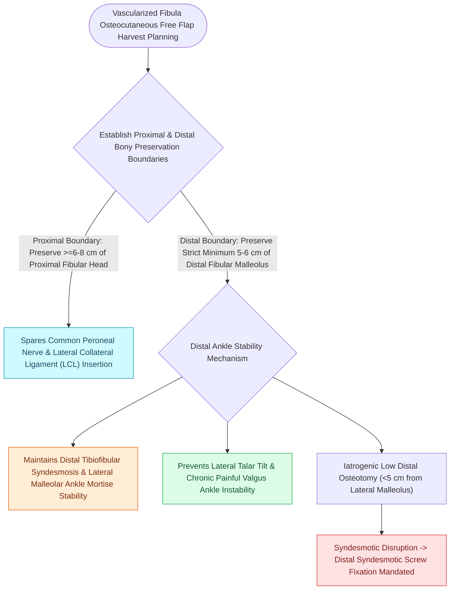

# Preserving the distal five centimeters of the fibula prevents ankle instability and talar tilt

## Active Recall

> [!question]- Why is it mandatory to preserve at least the distal 5 cm of the fibula during free flap harvest?
> *Answer / Clinical Rationale*: To maintain the structural integrity of the **lateral malleolus and ankle mortise**, preserving the insertions of the distal syndesmosis and collateral ligaments (ATFL, CFL) to prevent ankle instability and valgus talar tilt.

> [!question]- What nerve is at risk if bone is harvested too proximally near the fibular head?
> *Answer / Clinical Rationale*: The **common peroneal nerve (fibular nerve)** as it winds around the fibular neck, injury to which causes complete **foot drop** and lateral leg numbness.

## Core Clinical & Mechanistic Principles
During osteocutaneous [[Osteoradionecrosis of the mandible requires radical bony debridement and vascularized fibula free flap repair|fibula free flap]] harvest, the surgeon must strictly preserve the **distal $5\text{ to }8\text{ cm}$ of the fibula** and the **proximal $4\text{ to }5\text{ cm}$ of the fibular head**.

### Ankle Biomechanics & Ligamentous Stability
- **Distal $5\text{–}8\text{ cm}$ Rule**: The distal fibula forms the lateral wall of the **ankle mortise** and serves as the bony origin for the **anterior talofibular (ATFL)**, **calcaneofibular (CFL)**, and **posterior talofibular (PTFL)** ligaments, as well as the distal syndesmosis.
- **Consequences of Violation**: Harvesting bone too distally disrupts the syndesmotic mortise, resulting in **lateral ankle instability, valgus talar tilt, chronic pain, and early post-traumatic arthritis**.
- **Proximal Head Rule**: Preserving the proximal $4\text{–}5\text{ cm}$ protects the **common peroneal nerve** (which wraps around the fibular neck) and the insertion of the lateral collateral ligament / biceps femoris tendon.

## Connected Concepts & Graph Traversal
- **Flap Craft**: [[The fibula free flap provides vascularized cortical bone for composite mandibular reconstruction|Fibula Free Flap]]
- **Soft Tissue Flap**: [[The anterolateral thigh free flap provides versatile soft tissue volume based on the LCFA|Anterolateral Thigh Flap]]
- **Microvascular Salvage**: [[Microvascular free flap salvage requires urgent re-exploration within two hours of vascular compromise|Free Flap Monitoring]]
- **Diagnostic Evaluation**: [[Composite chondrocutaneous auricular graft transfers reconstruct complex alar and helical defects|Composite Auricular Graft]]
- **Anatomical Foundation**: [[Champy lines of ideal osteosynthesis dictate monocortical miniplate fixation along mandibular tension zones|Champy's Principle of Osteosynthesis]]
