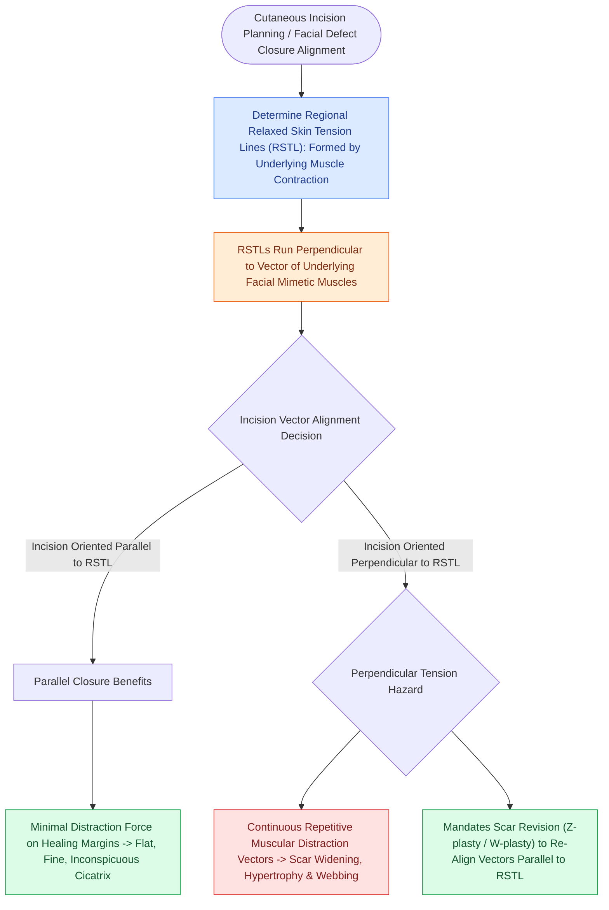

# Relaxed skin tension lines minimize scar hypertrophy along perpendicular muscular vectors

## Active Recall

> [!question]- What is the spatial relationship between Relaxed Skin Tension Lines (RSTLs) and the underlying mimetic facial musculature?
> *Answer / Clinical Rationale*: RSTLs run **perpendicular ($90^\circ$)** to the vector of underlying mimetic muscle contraction.

> [!question]- What is the biomechanical difference between mechanical creep and stress relaxation in skin flap elevation?
> *Answer / Clinical Rationale*: **Mechanical creep** is the progressive stretching and elongation of tissue under a constant applied tension, whereas **stress relaxation** is the gradual decrease in closing tension when tissue is held at a constant stretched position.

## Core Clinical & Mechanistic Principles
**Relaxed Skin Tension Lines (RSTLs)** correspond to the natural directional orientation of underlying dermal collagen and elastin bundles in relaxed skin. They are oriented **strictly perpendicular to the vector of underlying mimetic muscle contraction**.

### Biomechanical Properties of Skin
1. **Relaxed Skin Tension Lines (RSTLs)**:
   - Incisions placed **parallel to RSTLs** experience the lowest distracting tensile stress during dynamic facial movement.
   - Reduced tensile strain suppresses TGF-$\beta 1$ and fibroblast myofibroblastic activation, preventing hypertrophic scarring.
2. **Lines of Maximal Extensibility (LME)**:
   - Oriented **90° perpendicular to RSTLs**.
   - Represents the primary axis along which adjacent skin has the greatest elasticity and can be advanced or stretched with the lowest closing force.
3. **Mechanical Creep vs Stress Relaxation**:
   - **Mechanical Creep**: The time-dependent elongation of skin when subjected to a constant loading force (e.g., intraoperative [[Tissue expansion biomechanics generate vascularized skin for large pediatric and scalp defects|tissue expansion]] or serial traction).
   - **Stress Relaxation**: The progressive reduction in tension over time when skin is stretched and held at a constant displacement.

## Connected Concepts & Graph Traversal
- **Subunit Planning**: [[Gonzalez-Ulloa facial aesthetic subunits guide complete subunit reconstruction|Gonzalez-Ulloa Aesthetic Subunits]]
- **Ellipse Design**: [[Fusiform ellipse geometry requires a three-to-one ratio to prevent standing cutaneous cones|Fusiform Ellipse & Dog-Ears]]
- **Local Flaps**: [[Rhombic and Limberg flaps transpose tissue into sixty-degree and one-hundred-twenty-degree defects|Rhombic & Limberg Flaps]]
- **Anatomical Foundation**: [[Wound healing progresses through hemostasis, inflammation, proliferation, and maturation|Four Phases of Wound Healing]]
- **Bedrock Principle**: [[Bilateral A-T plasty and H-plasty advancements reconstruct forehead and suprabrow defects by recruiting transverse tissue laxity along relaxed skin tension lines|A-T Plasty & H-Plasty]]
- **Surgical Craft**: [[Cheek reconstruction partitions defects into suborbital, preauricular, and buccomandibular aesthetic zones to direct tissue recruitment along relaxed skin tension lines|Cheek Aesthetic Zones]]
