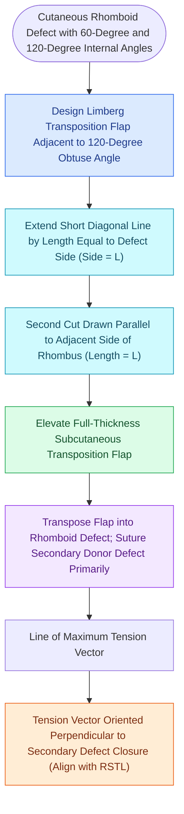

# Rhombic and Limberg flaps transpose tissue into sixty-degree and one-hundred-twenty-degree defects

## Active Recall

> [!question]- Where does the line of maximal closing tension reside in a Limberg rhombic transposition flap?
> *Answer / Clinical Rationale*: The line of maximal closing tension lies **across the secondary donor site closure**, not across the primary defect. This vector must align parallel to the local RSTLs.

> [!question]- What is the primary advantage of the Webster 30° modification over the classic 60° Limberg flap?
> *Answer / Clinical Rationale*: Narrowing the flap tip angle to **$30^\circ$** significantly reduces closing tension at the secondary donor site, allowing closure in tight facial areas with minimal distortion.

## Core Clinical & Mechanistic Principles
The **Limberg (Rhombic) Flap** is an equilateral transposition flap that mobilizes tissue across an intervening bridge of normal skin into a **$60^\circ / 120^\circ$ rhombic defect**.

### The 4 Flap Orientations & Donor Tension Alignment
- Every $60^\circ/120^\circ$ rhombus provides **4 possible flap harvest orientations** (two from each $120^\circ$ obtuse angle).
- **The Golden Selection Rule**: The surgeon must choose the orientation where the **secondary donor closure vector lies parallel to local RSTLs** and perpendicular to [[Relaxed skin tension lines minimize scar hypertrophy along perpendicular muscular vectors|Lines of Maximal Extensibility]] (LME).

## Connected Concepts & Graph Traversal
- **Biomechanical Axes**: [[Relaxed skin tension lines minimize scar hypertrophy along perpendicular muscular vectors|RSTLs & LME]]
- **Double Transposition**: [[The Zitelli bilobed flap restricts rotation to ninety degrees to prevent pincushioning|Zitelli Bilobed Flap]]
- **Subunit Planning**: [[Gonzalez-Ulloa facial aesthetic subunits guide complete subunit reconstruction|Aesthetic Subunits]]
- **Diagnostic Evaluation**: [[Advancement flaps recruit adjacent tissue laxity along a linear vector without rotation|Advancement Flaps]]
- **Surgical Craft**: [[Rotation flaps redistribute closing tension along a curvilinear arc of rotation|Rotation Flaps]]
