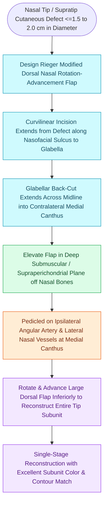

# Rieger dorsal nasal rotation advancement flaps reconstruct defects of the nasal dorsum and tip

## Active Recall

> [!question]- What is the primary vascular supply to a classic Rieger dorsal nasal rotation flap?
> *Answer / Clinical Rationale*: The **angular and dorsal nasal artery perforators** located at the medial canthus / nasofacial junction.

> [!question]- In what anatomical plane must the dorsal nasal flap be elevated?
> *Answer / Clinical Rationale*: In the **sub-[[Deep-plane rhytidectomy mobilizes the skin and SMAS as a composite flap across retaining ligaments|SMAS]] / supraperichondrial and supraperiosteal plane**, preserving the nasal vascular plexus within the overlying fibromuscular layer.

## Core Clinical & Mechanistic Principles
The **Rieger Dorsal Nasal Flap (Marchac modification)** is a large, single-stage rotation-advancement flap that recruits lax skin from the **glabella and upper nasal dorsum** to reconstruct defects up to **$1.5\text{–}2.0\text{ cm}$** of the lower nasal dorsum and tip.

### Preventing Nasal Tip Asymmetry
- Care must be taken not to exert upward vertical [[Rotation flaps redistribute closing tension along a curvilinear arc of rotation|tension]] on the alar rims or nasal tip, which creates prominent **alar retraction or asymmetric tip elevation**.

## Connected Concepts & Graph Traversal
- **Alternative Tip Flap**: [[The Zitelli bilobed flap restricts rotation to ninety degrees to prevent pincushioning|Zitelli Bilobed Flap]]
- **Forehead Standard**: [[The paramedian forehead flap is an axial interpolated flap pedicled on the supratrochlear artery|Paramedian Forehead Flap]]
- **Subunit Rules**: [[Gonzalez-Ulloa facial aesthetic subunits guide complete subunit reconstruction|Facial Subunits]]
- **Anatomical Foundation**: [[Total nasal reconstruction requires three-layer structural restoration of lining, cartilage, and cover|Total Nasal Reconstruction]]
- **Surgical Craft**: [[Rotation flaps redistribute closing tension along a curvilinear arc of rotation|Rotation Flaps]]
