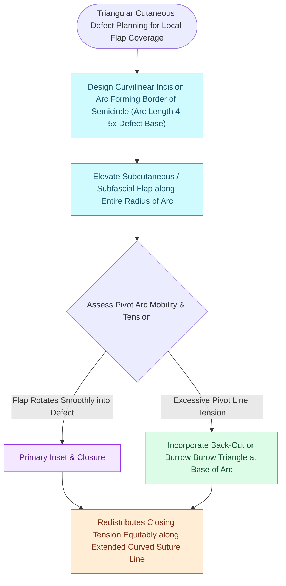

# Rotation flaps redistribute closing tension along a curvilinear arc of rotation

## Active Recall

> [!question]- What ratio must the circumference of a rotation flap arc have relative to the width of the primary defect?
> *Answer / Clinical Rationale*: The arc circumference must be **$4\text{ to }5\text{ times}$ the width of the primary defect** to allow tension-free closure without excessive distortion.

> [!question]- What is the risk of placing an aggressive back-cut at the pivot base of a rotation flap?
> *Answer / Clinical Rationale*: While a back-cut releases closing tension, it **narrows the vascular pedicle**, increasing the risk of distal flap ischemia and necrosis.

## Core Clinical & Mechanistic Principles
A **rotation flap** is a semicircular local flap that pivots around a **fixed point along the curvilinear arc of a circle** to close an adjacent triangular primary defect. The vector of movement distributes closing tension along the entire perimeter of the curved arc.

### Design Principles & Mustarde Cheek Flap
1. **Arc Proportion**: The circumference of the rotation arc must be **$4\text{ to }5\text{ times}$** the width of the triangular defect.
2. **Back-Cut vs Burow's Triangle**:
   - A **back-cut** placed at the base directed toward the center of the circle releases tension along the leading edge.
   - A **Burow's triangle** excised at the base removes redundant tissue along the outer arc without compromising pedicle blood supply.
3. **Mustarde Cheek Rotation**:
   - High-arc rotation from the preauricular cheek superiorly over the zygoma to reconstruct large lower eyelid and medial cheek defects, anchoring firmly to the lateral orbital rim periosteum to prevent [[Lateral canthopexy and lateral tarsal strip suspension prevent post-blepharoplasty ectropion|ectropion]].

## Connected Concepts & Graph Traversal
- **Advancement Partner**: [[Advancement flaps recruit adjacent tissue laxity along a linear vector without rotation|Advancement Flaps]]
- **Transposition Partner**: [[Rhombic and Limberg flaps transpose tissue into sixty-degree and one-hundred-twenty-degree defects|Rhombic & Limberg Flaps]]
- **Eyelid Protection**: [[Lateral canthopexy and lateral tarsal strip suspension prevent post-blepharoplasty ectropion|Ectropion Prevention]]
- **Flap Design Alternative**: [[Bilateral A-T plasty and H-plasty advancements reconstruct forehead and suprabrow defects by recruiting transverse tissue laxity along relaxed skin tension lines|A-T Plasty & H-Plasty]]
- **Flap Design Principle**: [[O-to-Z rotation-advancement flaps and secondary intention healing reconstruct lateral forehead defects and concave anatomical transition zones|O-to-Z Rotation-Advancement]]
