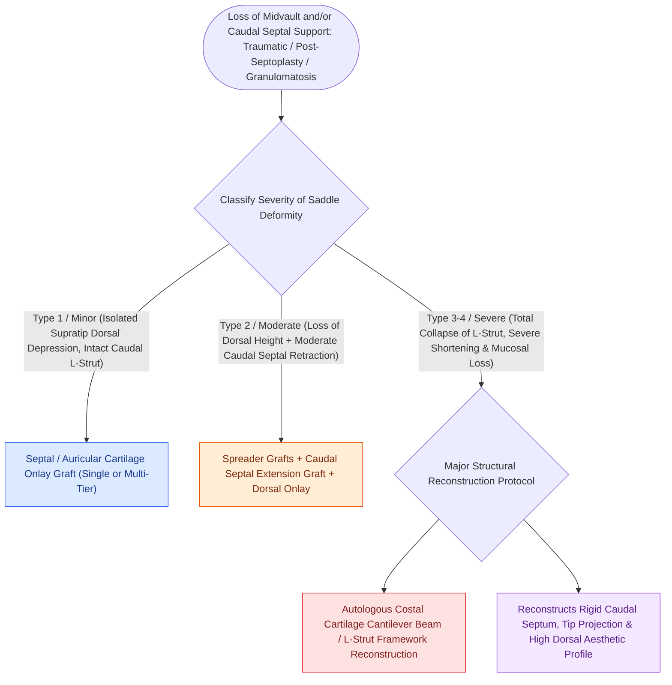

# Saddle nose deformity requires multi-tier dorsal and caudal structural reconstruction

## Active Recall

> [!question]- What are the primary underlying etiologies of severe cartilaginous saddle nose deformity?
> *Answer / Clinical Rationale*: **Nasal trauma, over-resection of the septal L-strut during septoplasty, septal hematoma/abscess, chronic intranasal cocaine abuse**, and autoimmune chondritis (**Granulomatosis with Polyangiitis** or Relapsing Polychondritis).

> [!question]- What donor tissue provides the structural volume necessary to reconstruct a Type 3 or Type 4 saddle nose?
> *Answer / Clinical Rationale*: **Autologous costal (rib) cartilage**, providing rigid bone-like structural strength for a cantilever dorsal strut and caudal extension graft.

## Core Clinical & Mechanistic Principles
A **Saddle Nose Deformity** is characterized by loss of **dorsal and caudal cartilaginous and bony nasal support**, resulting from trauma, aggressive septal resection, cocaine abuse, or autoimmune destruction (Granulomatosis with Polyangiitis / Relapsing Polychondritis).

### Multi-Tier Reconstruction Sequence
1. **L-Strut Cantilever Reconstruction**: Carve a rigid costal cartilage L-strut; anchor to the frontal bone / nasion with miniplates or lag screws.
2. **Caudal Septal Extension**: Re-establish tip projection and correct acute [[Goode's ratio and nasolabial angles define standard aesthetic nasal tip proportions|nasolabial angle]].
3. **Dorsal Overlay**: Diced cartilage in fascia (DCF) or carved rib graft to smooth the dorsal line.

## Connected Concepts & Graph Traversal
- **Rib Craft**: [[Costal cartilage harvest and concentric carving prevent structural graft warping in revision rhinoplasty|Costal Cartilage Harvest]]
- **Dorsal Dicing**: [[Diced cartilage glued with fibrin or wrapped in fascia reconstructs dorsal nasal contour|Diced Cartilage Fascia]]
- **Internal Valve**: [[Spreader grafts restore internal nasal valve patency and prevent inverted-V deformity|Spreader Grafts]]
- **Anatomical Foundation**: [[Cephalic trim of lower lateral cartilages must preserve at least six millimeters of lateral crus|Cephalic Trim 6-mm Rule]]
- **High-Stakes Safety**: [[Pollybeak deformities arise from cartilaginous over-projection or supratip soft tissue fibrosis|Pollybeak Deformity]]
