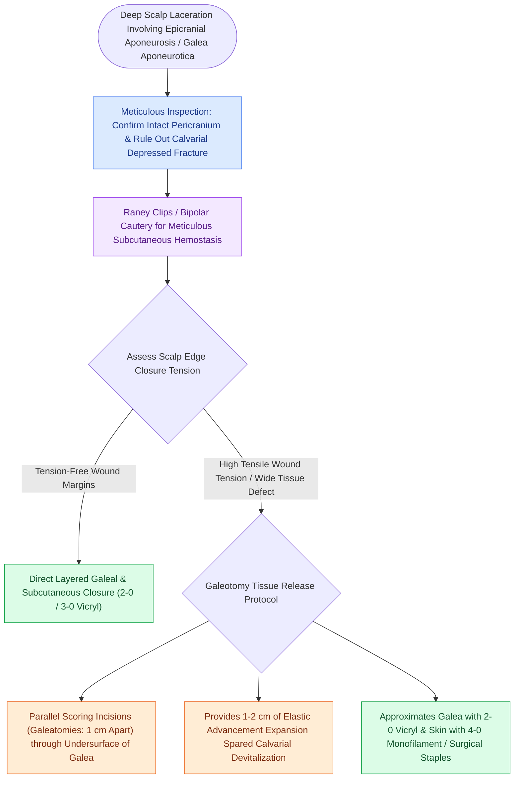

# Scalp laceration repair requires layered subgaleal and galeal closure with galeatomy to achieve tension-free closure

## Active Recall

> [!question]- What is the primary structural strength layer that must be sutured during scalp laceration repair?
> *Answer / Clinical Rationale*: The **galea aponeurotica** (using 2-0 or 3-0 absorbable sutures).

> [!question]- How does a galeatomy maneuver provide tissue relaxation for closing tight scalp defects?
> *Answer / Clinical Rationale*: By making **multiple parallel linear incisions through the inelastic galea**, stretching the scalp by $1\text{ to }2\text{ cm}$ while preserving blood flow in the overlying subcutaneous layer.

## Core Clinical & Mechanistic Principles
The scalp possesses unique anatomical and biomechanical properties governed by the **five SCALP layers**, requiring specialized layered [[Scar revision employs Z-plasty W-plasty and geometric broken line closure along relaxed skin tension lines|closure]] techniques to prevent hematoma and necrosis:
- **The Five SCALP Layers**:
  1. **S**kin: Thick, hair-bearing dermis with dense vasculature.
  2. **C**onnective Tissue (Subcutaneous): Dense fibrofatty layer binding skin to galea; contains the major axial arteries (supraorbital, supratrochlear, superficial temporal, posterior auricular, occipital).
  3. **A**poneurosis (**Galea Aponeurotica**): Strong, inelastic tendinous sheet connecting frontalis and occipitalis muscles; **the primary structural strength layer of the scalp**.
  4. **L**oose Areolar Tissue ("The Danger Space"): Avascular plane allowing free scalp mobility; potential space where massive subgaleal hematomas and infections can spread across the entire calvarium from orbital rims to nuchal line.
  5. **P**ericranium: Periosteum adherent to the calvarial bones.
- **Surgical Step-by-Step Closure Protocol**:
  1. **Debridement & Hemostasis**: Cauterize or ligate major spurting subcutaneous vessels (Raney clips or bipolar cautery); avoid excessive electrocautery to prevent follicular alopecia.
  2. **Layer 1: Galeal Closure (Mandatory Strength Layer)**:
     - Suture the galea with interrupted **2-0 or 3-0 absorbable braided sutures (Vicryl / PDS)**.
     - Reapproximating the galea bears all mechanical tension and prevents wound widening and spreading scar.
  3. **Tension-Relieving Maneuvers (Galeatomy)**:
     - In tight scalp defects, elevate in the loose areolar subgaleal plane.
     - Perform **multiple parallel linear incisions through the deep galea (Galeatomy)** spaced $1.0\text{ cm}$ apart perpendicular to the direction of closure (gaining $1.0\text{ to }2.0\text{ cm}$ of advancement without compromising skin perfusion).
  4. **Layer 2: Cutaneous Skin Closure**:
     - Fast-absorbing 4-0 gut, nylon, or surgical staples.
  5. **Compression Bolster Wrap**: Mandatory pressure dressing for 24–48 hours to **prevent large subgaleal hematoma formation**.

## References
1. Forsch, R.T, Little, S.H., Williams, C. (2017). Laceration repair: A practical approach. *Am Fam Physician*, 95(10):628-636.
2. Hill, J.D., Stoddard Jr., D.G., Hamilton III, G.S. (2020). Facial Trauma: Soft Tissue Lacerations and Burns. In Flint, P.W., et al. (Eds.), *Cummings Otolaryngology Head and Neck Surgery* 7e (pp. 269-287). Philadelphia, PA: Elsevier.
3. Shadfar, S., Shockley, W.W. (2013). Management of Soft Tissue Injuries of the Face. In Johnson, J.J., Rosen, C.A. (Eds.), *Bailey’s Head and Neck Surgery-Otolaryngology* 5e (pp. 1108-1130). Baltimore, MD: Lippincott Williams & Wilkins.

## Connected Concepts & Graph Traversal
- **Forehead Axial Pedicle**: [[The paramedian forehead flap is an axial interpolated flap pedicled on the supratrochlear artery|Forehead Flap Pedicle]]
- **Rotational Flap Repair**: [[Scalp reconstruction requires galeal score incisions and large rotational pinwheel flaps|Scalp Reconstruction Flaps]]
- **Frontal Branch Danger**: [[The sentinel vein marks the trajectory of the frontal branch of the facial nerve|Sentinel Vein & Frontal Nerve]]
- **Scar Revision Geometry**: [[Scar revision employs Z-plasty W-plasty and geometric broken line closure along relaxed skin tension lines|Scar Revision Geometry]]
- **Large Vault Free Flap**: [[The anterolateral thigh free flap provides versatile soft tissue volume based on the LCFA|ALT Scalp Reconstruction]]
- **Donor Zone Anatomy**: [[Androgenic alopecia management spans Norwood-Hamilton staging, medical five-alpha reductase blockade, and follicular unit transplantation|Safe Donor Zone Harvest]]
