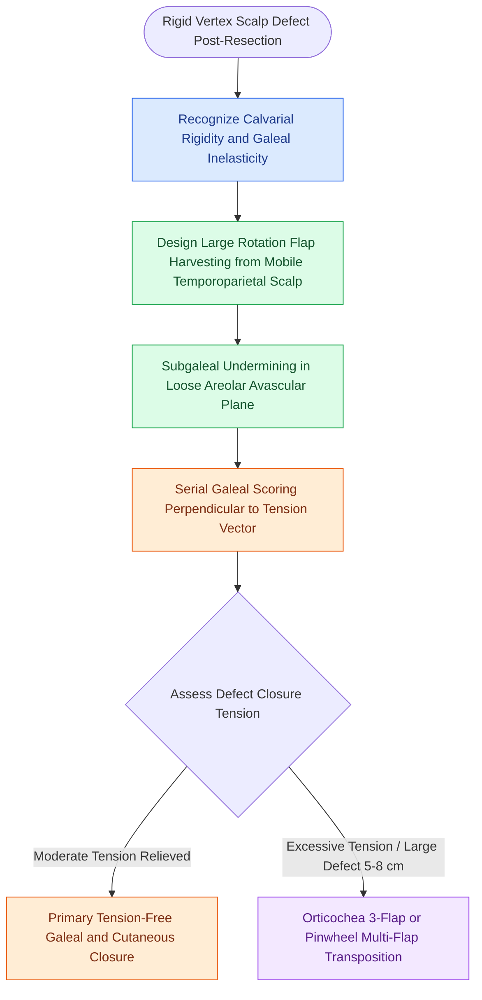

# Scalp local flap design exploits loose temporoparietal tissue laxity and galeal scoring to reconstruct rigid vertex defects

## Active Recall

> [!question]- Why do defects of the vertex and forehead scalp pose vastly greater reconstructive difficulty than temporoparietal defects?
> *Answer / Clinical Rationale*: The **vertex and forehead overlie rigid, unyielding convex calvarium with an inelastic galea**, whereas the **temporoparietal and occipital scalp have loose subcutaneous tissue and mobile fascial glide planes** that can yield substantial advancement.

> [!question]- What flap-to-defect perimeter ratio is mandatory when planning a single large rotation flap for the scalp?
> *Answer / Clinical Rationale*: The circumference arc of the rotation flap must be **at least 4 to 6 times the width of the defect**, requiring extensive subgaleal undermining from hairline to occiput to distribute closing tension.

## Core Clinical & Mechanistic Principles
Scalp reconstruction is governed by strict regional biomechanics. The scalp possesses two distinct anatomical behavior zones:
1. **Tight / Inelastic Regions**: The **frontal scalp and central vertex**, where dense fibrofatty tissue binds skin directly to the taut galea aponeurotica over a dome-shaped calvarium, prohibiting simple primary approximation even for small defects ($>2\text{ to }3\text{ cm}$).
2. **Loose / Mobile Regions**: The **temporoparietal and lower occipital scalp**, which feature softer subcutaneous tissue, looser fascial attachments, and considerable elasticity.

Reconstruction of central and vertex defects exploits this regional variation through deliberate flap architecture and [[Advancement flaps recruit adjacent tissue laxity along a linear vector without rotation|advancement and rotation flap mechanics]]:
- **Large Rotation-Advancement Flaps**: Because scalp skin will not stretch substantially, rotation flaps must be oversized with an arc 4 to 6 times the defect width. The incision is carried down through galea into the loose areolar plane, undermining widely across the calvarium.
- **Systematic Galeal Scoring (Galeatomy)**: Serial parallel incisions through the deep galea spaced $1\text{ cm}$ apart perpendicular to the vector of advancement expand flap dimensions by $1\text{ to }2\text{ cm}$ without compromising overlying dermal axial vessels.
- **Orticochea Three-Flap and Pinwheel Techniques**: For larger vertex defects ($4\text{ to }7\text{ cm}$), multi-flap rotational designs borrow tissue symmetrically from temporal and occipital quadrants, closing the central wound primarily and allowing secondary donor sites to be closed or skin grafted.
- **O-to-Z Flap**: Mobilizes two opposing curvilinear rotation flaps from opposite margins of a circular defect, transposing them across the defect center with minimal standing cutaneous deformities.

### Critical Surgical Safeguards
1. **Pericranial Preservation**: Flap elevation must remain strictly in the subgaleal loose areolar plane, leaving healthy pericranium intact on exposed donor areas so that any residual defect will readily accept a split-thickness skin graft.
2. **Vascular Pedicle Orientation**: Flaps should be designed with their bases oriented toward major axial scalp vessels (superficial temporal or occipital arteries) to maintain robust arterial perfusion under high closing tension.

## Connected Concepts & Graph Traversal
- **Denuded Calvarium Management**: [[Calvarial bone denuded of periosteum requires outer table burring to diploic bone or vascularized flap coverage to prevent osteonecrosis|Denuded Calvarium Management]]
- **Foundational Scalp Principles**: [[Scalp reconstruction requires galeal score incisions and large rotational pinwheel flaps|Scalp Reconstruction]]
- **Laceration & Tension Release**: [[Scalp laceration repair requires layered subgaleal and galeal closure with galeatomy to achieve tension-free closure|Scalp Laceration Repair]]
- **Free Flap Coverage**: [[The anterolateral thigh free flap provides versatile soft tissue volume based on the LCFA|ALT Scalp Reconstruction]]
- **Skin Tension Lines**: [[Relaxed skin tension lines minimize scar hypertrophy along perpendicular muscular vectors|Skin Tension Lines]]
