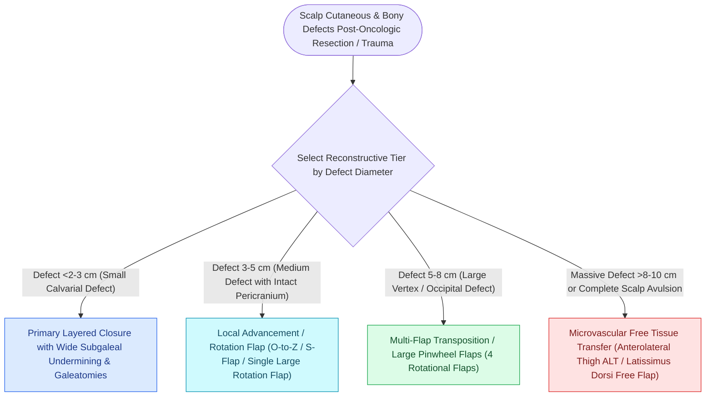

# Scalp reconstruction requires galeal score incisions and large rotational pinwheel flaps

## Active Recall

> [!question]- In what surgical plane are scalp rotation and advancement flaps elevated?
> *Answer / Clinical Rationale*: In the **subgaleal (loose areolar) plane** between the galea aponeurotica and the pericranium, which provides an avascular glide plane while preserving scalp vessels within the subcutaneous fat.

> [!question]- Why must galeal scoring incisions be performed carefully without penetrating into the subcutaneous fat layer?
> *Answer / Clinical Rationale*: The **major axial blood vessels of the scalp (STA, occipital, supraorbital) course within the dense subcutaneous fat layer** immediately superficial to the galea; penetrating this layer causes severe bleeding and flap ischemia.

## Core Clinical & Mechanistic Principles
The scalp possesses **minimal intrinsic skin elasticity and high biomechanical rigidity** due to the dense, inelastic galea aponeurotica.

Reconstructing scalp defects requires unique surgical techniques: **parallel galeal scoring** to expand local [[The anterolateral thigh free flap provides versatile soft tissue volume based on the LCFA|tissue]], large **rotational flaps (Orticochea pinwheel)**, or microvascular free tissue transfer.

### Defect Sizing & Reconstructive Hierarchy
- **$<3.0\text{ cm}$**: Primary closure with subgaleal undermining and galeal scoring.
- **$3.0\text{–}6.0\text{ cm}$**: Large rotational flaps (Orticochea 3- or 4-flap pinwheel technique).
- **$>6.0\text{–}8.0\text{ cm}$**: Latissimus dorsi or anterolateral thigh (ALT) microvascular free flap.

## Connected Concepts & Graph Traversal
- **Biomechanics**: [[Relaxed skin tension lines minimize scar hypertrophy along perpendicular muscular vectors|Tissue Biomechanics & Creep]]
- **Free Flap Alternative**: [[The anterolateral thigh free flap provides versatile soft tissue volume based on the LCFA|ALT Scalp Reconstruction]]
- **Tissue Expansion**: [[Tissue expansion biomechanics generate vascularized skin for large pediatric and scalp defects|Tissue Expansion in Scalp]]
- **Wound Bed Preparation**: [[Calvarial bone denuded of periosteum requires outer table burring to diploic bone or vascularized flap coverage to prevent osteonecrosis|Calvarial Outer Table Burring]]
- **Reconstructive Technique Precedent**: [[Scalp local flap design exploits loose temporoparietal tissue laxity and galeal scoring to reconstruct rigid vertex defects|Scalp Local Flap Design]]
