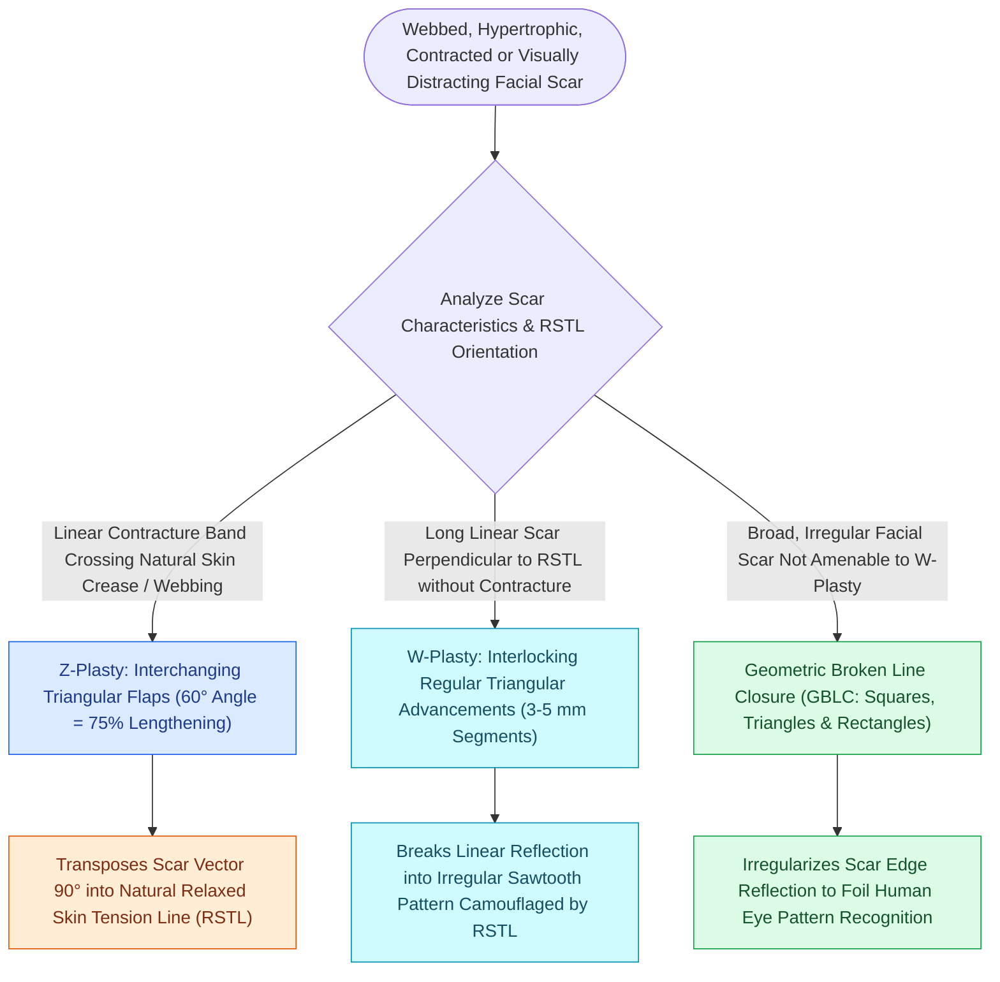

# Scar revision employs Z-plasty W-plasty and geometric broken line closure along relaxed skin tension lines

## Active Recall

> [!question]- State the classical angle-lengthening relationships of Z-plasty.
> *Answer / Clinical Rationale*: 30 degrees ~25 percent, 45 degrees ~50 percent, 60 degrees ~75 percent theoretical central-limb lengthening — larger angles gain length but recruit more lateral tissue.

> [!question]- When is GBLC preferred over Z-plasty?
> *Answer / Clinical Rationale*: For a long straight scar crossing RSTLs without contracture: irregularization camouflages it, while serial Z-plasties would add unnecessary length and tissue distortion.

## Core Clinical & Mechanistic Principles
- Diagnosis before technique: what makes the scar visible — direction against **relaxed skin tension lines**, contracture, width, depression/elevation, color mismatch — each fault has a matched tool.
- **Z-plasty**: transposition that lengthens along the central limb and reorients it; the classic 60-degree Z yields ~75 percent theoretical lengthening (30 degrees ~25 percent, 45 degrees ~50 percent) — the contracture and mal-orientation tool.
- **W-plasty and geometric broken line closure** irregularize a long straight scar into segments below the eye's pattern-detection threshold — camouflage tools that shorten nothing and consume adjacent tissue.
- **Trapdoor (Pincushion) Deformity Revision**: Circular, semicircular, or U-shaped scars frequently develop central soft-tissue elevation and pincushioning secondary to concentric scar contracture and lymphatic congestion. Revision of mature trapdoor deformities (>6 months) requires breaking up the continuous circumferential scar line with **multiple peripheral Z-plasties or W-plasties** along the margin, combined with sub-flap elevation and direct surgical debulking (tangential excision) of the underlying fibrotic cicatrix and excess deep subcutaneous fat.
- Timing and adjuncts: revise mature scars (classically 6-12 months, earlier selectively); **dermabrasion or fractional laser at roughly 6-8 weeks** exploits the remodeling window; silicone, sun protection, and steroid adjuncts guard the result.

### Management & Critical Safety Checks
- Choose by fault: contracted/misaligned → [[Z-plasty and W-plasty reorient scar vectors and break up linear contracture lines|Z-plasty]]; long, straight, RSTL-crossing but well-aligned tension → GBLC/W-plasty; depressed → excision with eversion or grafting; textural → resurfacing.
- Counsel in trades: revision exchanges one scar for a better-behaved scar — 'removal' is not on the menu.

## Connected Concepts & Graph Traversal
- **Keloid Management**: [[Hypertrophic scars and keloids result from abnormal TGF-beta signaling and collagen deposition|Keloid Therapy]]
- **Local Nasal Flap**: [[The Zitelli bilobed flap restricts rotation to ninety degrees to prevent pincushioning|Zitelli Bilobed Flap]]
- **Layered Scalp Repair**: [[Scalp laceration repair requires layered subgaleal and galeal closure with galeatomy to achieve tension-free closure|Scalp Layered Closure]]
- **Forehead Flap Donor**: [[The paramedian forehead flap is an axial interpolated flap pedicled on the supratrochlear artery|Paramedian Forehead Flap]]
- **Scar Camouflage Technique**: [[O-to-Z rotation-advancement flaps and secondary intention healing reconstruct lateral forehead defects and concave anatomical transition zones|O-to-Z Rotation-Advancement]]
