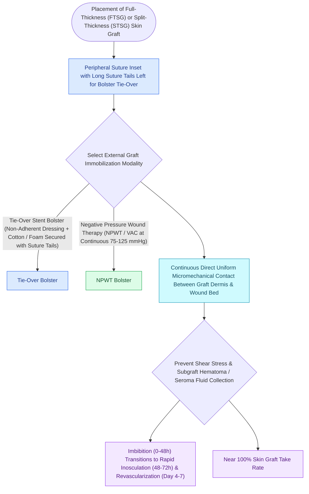

# Skin graft bolsters and negative pressure wound therapy optimize graft bed inosculation

## Active Recall

> [!question]- What are the three distinct phases of skin graft take, and what is their timeline?
> *Answer / Clinical Rationale*: (1) **Plasmatic Imbibition** ($0\text{–}48\text{ hours}$), (2) **Inosculation** ($48\text{–}72\text{ hours}$), and (3) **Revascularization / Angiogenesis** (Day 4+).

> [!question]- What is the most common cause of skin graft failure?
> *Answer / Clinical Rationale*: **Hematoma or seroma accumulation** beneath the graft, which physically separates the graft from recipient capillary beds, blocking plasmatic imbibition and inosculation.

## Core Clinical & Mechanistic Principles
Skin graft survival ("take") requires three chronological physiological phases: **Plasmatic Imbibition (0–48h), Inosculation (48–72h), and Revascularization (Day 4+)**.

Graft failure is overwhelmingly caused by **hematoma/seroma formation, shearing forces, or infection**. Mechanical immobilization via **tie-over bolsters or Negative Pressure Wound Therapy (NPWT / Wound VAC)** is mandatory.

### The Three Stages of Skin Graft Take
1. **Plasmatic Imbibition (Hours 0–48)**: Graft passively absorbs nutrients and oxygen from the recipient bed through capillary action ($40\%$ weight gain).
2. **Inosculation (Hours 48–72)**: Direct microvascular alignment and connection between donor and recipient capillary buds ("kissing vessels").
3. **Angiogenesis / Ingrowth (Day 4–7)**: True [[Full-thickness and split-thickness skin grafts differ in primary contraction and vascular take|vascular]] ingrowth and lymphatic reconnection.

## Connected Concepts & Graph Traversal
- **Graft Types**: [[Full-thickness and split-thickness skin grafts differ in primary contraction and vascular take|FTSG vs STSG Take]]
- **Scar Maturation**: [[Wound healing progresses through hemostasis, inflammation, proliferation, and maturation|Wound Healing Phases]]
- **Anatomical Foundation**: [[Alar rim retraction requires non-anatomical contour grafts, batten grafts, or composite chondrocutaneous grafting based on the Gorney classification|Alar Rim Retraction Repair]]
- **Surgical Craft**: [[Alar subunit reconstruction requires non-anatomical rigid cartilage grafting to counteract scar contracture and prevent alar rim notching|Alar Subunit Cartilage Framework]]
- **Diagnostic Assessment**: [[Bilateral A-T plasty and H-plasty advancements reconstruct forehead and suprabrow defects by recruiting transverse tissue laxity along relaxed skin tension lines|Forehead A-T Plasty]]
