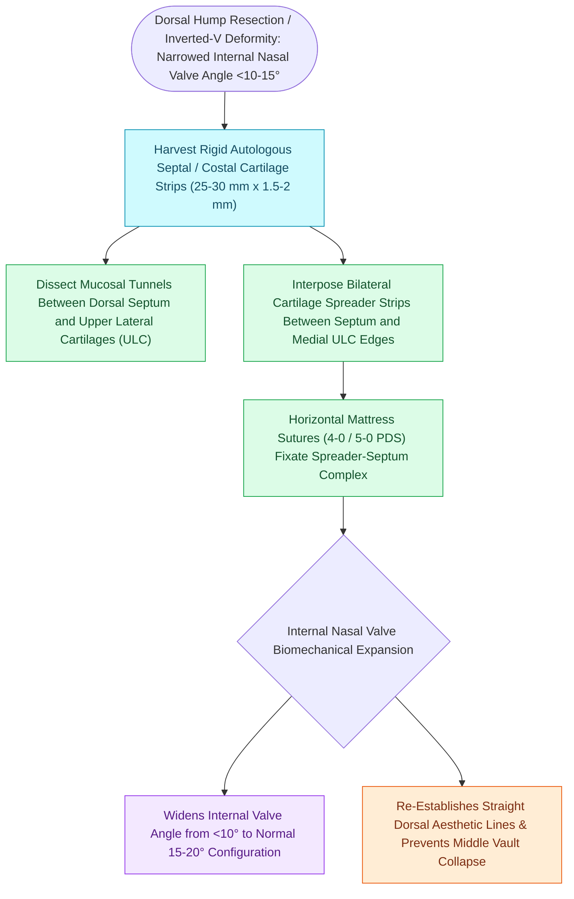

# Spreader grafts restore internal nasal valve patency and prevent inverted-V deformity

## Active Recall

> [!question]- What anatomical boundaries define the internal nasal valve, and what is its normal cross-sectional angle?
> *Answer / Clinical Rationale*: Bounded by the **caudal edge of the upper lateral cartilage**, the **dorsal nasal septum**, and the **head of the inferior turbinate**. The normal angle is **$10^\circ	ext{–}15^\circ$**.

> [!question]- How does an autologous spreader graft prevent an inverted-V deformity following dorsal hump reduction?
> *Answer / Clinical Rationale*: It acts as a rigid spacer between the dorsal septum and the detached upper lateral cartilages, preventing inferomedial collapse of the ULCs and stenting the internal nasal valve.

## Core Clinical & Mechanistic Principles
The **Internal Nasal Valve (INV)** is bounded by the **caudal margin of the upper lateral cartilage (ULC)**, the **dorsal nasal septum**, and the head of the **inferior turbinate**. 

It subtends an angle of **$10^\circ	ext{–}15^\circ$** and represents the **narrowest cross-sectional airway resistance zone in the entire human respiratory tract** (governed by Poiseuille’s Law: Airflow $\propto r^4$).

### Internal Nasal Valve Architecture & The Keystone Area
- **The Internal Nasal Valve (INV) Triangle**:
  - Boundaries: Bound medially by the **dorsal nasal septum**, superior-laterally by the **caudal margin of the upper lateral cartilage (ULC)**, and inferior-laterally by the head of the inferior turbinate and pyriform aperture floor.
  - *Normal Angle & Airway Resistance*: The normal internal nasal valve angle is **–15^\circ$ in leptorrhine (Caucasian) noses**; narrowing to $<10^\circ$ dramatically elevates airway resistance ( \propto 1/r^4$ by Poiseuille's law). The INV accounts for **$>50\%$ of total upper airway resistance**.
- **The Keystone Area (K-Area)**:
  - The critical osteocartilaginous junction where the **nasal bones overlap the cephalic margin of the upper lateral cartilages** by –8	ext{ mm}$ and articulate with the perpendicular plate of the ethmoid and dorsal septum.
  - Dorsal hump reduction that overzealously transects the K-area disrupts this structural junction, causing middle vault collapse and inverted-V deformity unless reconstructed with spreader grafts.

### The Inverted-V Deformity & Spreader Flaps
1. **Inverted-V Deformity**: Resection of a cartilaginous dorsal hump detaches the upper lateral cartilages from the septum. Without reconstruction, the ULCs collapse inferomedially, creating a visible "inverted-V" shadow at the caudal margin of the nasal bones and severe nasal valve obstruction.
2. **Spreader Grafts (Sheen, 1984)**: Autologous septal or [[Costal cartilage harvest and concentric carving prevent structural graft warping in revision rhinoplasty|costal cartilage]] struts ($1	ext{–}2	ext{ mm}$ thick, $20	ext{–}30	ext{ mm}$ long) sutured between the dorsal septum and ULCs.
3. **Spreader Flaps (Turn-in Flaps)**: Inverting the redundant upper lateral cartilage edges medially to act as autologous spreader struts without needing cartilage harvest.

## Connected Concepts & Graph Traversal
- **External Valve**: [[Alar batten and lateral crural strut grafts prevent external nasal valve inspiratory collapse|External Nasal Valve Grafts]]
- **Dorsal Osteotomies**: [[Medial, intermediate, and lateral osteotomies close open roof deformities after hump resection|Nasal Osteotomies]]
- **Deformity**: [[Pollybeak deformities arise from cartilaginous over-projection or supratip soft tissue fibrosis|Pollybeak Deformity]]
- **Anatomical Foundation**: [[Cephalic trim of lower lateral cartilages must preserve at least six millimeters of lateral crus|Cephalic Trim 6-mm Rule]]
- **Diagnostic Evaluation**: [[Lateral crural steal and overlay maneuvers dynamically modify tip rotation and projection|Lateral Crural Steal]]
