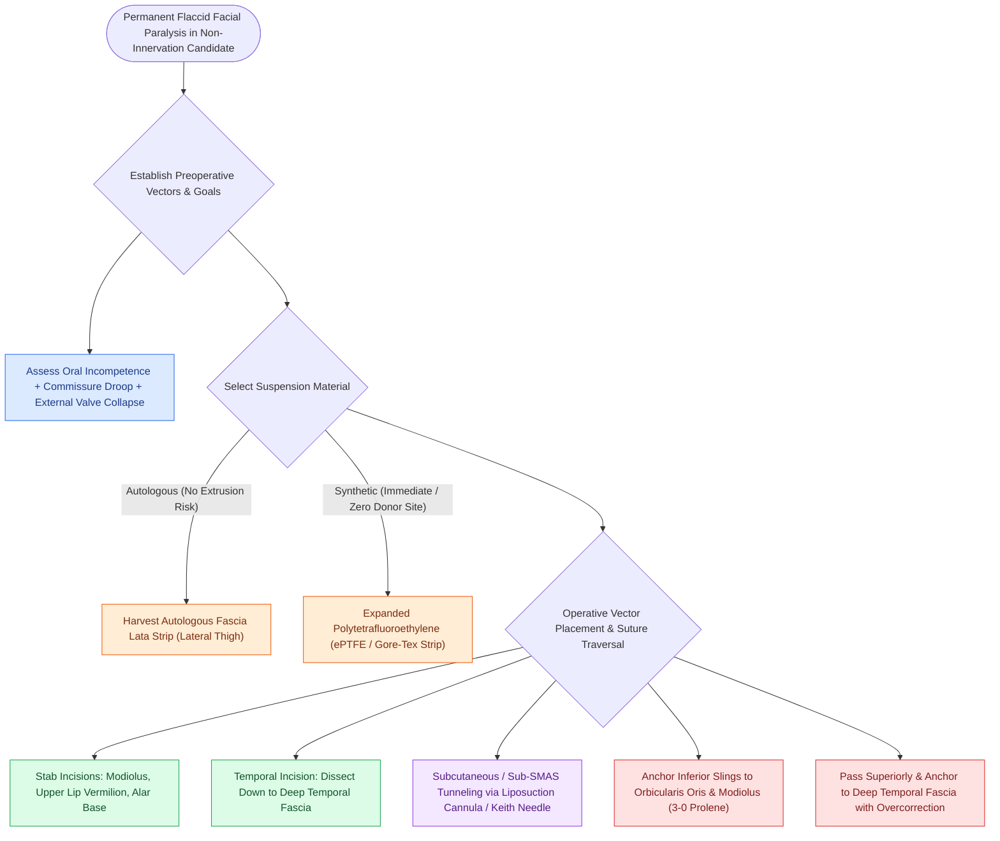

# Static facial suspension utilizes multivectored fascia lata or expanded polytetrafluoroethylene slings to restore symmetry in non-innervation candidates

## Active Recall

> [!question]- What are the primary surgical indications for performing static facial suspension rather than dynamic nerve or muscle transfer?
> *Answer / Clinical Rationale*: It is indicated for patients with longstanding facial paralysis ($>24\text{ months}$) who have **irreversible loss of facial motor endplates**, elderly or medically frail patients who cannot tolerate prolonged general anesthesia for microvascular free transfer, and as an immediate temporary adjunct during dynamic reanimation.

> [!question]- Why must static suspension slings anchored to the oral commissure and modiolus be intentionally overcorrected intraoperatively?
> *Answer / Clinical Rationale*: Gradual postoperative tissue stretching, fascial creeping, and suture settling lead to a loss of $20\%\text{ to }30\%$ of initial elevation; intentional **overcorrection (displaying 1 to 2 mm of tooth show at rest)** ensures symmetric resting position once tissues settle.

## Core Clinical & Mechanistic Principles
**Static facial suspension** is an indispensable surgical technique in the comprehensive rehabilitation of permanent facial paralysis. Rather than attempting active muscular contraction, static procedures aim to restore **resting facial symmetry, oral competence, and external nasal valve patency** by suspending flaccid, ptotic perioral and midfacial soft tissues to rigid cranial structures.

### Clinical Indications & Patient Selection
Static slings are indicated in:
1. **Elderly or Medically Frail Patients**: Candidates with significant medical comorbidities who cannot safely undergo long microvascular free tissue transfers (such as free gracilis transfer) or complex nerve grafting.
2. **Chronic Paralysis with Atrophic Endplates**: Long-standing paralysis ($>2\text{ to }3\text{ years}$) where native mimetic muscles have fibrosed and the patient declines free muscle transfer.
3. **Palliative Oncologic Settings**: Patients undergoing radical skull base or parotid ablations with poor overall prognosis where immediate resting symmetry and eye protection are required.
4. **Temporary Adjunct to Dynamic Procedures**: Placed alongside dynamic transfers (e.g., cross-facial nerve grafting) to support soft tissues and prevent muscle stretching during the 9 to 12 months required for axonal regeneration.

### Suspension Materials: Autologous vs Synthetic
- **Autologous Fascia Lata**: Harvested from the lateral thigh ($15\text{ to }20\text{ cm}$ long, $3\text{ to }4\text{ cm}$ wide). Gold standard for biocompatibility; zero risk of extrusion or foreign body infection. Disadvantage: donor site morbidity and potential fascial stretching over time.
- **Expanded Polytetrafluoroethylene (ePTFE / Gore-Tex)**: Inert synthetic material with microporous structure ($20\text{ to }30\text{ }\mu\text{m}$) permitting minimal fibrous tissue ingrowth while resisting mechanical stretching. Disadvantage: lifetime risk of extrusion ($3\%\text{ to }5\%$) or infection requiring removal.
- **Acellular Dermal Matrix (ADM / AlloDerm)**: Pliable, readily available alternative; integrates into host tissue but carries higher elasticity and gradual loss of suspension height.

### Operative Craft: Multivectored Suspension Protocol
1. **Multivector Design**:
   - Single-vector suspension to the oral commissure creates an unnatural lateral grimace and fails to resolve nasal valve collapse or lip droop.
   - Modern technique employs **three distinct suspension vectors**:
     - *Vector 1 (Oral Commissure / Modiolus)*: Elevates the dropped angle of the mouth toward the temporal fossa to restore resting symmetry and oral competence during eating.
     - *Vector 2 (Upper Lip Philtrum)*: Re-establishes the Cupid's bow and prevents drooling.
     - *Vector 3 (Alar Base)*: Suspends the lateralized, collapsed alar base, reopening the external nasal valve and alleviating unilateral nasal obstruction.
2. **Incision & Pocket Dissection**:
   - Small $3\text{ to }5\text{ mm}$ stab incisions are made at the melolabial crease, oral commissure, and alar-facial groove.
   - A $3\text{ cm}$ temporal incision is created within the hairline. Dissection proceeds through the temporoparietal fascia down to the gleaming white, rigid **deep temporal fascia (DTF)**, strictly protecting the frontal branch of the facial nerve.
3. **Tunneling & Sling Passage**:
   - A specialized tunneling instrument or liposuction cannula is introduced from the temporal incision and advanced in the deep subcutaneous / [[The superficial musculoaponeurotic system divides facial fat into distinct surgical planes|SMAS plane]] to emerge at the perioral stab incisions.
   - The sling branches are drawn through the tunnels.
4. **Rigid Anchoring & Intentional Overcorrection**:
   - Inferiorly, the slips are sutured directly into the dense fibers of the modiolus and orbicularis oris muscle using interrupted 3-0 or 4-0 clear braided polypropylene or polyester sutures.
   - Superiorly, under endoscopic or direct vision, the slips are pulled superiorly and anchored directly to the [[Deep-plane rhytidectomy mobilizes the skin and SMAS as a composite flap across retaining ligaments|deep temporal fascia]] (or drilled zygomatic arch) using heavy non-absorbable sutures placed with a sturdy Mayo needle.
   - **Mandatory Overcorrection**: The oral commissure must be elevated to expose $1\text{ to }2\text{ mm}$ of the maxillary canine and incisor teeth at rest. Postoperative soft tissue relaxation and gravitational stretch over 4 to 8 weeks will relax this position into perfect resting horizontal symmetry.
5. **Concurrent Periocular Protection**:
   - Static midface suspension must be accompanied by eye protective measures: [[Upper eyelid platinum weights and lateral tarsal strips protect the cornea in flaccid facial paralysis|upper eyelid platinum weight]] placement and lateral tarsal strip suspension to eliminate lagophthalmos and prevent exposure keratitis.

## Critical Failure Modes & Error Traps
- **Superficial Tunneling with Synthetic Slings**: Tunneling ePTFE too superficially beneath thin dermis causes visible ridging, palpability, and skin erosion/extrusion requiring complete removal.
- **Anchoring to Loose Superficial Fascia**: Securing the superior sling to temporoparietal fascia rather than the rigid deep temporal fascia results in rapid slippage and complete loss of suspension within weeks.

## Connected Concepts & Graph Traversal
- **Great Auricular Nerve Landmark**: [[The great auricular nerve emerges at Erb's point and is vulnerable during rhytidectomy|Great Auricular Nerve Protection]]
- **Marginal Mandibular Trajectory**: [[The marginal mandibular nerve courses deep to platysma over the facial vessels|Marginal Mandibular Nerve Course]]
- **Retaining Ligament Traversal**: [[Facial retaining ligaments require surgical release to mobilize ptotic midface tissues|Retaining Ligament Traversal]]
- **Brow Elevation Technique**: [[Coronal and pretrichial open browlifts address severe brow ptosis with high versus low hairlines|Direct Browlift Rejuvenation]]
- **Vertical Suspension Vector**: [[MACS lift and SMAS plication provide vertical vector elevation via suspension purse-string sutures|Vertical Vector Suspension]]
