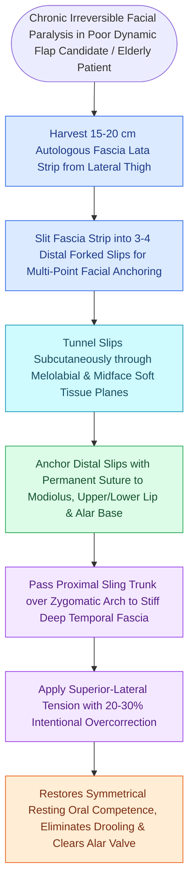

# Static fascia lata slings suspend the modiolus and nasal valve in non-innervation candidates

## Active Recall

> [!question]- Why must static facial slings be significantly overcorrected intraoperatively?
> *Answer / Clinical Rationale*: To account for **inevitable postoperative tissue stretch, mechanical creep, and gravity-induced relaxation** over the subsequent months.

> [!question]- What rigid anatomical structure serves as the superior suspension anchor for modiolar slings?
> *Answer / Clinical Rationale*: The **deep temporal fascia (DTF) proper** or the zygomatic arch periosteum.

## Core Clinical & Mechanistic Principles
In patients who are **poor candidates for dynamic reanimation** (e.g., advanced age, severe medical comorbidities, poor prognosis, or long-standing [[Free gracilis muscle transfer provides dynamic smile restoration in chronic facial paralysis|paralysis]] with patient preference for single-stage short recovery), **Static Fascia Lata Slings** restore resting facial symmetry, oral competence, and nasal valve patency.

### The Overcorrection Mandate
- Because fascia lata and surrounding tissues undergo **gradual viscoelastic stretching and relaxation (creep)** over the first 6–12 months, the oral commissure must be **significantly overcorrected intraoperatively** (resting commissure elevated $5\text{–}10\text{ mm}$ above the normal contralateral side).

## Connected Concepts & Graph Traversal
- **Dynamic Reanimation**: [[Free gracilis muscle transfer provides dynamic smile restoration in chronic facial paralysis|Free Gracilis Transfer]]
- **Corneal Protection**: [[Upper eyelid platinum weights and lateral tarsal strips protect the cornea in flaccid facial paralysis|Upper Eyelid Weights]]
- **Tissue Creep**: [[Relaxed skin tension lines minimize scar hypertrophy along perpendicular muscular vectors|Viscoelastic Creep]]
- **Anatomical Foundation**: [[Cross-facial nerve grafting provides coordinated spontaneous smile excursion in children|Cross-Facial Nerve Graft (CFNG)]]
- **Surgical Craft**: [[Epineural neurorrhaphy and cable nerve grafting restore facial continuity within twelve months|Direct Epineural Neurorrhaphy]]
- **Bedrock Principle**: [[Composite chondrocutaneous auricular graft transfers reconstruct complex alar and helical defects|Composite Auricular Graft]]
- **Multivectored Static Suspension**: [[Static facial suspension utilizes multivectored fascia lata or expanded polytetrafluoroethylene slings to restore symmetry in non-innervation candidates|Static Facial Suspension (Multivectored Slings)]]
