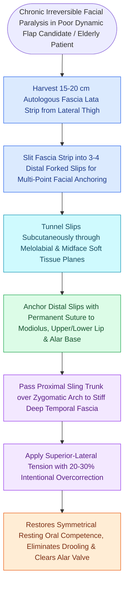

# Static fascia lata slings suspend the modiolus and nasal valve in non-innervation candidates

## Active Recall

> [!question]- Why must static facial slings be significantly overcorrected intraoperatively?
> *Answer / Clinical Rationale*: To account for **inevitable postoperative tissue stretch, mechanical creep, and gravity-induced relaxation** over the subsequent months.

> [!question]- What rigid anatomical structure serves as the superior suspension anchor for modiolar slings?
> *Answer / Clinical Rationale*: The **deep temporal fascia (DTF) proper** or the zygomatic arch periosteum.

## Core Clinical & Mechanistic Principles
In patients who are **poor candidates for dynamic reanimation** (e.g., advanced age, severe medical comorbidities, poor prognosis, or long-standing [[Free gracilis muscle transfer provides dynamic smile restoration in chronic facial paralysis|paralysis]] with patient preference for single-stage short recovery), **Static Fascia Lata Slings** restore resting facial symmetry, oral competence, and nasal valve patency.

### Clinical Indications, Materials & Multivectored Operative Craft
- **Patient Selection**: Elderly or medically frail patients unsuitable for prolonged microvascular free tissue transfer, chronic paralysis ($>24\text{ months}$) with irreversible motor endplate fibrosis, palliative oncologic resections requiring immediate symmetry and eye protection, or as a temporary adjunct supporting soft tissues during the 9–12 months of axonal regeneration after cross-facial nerve grafting.
- **Suspension Materials**:
  - *Autologous Fascia Lata*: Harvested from the lateral thigh ($15\text{–}20\text{ cm} \times 3\text{–}4\text{ cm}$); gold standard biocompatibility with zero extrusion risk, at the cost of donor-site morbidity and late stretching.
  - *Expanded Polytetrafluoroethylene (ePTFE / Gore-Tex)*: Inert microporous ($20\text{–}30\ \mu\text{m}$) synthetic strip with zero donor morbidity and stretch resistance, carrying a $3\%\text{–}5\%$ lifetime risk of extrusion or infection.
  - *Acellular Dermal Matrix (ADM / AlloDerm)*: Pliable off-the-shelf option with higher elasticity and gradual loss of suspension height.
- **Three Suspension Vectors & Tunneling**: Rather than a single lateral vector (which creates an unnatural grimace), place $3\text{–}5\text{ mm}$ stab incisions at the melolabial crease, oral commissure, and alar-facial groove to suspend: (1) the **modiolus/oral commissure** (oral competence), (2) the **upper lip philtrum** (Cupid's bow/drooling control), and (3) the **alar base** (reopening the external nasal valve). Tunnel from a $3\text{ cm}$ temporal incision in the deep subcutaneous / [[The superficial musculoaponeurotic system divides facial fat into distinct surgical planes|SMAS plane]] and anchor distally to orbicularis oris/modiolus and proximally to the rigid **deep temporal fascia (DTF)** (protecting the frontal branch; never anchor to loose temporoparietal fascia).
- **The Overcorrection Mandate & Error Traps**: Because fascia lata and surrounding tissues undergo **gradual viscoelastic stretching and relaxation ($20\%\text{–}30\%$ loss over 4–8 weeks to 6–12 months)**, intentionally overcorrect the oral commissure ($5\text{–}10\text{ mm}$ elevation or displaying $1\text{–}2\text{ mm}$ of maxillary canine/incisor show at rest) and pair with periocular protection (upper lid weight + lateral tarsal strip). Avoid superficial ePTFE tunneling beneath thin dermis (causes ridging and extrusion).

## Connected Concepts & Graph Traversal
- **Dynamic Reanimation**: [[Free gracilis muscle transfer provides dynamic smile restoration in chronic facial paralysis|Free Gracilis Transfer]]
- **Corneal Protection**: [[Upper eyelid platinum weights and lateral tarsal strips protect the cornea in flaccid facial paralysis|Upper Eyelid Weights]]
- **Tissue Creep**: [[Relaxed skin tension lines minimize scar hypertrophy along perpendicular muscular vectors|Viscoelastic Creep]]
- **Anatomical Foundation**: [[Cross-facial nerve grafting provides coordinated spontaneous smile excursion in children|Cross-Facial Nerve Graft (CFNG)]]
- **Surgical Craft**: [[Epineural neurorrhaphy and cable nerve grafting restore facial continuity within twelve months|Direct Epineural Neurorrhaphy]]
- **SMAS Surgical Plane**: [[The superficial musculoaponeurotic system divides facial fat into distinct surgical planes|SMAS Architecture]]
