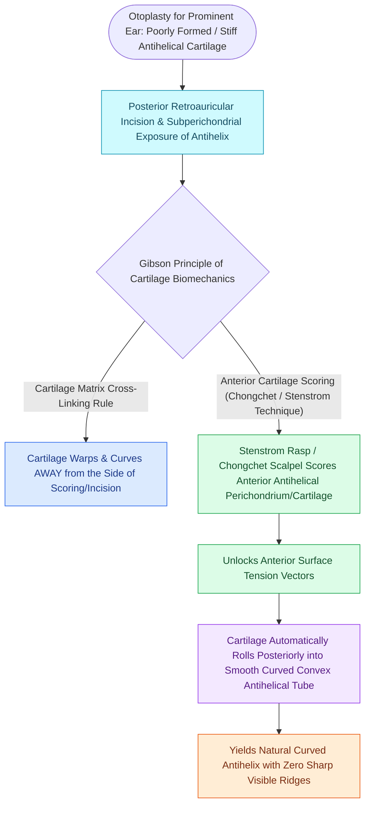

# Stenstrom and Chongchet cartilage scoring utilizes Gibson's principle to fold the antihelix

## Active Recall

> [!question]- How does Gibson's principle explain the directional bending of cartilage during otoplasty?
> *Answer / Clinical Rationale*: Disrupting the cross-linked elastic fibers on one surface of the cartilage allows the **intact tensile contracture on the opposite, uninjured surface** to bend and curl the cartilage *away* from the scored surface.

> [!question]- On which surface of the auricular cartilage (anterior or posterior) is scoring performed to recreate an antihelical fold?
> *Answer / Clinical Rationale*: On the **anterior surface**, causing the cartilage to warp and fold posteriorly into a rounded antihelix.

## Core Clinical & Mechanistic Principles
In 1958, Gibson and Davis established **Gibson's Principle of Cartilage Warping**: *When cartilage is scored, incised, or abraded on one surface, the intact, uninterrupted tensile forces on the opposing, intact perichondrial surface cause the cartilage to curl and warp away from the injured side.*

### Technical Approaches (Stenstrom vs Chongchet)
1. **Stenstrom Technique (Blind Anterior Scratching)**:
   - A specialized rasp or rasping cannula is introduced through a small posterior or anterior incision into the subcutaneous plane over the anterior [[Mustarde and Furnas sutures correct antihelical effacement and conchal hypertrophy|antihelical]] region.
   - Scratching the anterior perichondrium and outer cartilage causes it to tube posteriorly into an antihelix.
2. **Chongchet Technique (Open Anterior Scoring)**:
   - Through an open exposure, full-thickness partial incisions/scores are placed along the anterior cartilage surface under direct visualization.

## Connected Concepts & Graph Traversal
- **Suture Technique**: [[Mustarde and Furnas sutures correct antihelical effacement and conchal hypertrophy|Mustarde & Furnas Sutures]]
- **Microtia Craft**: [[Microtia autologous costal cartilage framework stages balance four-stage Brent and two-stage Nagata reconstruction protocols|Costal Cartilage Framework]]
- **Rhinoplasty Warping**: [[Goode's ratio and nasolabial angles define standard aesthetic nasal tip proportions|Cartilage Graft Mechanics]]
- **Diagnostic Evaluation**: [[Composite chondrocutaneous auricular graft transfers reconstruct complex alar and helical defects|Composite Auricular Graft]]
- **Anatomical Foundation**: [[Antia-Buch helical rim chondrocutaneous advancement flaps mobilize the helical margin and lobule to close defects up to two centimeters|Antia-Buch Flap]]
