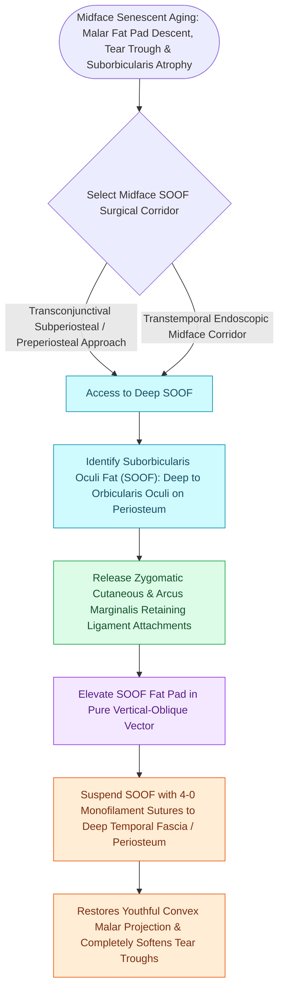

# Suborbicularis oculi fat SOOF elevation restores malar projection and midface youthfulness

## Active Recall

> [!question]- What ligamentous structure must be released along the inferior orbital rim to mobilize the SOOF and midface?
> *Answer / Clinical Rationale*: The **orbitomalar ligament (orbicularis retaining ligament / ORL)**, which anchors the orbicularis muscle to the inferior orbital rim.

> [!question]- What sensory nerve is located 5 to 10 mm inferior to the mid-pupillary infraorbital rim during SOOF dissection?
> *Answer / Clinical Rationale*: The **infraorbital nerve (CN V2)**, supplying sensation to the lower eyelid, cheek, lateral nose, and upper lip.

## Core Clinical & Mechanistic Principles
The **Suborbicularis Oculi Fat (SOOF)** is a deep fat compartment situated immediately deep to the orbicularis oculi muscle along the [[Lower blepharoplasty addresses fat herniation while preserving the inferior oblique muscle|inferior]] orbital rim and anterior maxilla.

Age-related gravitational descent of the SOOF and malar fat pad causes **lengthening of the lower eyelid vertical height, skeletonization of the infraorbital rim (tear trough deformity), and deepening of the nasolabial fold**.

### Key Anatomical Danger: Infraorbital Nerve (V2)
- The **infraorbital nerve** emerges from the infraorbital foramen **$5\text{–}10\text{ mm}$ inferior to the midpoint of the infraorbital rim**; dissection directly over the anterior maxillary face must identify and preserve this sensory trunk.

## Connected Concepts & Graph Traversal
- **Lower Eyelid**: [[Lower blepharoplasty addresses fat herniation while preserving the inferior oblique muscle|Lower Blepharoplasty]]
- **Canthal Support**: [[Lateral canthopexy and lateral tarsal strip suspension prevent post-blepharoplasty ectropion|Lateral Tarsal Strip]]
- **Deep-Plane Midface**: [[Deep-plane rhytidectomy mobilizes the skin and SMAS as a composite flap across retaining ligaments|Deep-Plane Midface]]
- **Diagnostic Evaluation**: [[High-SMAS rhytidectomy extends dissection above the zygomatic arch to rejuvenate the midface|High-SMAS Technique (Fritz Barton)]]
- **Anatomical Foundation**: [[Composite chondrocutaneous auricular graft transfers reconstruct complex alar and helical defects|Composite Auricular Graft]]
