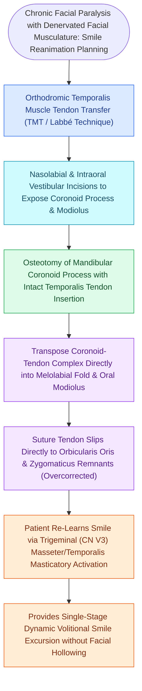

# Temporalis muscle tendon transfer provides regional dynamic smile reanimation

## Active Recall

> [!question]- How does the orthodromic temporalis transfer (Labbé technique) differ from the classic Rubin muscle turnover technique?
> *Answer / Clinical Rationale*: The orthodromic transfer **maintains the temporalis muscle in its anatomical fossa and mobilizes only the tendon/coronoid insertion**, avoiding the unnatural bulge over the zygomatic arch and temporal hollowing of the turnover flap.

> [!question]- What cranial nerve innervates the temporalis muscle to drive smile excursion in TMTT?
> *Answer / Clinical Rationale*: The **mandibular division of the trigeminal nerve (CN V3)** via the deep temporal motor branches.

## Core Clinical & Mechanistic Principles
**Temporalis Muscle Tendon Transfer (TMTT / Orthodromic Temporalis Transfer / Labbé Technique)** is a regional [[Free gracilis muscle transfer provides dynamic smile restoration in chronic facial paralysis|dynamic]] reanimation procedure that mobilizes the **temporalis muscle and its inserting tendon from the mandibular coronoid process**, transposing it directly to the oral modiolus and upper lip.

### Motor Innervation & Smile Trigger
- Innervated by **Deep Temporal Nerves (CN V3)**.
- Dynamic excursion is initiated by **biting down / jaw clenching**; patients undergo biofeedback therapy to transition movement into natural smile expression.

## Connected Concepts & Graph Traversal
- **Free Muscle Alternative**: [[Free gracilis muscle transfer provides dynamic smile restoration in chronic facial paralysis|Free Gracilis Transfer]]
- **Trigeminal Nerve**: [[The masseteric nerve provides a dense motor donor for single-stage facial reanimation|Masseteric Nerve Transfer]]
- **Static Option**: [[Static fascia lata slings suspend the modiolus and nasal valve in non-innervation candidates|Static Fascia Slings]]
- **Anatomical Foundation**: [[Cross-facial nerve grafting provides coordinated spontaneous smile excursion in children|Cross-Facial Nerve Graft (CFNG)]]
- **Surgical Craft**: [[Epineural neurorrhaphy and cable nerve grafting restore facial continuity within twelve months|Direct Epineural Neurorrhaphy]]
- **Structural / Flap Alternative**: [[Champy lines of ideal osteosynthesis dictate monocortical miniplate fixation along mandibular tension zones|Champy's Principle of Osteosynthesis]]
- **Free Functional Muscle Alternative**: [[Cross-facial nerve grafting combined with free gracilis muscle transfer restores spontaneous emotional smile excursion in established facial paralysis|Two-Stage CFNG-Gracilis Reanimation]]
