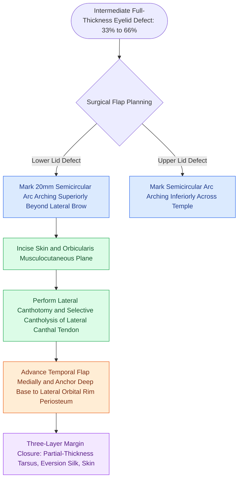

# Tenzel semicircular rotation flaps mobilize temporal tissue for intermediate full-thickness eyelid defect closure

## Active Recall

> [!question]- What is the geometric orientation of the semicircular arc when designing a Tenzel flap for a lower versus an upper eyelid defect?
> *Answer / Clinical Rationale*: For **lower eyelid defects**, the semicircular arc curves **upward and outward** from the lateral canthus extending above the lateral brow line (counteracting downward gravity vectors); for **upper eyelid defects**, the arc curves **downward and outward** onto the temporal cheek.

> [!question]- What deep anatomical release is mandatory during Tenzel flap mobilization to allow tension-free medial advancement?
> *Answer / Clinical Rationale*: A **lateral canthotomy** combined with **selective cantholysis of the corresponding crus of the lateral canthal tendon** (inferior crus for lower lid; superior crus for upper lid) must be performed beneath the musculocutaneous flap to release the lid segment from the orbital rim.

## Core Clinical & Mechanistic Principles
The Tenzel semicircular advancement flap is the premier single-stage technique for repairing intermediate full-thickness eyelid defects encompassing 33% to 66% (and up to 75% in elderly patients with marked tissue laxity) of the horizontal eyelid margin. It mobilizes periorbital and temporal musculocutaneous tissue along a [[Rotation flaps redistribute closing tension along a curvilinear arc of rotation|curvilinear arc]], combining lateral rotational tissue recruitment with horizontal advancement of the remaining eyelid margin.

Biomechanical and operative components include:
1. **Flap Design**: Beginning at the lateral canthus, a semicircular arch with a diameter of approximately 20 mm is drawn. For lower lid defects, the arc sweeps superiorly and laterally toward the tail of the eyebrow. This high superior trajectory is critical: because flap wound contraction and gravity pull downward, an elevated arc vector converts closing forces into upward-medial support, preventing postoperative lower lid retraction and ectropion. For upper lid defects, the mirror-image arc sweeps inferiorly across the temple.
2. **Musculocutaneous Elevation & Cantholysis**: Skin and orbicularis oculi are incised and elevated superficial to the temporalis fascia and lateral orbital rim periosteum. A lateral canthotomy incision is made deep to the flap, followed by complete transection (cantholysis) of the inferior crus of the lateral canthal tendon (for lower lid defects) or superior crus (for upper lid defects). This step detaches the lid margin from the lateral rim, granting 5 to 8 mm of medial advancement.
3. **Three-Layer Eyelid Margin Closure**: The freshened tarsal edges are approximated with interrupted 6-0 polyglactin sutures passed through the anterior two-thirds of the tarsal plate on a spatula needle (S-14), preventing corneal suture abrasion. The eyelid margin is precisely realigned at the gray line with a vertical mattress 4-0 silk suture to produce slight margin eversion, eliminating late notched deformities. Margin suture ends are left long and incorporated into adjacent skin closure sutures to avoid corneal rubbing.
4. **Lateral Canthal Reconstruction**: The deep subcutaneous tissue of the advanced flap is anchored to the periosteum inside the lateral orbital rim at Whitnall's tubercle with 4-0 or 5-0 non-absorbable sutures to recreate a sharp lateral canthal angle and provide permanent suspensory support.

### Complications and Mitigation
- **Eyelid Margin Notching**: Avoided by mandatory gray-line vertical mattress eversion sutures and precise tarsal plate alignment.
- **Lateral Eyelid Sagging / Ectropion**: Results from inadequate superior arc design or failure to rigidly anchor the flap base to the periosteum of the lateral orbital rim.
- **Trapdoor Deformity**: Temporal semicircular scar contraction can produce central tissue bulging; minimized by wide peripheral undermining and meticulous layered closure.

## Connected Concepts & Graph Traversal
- **Canthotomy Release Dynamics**: [[Acute retrobulbar hematoma in facial trauma requires immediate bedside lateral canthotomy|Lateral Canthotomy & Cantholysis Mechanics]]
- **Canthal Rim Fixation**: [[Lateral canthopexy and lateral tarsal strip suspension prevent post-blepharoplasty ectropion|Lateral Canthopexy & Periosteal Anchoring]]
- **Aesthetic Subunit Architecture**: [[Gonzalez-Ulloa facial aesthetic subunits guide complete subunit reconstruction|Periorbital Aesthetic Subunits]]
- **Skin Tension Vectors**: [[Relaxed skin tension lines minimize scar hypertrophy along perpendicular muscular vectors|Periorbital Relaxed Skin Tension Lines]]
- **Eversion Margin Realignment**: [[Upper eyelid platinum weights and lateral tarsal strips protect the cornea in flaccid facial paralysis|Eyelid Margin Alignment]]
- **Linear Advancement Principles**: [[Advancement flaps recruit adjacent tissue laxity along a linear vector without rotation|Linear Tissue Advancement]]
