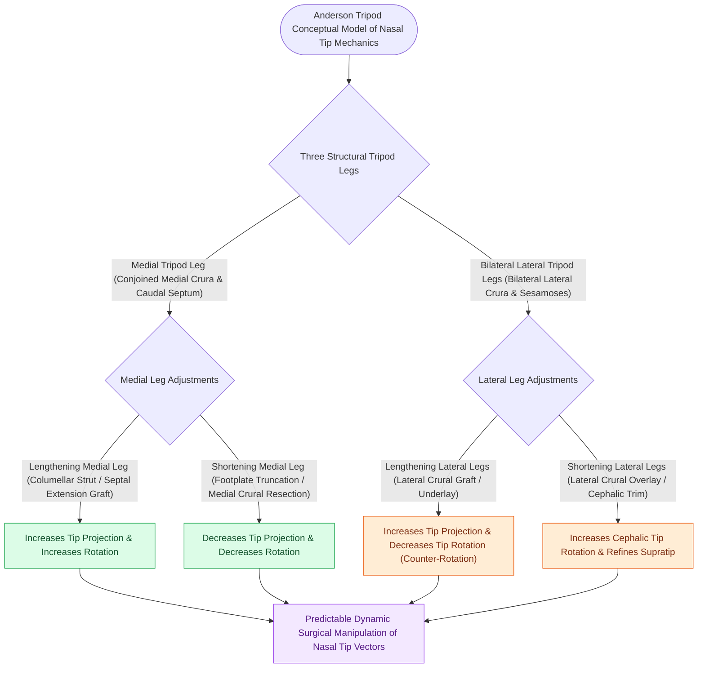

# The Anderson tripod theory governs nasal tip projection, rotation, and support dynamics

## Active Recall

> [!question]- According to Anderson's tripod theory, what effect does shortening the bilateral lateral crura have on nasal tip rotation and projection?
> *Answer / Clinical Rationale*: Shortening the lateral crura **increases cephalic rotation (upward rotation)** and maintains or slightly increases tip projection.

> [!question]- What are the three major structural supports of the nasal tip?
> *Answer / Clinical Rationale*: (1) Cartilaginous strength of the LLCs, (2) Attachment of medial crura to the caudal septum, and (3) Attachment of LLCs to ULCs at the scroll area.

## Core Clinical & Mechanistic Principles
In 1969, Jack Anderson introduced the **Tripod Concept of Nasal Tip Dynamics**. The paired lower lateral cartilages (LLCs) function as an integrated structural tripod supporting the nasal tip:
- **Two Superior / Lateral Legs**: Formed by the **bilateral lateral crura**.
- **One Inferior / Medial Leg**: Formed by the conjoined **medial crura and columellar footplates**.

### Major vs Minor Tip Support Mechanisms
1. **Major Tip Supports**:
   - Size, shape, and resilience of the lower lateral cartilages.
   - Attachment of [[Columellar strut grafts support the medial crural footplates to maintain tip projection|medial crural footplates]] to the caudal septum.
   - Attachment of the cephalic margin of the LLCs to the caudal margin of the ULCs (scroll area).
2. **Minor Tip Supports**:
   - Interdomal ligament (pitanguy ligament) bridging the domes.
   - Cartilaginous dorsal septal angle.
   - Membranous septum and attachments to overlying thick skin.

## Connected Concepts & Graph Traversal
- **Surgical Modifications**: [[Lateral crural steal and overlay maneuvers dynamically modify tip rotation and projection|Lateral Crural Steal & Overlay]]
- **Rigid Anchors**: [[Tongue-in-groove and septal extension grafts provide rigid columellar and tip stabilization|Tongue-in-Groove & SEG]]
- **Aesthetic Goals**: [[Goode's ratio and nasolabial angles define standard aesthetic nasal tip proportions|Nasal Tip Proportions]]
- **Caudal Septal Extension**: [[The caudal septal extension graft controls tip projection and rotation via rigid septal overlap|Caudal Septal Extension Graft]]
- **Columellar Strut Support**: [[Columellar strut grafts support the medial crural footplates to maintain tip projection|Columellar Strut Craft]]
- **Profile Angle Correlate**: [[Facial horizontal fifths and vertical thirds define baseline aesthetic analysis and proportions|Nasolabial Angle Baseline]]
