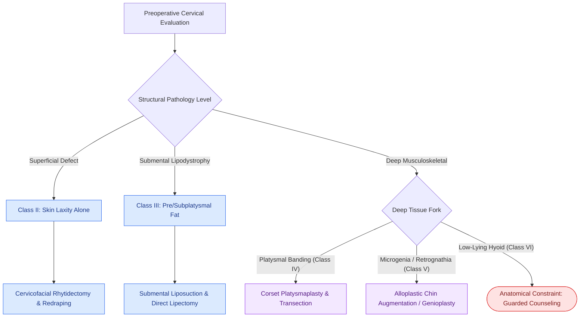

# The Dedo classification categorizes cervical aging deformities based on skin laxity, submental fat, platysma banding, and skeletal morphology

## Active Recall

> [!question]- What are the six classes of the Dedo classification of the aging neck, and what anatomical components define each?
> *Answer / Clinical Rationale*: - **Class I**: Normal cervical profile with youthful cervicomental angle, minimal skin laxity, well-defined mandibular border, and good platysmal tone. - **Class II**: Cervical **skin laxity alone** without significant muscular, adipocytic, or bony pathology. - **Class III**: Submental **fat deposition / accumulation** (preplatysmal and/or subplatysmal). - **Class IV**: **Platysma muscle flaccidity and banding** (active dynamic or static anterior vertical cords). - **Class V**: **Microgenia / retrognathia** (bony chin deficiency reducing structural projection). - **Class VI**: **Low-lying or retrodisplaced hyoid bone** (cervical point situated anteriorly/inferiorly, blunting the cervicomental angle).

> [!question]- Why is identifying a Dedo Class VI deformity critical during preoperative consultation?
> *Answer / Clinical Rationale*: A low-lying hyoid anatomically limits the acute definition of the **cervicomental angle (normally $105^\circ\text{–}120^\circ$; distinct from the Powell & Humphreys mentocervical angle of $80^\circ\text{–}90^\circ$)**. Standard rhytidectomy, submentoplasty, or platysmaplasty cannot reposition the hyoid apparatus, predisposing the patient to an obtuse neckline postoperatively; preoperative counseling must temper patient expectations regarding the surgical neckline ceiling.

## Core Clinical & Mechanistic Principles
The [[Deep-plane rhytidectomy mobilizes the skin and SMAS as a composite flap across retaining ligaments|aging neck and cervicomental angle]] represent a multi-tissue complex composed of skin, subcutaneous fat, the [[Corset platysmaplasty and lateral suspension restore the youthfulness of the cervicomental angle|platysma muscle]], subplatysmal structures (submandibular glands and anterior digastric bellies), and underlying osseous foundations. The **Dedo Classification** provides an algorithmic framework to dissect which anatomical layer generates the aesthetic deficit, guiding tailored surgical interventions.

### Anatomical Subunits & Craft Nuances
1. **Targeted Interventions by Layer**:
   - **Class II (Skin Laxity)**: Addressed via lateral postauricular and temporal skin flap advancement during rhytidectomy.
   - **Class III (Submental Adiposity)**: Closed submental cannula liposuction for preplatysmal fat; open direct excision for subplatysmal deep fat between anterior digastric bellies. During closed liposuction, the **cannula suction aperture must always be directed deep (downward) toward the platysma muscle and away from the overlying dermis**; directing the port superficially toward the dermis causes thermal/mechanical injury to the subdermal plexus, resulting in permanent grooving, dermal adhesion banding, hyperpigmentation, or full-thickness skin flap necrosis.
   - **Class IV (Platysmal Banding)**: Submental incision with midline anterior platysma plication (corset platysmaplasty) and wedge/horizontal transection 4–5 cm below the mandible to recreate an acute angle.
   - **Class V (Skeletal Retrusion)**: Placement of extended anatomical silicone or porous polyethylene implants or osseous horizontal osteotomy (sliding genioplasty).
   - **Class VI (Hyoid Position)**: Anatomical limit of soft-tissue redraping where the floor of the mouth cannot be deepened without unsafe hyoid suspension.

## Connected Concepts & Graph Traversal
- **Surgical Execution**: [[Deep-plane rhytidectomy mobilizes the skin and SMAS as a composite flap across retaining ligaments|Deep-Plane Rhytidectomy Craft]]
- **Platysmal Reconstruction**: [[Corset platysmaplasty and lateral suspension restore the youthfulness of the cervicomental angle|Corset Platysmaplasty]]
- **Facial Analysis Foundation**: [[Gonzalez-Ulloa facial aesthetic subunits guide complete subunit reconstruction|Facial Aesthetic Subunits]]
- **Sensory Danger Zone**: [[The great auricular nerve emerges at Erb's point and is vulnerable during rhytidectomy|Great Auricular Nerve Safety]]
- **Motor Danger Zone**: [[The marginal mandibular nerve courses deep to platysma over the facial vessels|Marginal Mandibular Nerve Safety]]
