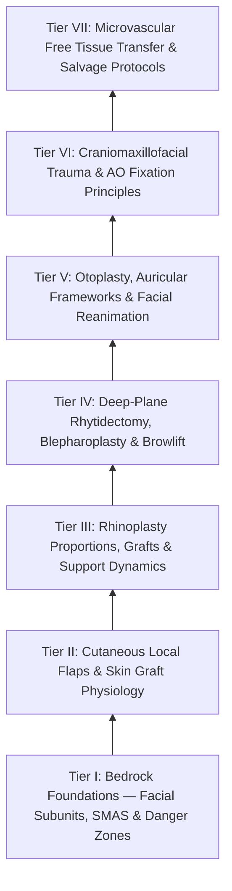

# The FPRS Knowledge Graph provides a structured mastery curriculum

Welcome to the **Comprehensive Facial Plastic & Reconstructive Surgery (FPRS) Knowledge Graph**. This interconnected Obsidian wiki is structured as a **progressively load-bearing mastery framework** encompassing 104 granular knowledge nodes spanning facial angiosomes, cutaneous local flaps, functional and aesthetic rhinoplasty, deep-plane rhytidectomy, comprehensive facial reanimation, craniomaxillofacial rigid internal fixation (AO principles), and complex microvascular free tissue transfer.

> [!NOTE] **Source Document**
> This graph was atomized from the [[Comprehensive FPRS Residency Mastery Curriculum & Self-Assessment Guide|original linear FPRS curriculum document]]. Refer to it for the complete linear syllabus and self-assessment checkpoints.

---

## 🗺️ Master Curriculum Navigation by Tier

### Tier I: Bedrock Foundations — Angiosomes, Biomechanics, SMAS & Facial Nerve Planes
- **Aesthetic Subunits**: [[Gonzalez-Ulloa facial aesthetic subunits guide complete subunit reconstruction|Gonzalez-Ulloa aesthetic subunits]]
- **RSTLs & Biomechanics**: [[Relaxed skin tension lines minimize scar hypertrophy along perpendicular muscular vectors|Relaxed skin tension lines & creep]]
- **SMAS Architecture**: [[The superficial musculoaponeurotic system divides facial fat into distinct surgical planes|SMAS surgical planes & fat compartments]]
- **Retaining Ligaments**: [[Facial retaining ligaments require surgical release to mobilize ptotic midface tissues|Facial retaining ligaments & McGregor's patch]]
- **Frontal Branch Danger**: [[Pitanguy's line defines the danger zone for the frontal branch of the facial nerve|Pitanguy's line & frontal branch]]
- **Marginal Mandibular Nerve**: [[The marginal mandibular nerve courses deep to platysma over the facial vessels|Marginal mandibular nerve & facial vessels]]
- **Great Auricular Nerve**: [[The great auricular nerve emerges at Erb's point and is vulnerable during rhytidectomy|Great auricular nerve & Erb's point]]
- **Facial Artery & Vein**: [[The facial artery and facial vein provide the primary vascular supply to the anterior face|Facial artery & vein anatomy]]
- **Angiosome Theory**: [[Facial angiosomes and perforator choke zones determine cutaneous flap survival boundaries|Facial angiosomes & choke zones]]
- **Wound Healing Phases**: [[Wound healing progresses through hemostasis, inflammation, proliferation, and maturation|Four phases of wound healing]]
- **Hypertrophic Scars & Keloids**: [[Hypertrophic scars and keloids result from abnormal TGF-beta signaling and collagen deposition|Hypertrophic scars vs keloids]]
- **Suture Biomaterials**: [[Monofilament versus braided absorbable and non-absorbable sutures have distinct tissue reactivity|Monofilament vs braided sutures]]
- **Local Anesthetics & LAST**: [[Local anesthetic pharmacology and epinephrine limits govern safe office-based facial surgery|Local anesthetic dosing & LAST]]
- **Cervical Plexus Blocks**: [[Erb's point and the cervical plexus provide somatic sensory innervation to the head and neck|Superficial cervical plexus]]
- **Facial Analysis**: [[Facial horizontal fifths and vertical thirds define baseline aesthetic analysis and proportions|Facial Fifths and Thirds]]

### Tier II: Cutaneous Reconstruction, Local & Regional Flaps, Skin Grafts
- **Fusiform Ellipse**: [[Fusiform ellipse geometry requires a three-to-one ratio to prevent standing cutaneous cones|Fusiform ellipse 3:1 geometry]]
- **Advancement Flaps**: [[Advancement flaps recruit adjacent tissue laxity along a linear vector without rotation|Advancement & V-Y flaps]]
- **Rotation Flaps**: [[Rotation flaps redistribute closing tension along a curvilinear arc of rotation|Rotation & Mustarde cheek flaps]]
- **Rhombic / Limberg Flaps**: [[Rhombic and Limberg flaps transpose tissue into sixty-degree and one-hundred-twenty-degree defects|Rhombic & Limberg transposition]]
- **Zitelli Bilobed Flap**: [[The Zitelli bilobed flap restricts rotation to ninety degrees to prevent pincushioning|Zitelli bilobed flap]]
- **Paramedian Forehead Flap**: [[The paramedian forehead flap is an axial interpolated flap pedicled on the supratrochlear artery|Paramedian forehead flap (PFF)]]
- **Abbe & Estlander Flaps**: [[Abbe and Estlander cross-lip flaps are pedicled on the labial artery to repair lip defects|Abbe & Estlander lip flaps]]
- **Skin Graft Physiology**: [[Full-thickness and split-thickness skin grafts differ in primary contraction and vascular take|FTSG vs STSG physiology]]
- **Karapandzic Flap**: [[Karapandzic orbicularis oris myocutaneous rotation flaps preserve oral sphincter innervation|Karapandzic innervated lip flap]]
- **Subtotal Lip Flaps**: [[Gilles fan flaps and Webster-Bernard cheek advancements reconstruct large lower lip defects|Gilles & Webster-Bernard flaps]]
- **Scalp Reconstruction**: [[Scalp reconstruction requires galeal score incisions and large rotational pinwheel flaps|Scalp reconstruction & galeal scoring]]
- **Composite Ear Grafts**: [[Composite chondrocutaneous auricular graft transfers reconstruct complex alar and helical defects|Composite auricular grafts]]
- **Z-Plasty & Scar Revision**: [[Z-plasty and W-plasty reorient scar vectors and break up linear contracture lines|Z-plasty & W-plasty mechanics]]
- **Rieger Dorsal Flap**: [[Rieger dorsal nasal rotation advancement flaps reconstruct defects of the nasal dorsum and tip|Rieger dorsal nasal flap]]
- **Graft Bolsters & NPWT**: [[Skin graft bolsters and negative pressure wound therapy optimize graft bed inosculation|Skin graft bolsters & NPWT]]
- **Tissue Expansion**: [[Tissue expansion biomechanics generate vascularized skin for large pediatric and scalp defects|Tissue expansion biomechanics]]
- **Scalp Reconstruction**: [[Scalp local flap design exploits loose temporoparietal tissue laxity and galeal scoring to reconstruct rigid vertex defects|Scalp Local Flap Biomechanics]]
- **Lip Reconstruction**: [[Vermilion reconstruction requires mucosal advancement, tongue flaps, or vermilionectomy with mucosal lip crawl|Vermilion Reconstruction Techniques]]
- **Eyelid Reconstruction**: [[Mustarde cheek rotation flaps advance malar skin for total lower eyelid anterior lamella reconstruction|Mustarde Cheek Rotation Flap]]
- **Eyelid Reconstruction**: [[Cutler-Beard bridge flaps reconstruct full-thickness upper eyelid defects via lower eyelid tissue advancement beneath a spared margin|Cutler-Beard Flap]]
- **Nasal Reconstruction**: [[Three-stage paramedian forehead flap permits radical intermediate thinning and cartilage framework sculpting before pedicle division|Three-Stage Paramedian Forehead Flap]]
- **Eyelid Reconstruction**: [[Tenzel semicircular rotation flaps mobilize temporal tissue for intermediate full-thickness eyelid defect closure|Tenzel Semicircular Flap]]
- **Forehead Reconstruction**: [[Forehead reconstruction requires subcutaneous or subfrontalis dissection planes to prevent motor paralysis of the frontalis muscle|Forehead Surgical Dissection Planes]]
- **Auricular Reconstruction**: [[Antia-Buch helical rim chondrocutaneous advancement flaps mobilize the helical margin and lobule to close defects up to two centimeters|Antia-Buch Flap]]
- **Forehead Reconstruction**: [[Forehead aesthetic subunit reconstruction divides the forehead into midline, paramedian, and lateral zones to optimize scar camouflage and brow symmetry|Forehead Aesthetic Subunit Reconstruction]]
- **Eyelid Reconstruction**: [[Hughes tarsoconjunctival flaps reconstruct extensive lower eyelid defects using upper eyelid posterior lamella sharing|Hughes Tarsoconjunctival Flap]]
- **Cheek Reconstruction**: [[Cheek flap reconstruction requires deep periosteal suspension to the orbital rim and lateral retinaculum to prevent lower eyelid retraction and ectropion|Cheek Flap Periosteal Suspension]]
- **Parotid Trauma**: [[Parotid duct laceration requires primary microsurgical repair over a silastic stent to prevent sialocele and salivary fistula|Stensen Duct Laceration Repair]]
- **Nasal Reconstruction**: [[Alar subunit reconstruction requires non-anatomical rigid cartilage grafting to counteract scar contracture and prevent alar rim notching|Alar Subunit Cartilage Framework]]
- **Hair Restoration**: [[Androgenic alopecia management spans Norwood-Hamilton staging, medical five-alpha reductase blockade, and follicular unit transplantation|Hair Restoration Surgery]]
- **Cheek Reconstruction**: [[The Mustarde cervicofacial rotation-advancement flap recruits cervical and preauricular tissue laxity to reconstruct large cheek and lower eyelid defects|Mustarde Cervicofacial Flap]]
- **Lip Reconstruction**: [[Oral commissure reconstruction balances single-stage Estlander transpositions against staged commissuroplasty to prevent microstomia and incontinence|Oral Commissure Reconstruction]]
- **Nasal Reconstruction**: [[Nasal lining reconstruction employs bipedicled vestibular, ipsilateral or contralateral septal mucoperichondrial hinge flaps, and turbinate flaps to prevent cicatricial airway stenosis|Nasal Lining Reconstruction]]
- **Burns**: [[Pediatric oral commissure electrical burns risk delayed labial artery hemorrhage and require dynamic microstomia splinting|Oral Commissure Electrical Burns]]
- **Forehead Reconstruction**: [[O-to-Z rotation-advancement flaps and secondary intention healing reconstruct lateral forehead defects and concave anatomical transition zones|Forehead O-to-Z Flap]]
- **Forehead Reconstruction**: [[Bilateral A-T plasty and H-plasty advancements reconstruct forehead and suprabrow defects by recruiting transverse tissue laxity along relaxed skin tension lines|Forehead A-T Plasty]]
- **Composite Grafts**: [[Composite conchal cartilage grafts provide three-dimensional structural support and cutaneous coverage for auricular and facial defects|Composite Conchal Grafts]]
- **Cheek Reconstruction**: [[Cheek reconstruction employs deep SMAS plane elevation superficial to the zygomaticus major to restore volume contour defects while preserving the facial nerve|SMAS Plane Cheek Reconstruction]]
- **Cheek Reconstruction**: [[Cheek reconstruction partitions defects into suborbital, preauricular, and buccomandibular aesthetic zones to direct tissue recruitment along relaxed skin tension lines|Cheek Aesthetic Zones]]
- **Lip Reconstruction**: [[Philtral subunit reconstruction requires Abbe cross-lip flaps or bilateral melolabial advancement to restore three-dimensional contour|Philtral Subunit Reconstruction]]
- **Nasal Reconstruction**: [[Interpolated melolabial flaps reconstruct nasal alar defects by bridging the alar crease to prevent blunting and trapdoor deformity|Interpolated Melolabial Flap]]
- **Scalp Reconstruction**: [[Calvarial bone denuded of periosteum requires outer table burring to diploic bone or vascularized flap coverage to prevent osteonecrosis|Denuded Calvarium Management]]
- **Auricular Reconstruction**: [[Postauricular revolving door subcutaneous island flaps provide single-stage reconstruction of full-thickness conchal and nonmarginal auricular defects|Postauricular Revolving Door Flap]]
- **Frostbite**: [[Frostbite tissue salvage prioritizes rapid warm water bath thawing and delayed tissue demarcation over early debridement|Frostbite Management Protocol]]

### Tier III: Functional & Aesthetic Rhinoplasty: Cartilage Kinetics & Structural Grafting
- **Aesthetic Proportions**: [[Goode's ratio and nasolabial angles define standard aesthetic nasal tip proportions|Goode's ratio & nasal angles]]
- **Internal Valve & Spreaders**: [[Spreader grafts restore internal nasal valve patency and prevent inverted-V deformity|Spreader grafts & internal valve]]
- **External Valve & Struts**: [[Alar batten and lateral crural strut grafts prevent external nasal valve inspiratory collapse|Alar batten & lateral crural struts]]
- **Tripod Theory**: [[The Anderson tripod theory governs nasal tip projection, rotation, and support dynamics|Anderson tripod theory]]
- **Lateral Crural Maneuvers**: [[Lateral crural steal and overlay maneuvers dynamically modify tip rotation and projection|Lateral crural steal & overlay]]
- **Tongue-in-Groove Fixation**: [[Tongue-in-groove and septal extension grafts provide rigid columellar and tip stabilization|Tongue-in-groove & septal extension]]
- **Osteotomy Sequence**: [[Medial, intermediate, and lateral osteotomies close open roof deformities after hump resection|Bony vault osteotomies]]
- **Pollybeak Management**: [[Pollybeak deformities arise from cartilaginous over-projection or supratip soft tissue fibrosis|Cartilaginous vs soft-tissue pollybeak]]
- **Caudal Septal Extension**: [[The caudal septal extension graft controls tip projection and rotation via rigid septal overlap|Caudal septal extension graft]]
- **Diced Cartilage & Fascia**: [[Diced cartilage glued with fibrin or wrapped in fascia reconstructs dorsal nasal contour|Diced cartilage fascia (DCF)]]
- **Costal Cartilage Carving**: [[Costal cartilage harvest and concentric carving prevent structural graft warping in revision rhinoplasty|Costal cartilage harvest & carving]]
- **Conchal Cartilage Grafts**: [[Auricular conchal cartilage grafts provide curved structural support for the alar and nasal valves|Auricular conchal cartilage grafts]]
- **Cephalic Trim 6-mm Rule**: [[Cephalic trim of lower lateral cartilages must preserve at least six millimeters of lateral crus|Cephalic trim 6-mm preservation]]
- **Columellar Strut**: [[Columellar strut grafts support the medial crural footplates to maintain tip projection|Columellar strut grafts]]
- **Saddle Nose Repair**: [[Saddle nose deformity requires multi-tier dorsal and caudal structural reconstruction|Saddle nose reconstruction]]
- **Septal Perforation Repair**: [[Nasal septal perforation repair requires bilateral mucosal advancement flaps and interposition grafts|Nasal septal perforation repair]]
- **Blepharoplasty**: [[Blepharochalasis causes episodic painless eyelid edema leading to atrophic skin laxity, orbital fat pseudoherniation, and secondary ptosis|Blepharochalasis Syndrome]]

### Tier IV: Aesthetic Facial Surgery: Deep-Plane Rhytidectomy, Blepharoplasty & Browlift
- **Dedo Neck Classification**: [[The Dedo classification categorizes cervical aging deformities based on skin laxity, submental fat, platysma banding, and skeletal morphology|Dedo classification of cervical aging]]
- **Deep-Plane Rhytidectomy**: [[Deep-plane rhytidectomy mobilizes the skin and SMAS as a composite flap across retaining ligaments|Deep-plane composite rhytidectomy]]
- **Neck Rejuvenation**: [[Corset platysmaplasty and lateral suspension restore the youthfulness of the cervicomental angle|Corset platysmaplasty]]
- **Upper Blepharoplasty**: [[Upper blepharoplasty requires precise skin crease marking to avoid lagophthalmos|Upper blepharoplasty]]
- **Lower Blepharoplasty**: [[Lower blepharoplasty addresses fat herniation while preserving the inferior oblique muscle|Lower blepharoplasty & inferior oblique]]
- **Canthal Suspension**: [[Lateral canthopexy and lateral tarsal strip suspension prevent post-blepharoplasty ectropion|Lateral canthopexy & tarsal strip]]
- **Endoscopic Browlift**: [[Endoscopic browlift releases the conjoint tendon and arcus marginalis along the supraorbital rim|Endoscopic browlift & arcus marginalis]]
- **Sentinel Vein Landmark**: [[The sentinel vein marks the trajectory of the frontal branch of the facial nerve|Sentinel vein & frontal branch]]
- **MACS Lift & Plication**: [[MACS lift and SMAS plication provide vertical vector elevation via suspension purse-string sutures|MACS lift & SMAS plication]]
- **High-SMAS Technique**: [[High-SMAS rhytidectomy extends dissection above the zygomatic arch to rejuvenate the midface|High-SMAS rhytidectomy]]
- **SOOF Midface Elevation**: [[Suborbicularis oculi fat SOOF elevation restores malar projection and midface youthfulness|SOOF elevation & midface]]
- **Asian Blepharoplasty**: [[Asian double eyelid blepharoplasty creates a supratarsal crease by anchoring skin to levator aponeurosis|Asian double eyelid blepharoplasty]]
- **Open Browlifts**: [[Coronal and pretrichial open browlifts address severe brow ptosis with high versus low hairlines|Coronal vs pretrichial browlifts]]
- **Blepharoplasty Hematoma**: [[Post-blepharoplasty retrobulbar hematoma requires immediate bedside decompression to prevent blindness|Post-blepharoplasty retrobulbar hematoma]]
- **Skin Resurfacing**: [[Chemical peels and fractional CO2 laser resurfacing treat photoaging and perioral rhytids|Chemical peels & CO2 laser]]
- **Autologous Fat Grafting**: [[Autologous fat grafting restores volume loss across facial aesthetic fat compartments|Autologous fat grafting & compartments]]
- **Rhinoplasty**: [[Alar rim retraction requires non-anatomical contour grafts, batten grafts, or composite chondrocutaneous grafting based on the Gorney classification|Alar Rim Retraction Repair]]

### Tier V: Otoplasty, Auricular Frameworks & Comprehensive Facial Reanimation
- **Mustarde & Furnas Sutures**: [[Mustarde and Furnas sutures correct antihelical effacement and conchal hypertrophy|Mustarde & Furnas sutures]]
- **Cartilage Scoring**: [[Stenstrom and Chongchet cartilage scoring utilizes Gibson's principle to fold the antihelix|Stenstrom & Chongchet scoring]]
- **Microtia Reconstruction**: [[Microtia autologous costal cartilage framework stages balance four-stage Brent and two-stage Nagata reconstruction protocols|Brent & Nagata microtia]]
- **Direct Neurorrhaphy**: [[Epineural neurorrhaphy and cable nerve grafting restore facial continuity within twelve months|Epineural neurorrhaphy & cable grafts]]
- **Masseteric Nerve Transfer**: [[The masseteric nerve provides a dense motor donor for single-stage facial reanimation|Masseteric nerve transfer (CN V3)]]
- **Free Gracilis Transfer**: [[Free gracilis muscle transfer provides dynamic smile restoration in chronic facial paralysis|Free gracilis muscle transfer]]
- **Upper Eyelid Weights**: [[Upper eyelid platinum weights and lateral tarsal strips protect the cornea in flaccid facial paralysis|Platinum eyelid weights & lagophthalmos]]
- **Hypoglossal Transfer**: [[Hypoglossal-facial nerve transfer restores resting facial symmetry and basal muscle tone|Hypoglossal-facial transfer (CN XII-to-VII)]]
- **Cross-Facial Nerve Graft**: [[Cross-facial nerve grafting provides coordinated spontaneous smile excursion in children|Cross-facial nerve grafting (CFNG)]]
- **Temporalis Transfer**: [[Temporalis muscle tendon transfer provides regional dynamic smile reanimation|Temporalis muscle tendon transfer (TMTT)]]
- **Static Facial Slings**: [[Static fascia lata slings suspend the modiolus and nasal valve in non-innervation candidates|Static fascia lata slings]]
- **House-Brackmann Grading**: [[The House-Brackmann facial nerve grading system standardizes facial paralysis severity|House-Brackmann facial nerve scale]]
- **Synkinesis Management**: [[Facial synkinesis is managed with selective neurolysis, myectomy, and botulinum toxin titration|Facial synkinesis & selective neurectomy]]
- **Medpor Frameworks**: [[Porcine and porous polyethylene Medpor frameworks provide synthetic alternatives in microtia repair|Medpor microtia frameworks]]
- **Facial Reanimation**: [[Cross-facial nerve grafting combined with free gracilis muscle transfer restores spontaneous emotional smile excursion in established facial paralysis|Two-Stage CFNG Free Gracilis Transfer]]
- **Facial Reanimation**: [[Static facial suspension utilizes multivectored fascia lata or expanded polytetrafluoroethylene slings to restore symmetry in non-innervation candidates|Static Facial Slings]]

### Tier VI: Craniomaxillofacial Trauma & Rigid Internal Fixation (AO Principles)
- **Champy's Mandible Lines**: [[Champy lines of ideal osteosynthesis dictate monocortical miniplate fixation along mandibular tension zones|Champy's principle & mandible fixation]]
- **Le Fort I Fractures**: [[Le Fort I fractures separate the hard palate and require bilateral buttress plate fixation|Le Fort I horizontal maxilla]]
- **Le Fort II & III Buttresses**: [[Le Fort II pyramidal and Le Fort III craniofacial disjunction fractures disrupt facial buttresses|Le Fort II & III buttresses]]
- **ZMC Tetrapod Fractures**: [[Zygomaticomaxillary complex fractures disrupt four buttress articulations requiring multi-point reduction|ZMC tetrapod fixation]]
- **Pediatric Trapdoor Fractures**: [[Pediatric white-eyed blowout fractures cause muscle entrapment requiring emergent surgical release|White-eyed blowout & trapdoor entrapment]]
- **Orbital Floor Reconstruction**: [[Orbital floor blowout fractures with muscle entrapment or significant enophthalmos mandate reconstruction|Orbital floor reconstruction & enophthalmos]]
- **Acute Retrobulbar Hematoma**: [[Acute retrobulbar hematoma in facial trauma requires immediate bedside lateral canthotomy|Acute retrobulbar hematoma & canthotomy]]
- **NOE Fractures**: [[Naso-orbito-ethmoid NOE fractures staged by Markowitz and Manson require medial canthal tendon fixation|NOE fractures & Markowitz staging]]
- **Frontal Sinus Fractures**: [[Displaced posterior table frontal sinus fractures and nasofrontal outflow injury require obliteration or cranialization|Frontal sinus fractures & cranialization]]
- **Condylar Fractures**: [[Mandibular condyle fractures managed via open versus closed reduction depend on displacement and occlusion|Mandibular condyle fractures (ORIF vs MMF)]]
- **Maxillomandibular Fixation**: [[Maxillomandibular fixation MMF using arch bars, hybrid systems, and IMF screws re-establishes occlusion|MMF & dental occlusion]]
- **Coronoidectomy & Trismus**: [[Coronoidectomy relieves severe trismus caused by temporalis impingement under displaced zygomatic arch|Coronoidectomy for trismus]]
- **Orbital Apex Syndrome**: [[Orbital apex syndrome and superior orbital fissure syndrome manifest with ophthalmoplegia and vision loss|Orbital apex vs superior orbital fissure]]
- **Panfacial Sequencing**: [[Panfacial fracture reconstruction proceeds from known stable peripheral buttresses to central occlusion|Panfacial fracture sequencing]]

### Tier VII: Complex Microvascular Free Tissue Transfer & Maxillofacial Reconstruction
- **Radial Forearm (RFFF)**: [[The radial forearm free flap provides thin, pliable fasciocutaneous tissue for oral and pharyngeal defects|Radial forearm free flap (RFFF)]]
- **Anterolateral Thigh (ALT)**: [[The anterolateral thigh free flap provides versatile soft tissue volume based on the LCFA|Anterolateral thigh (ALT) flap]]
- **Fibula Free Flap (FFF)**: [[The fibula free flap provides vascularized cortical bone for composite mandibular reconstruction|Fibula free flap (FFF)]]
- **Fibula Distal 5-cm Safety**: [[Preserving the distal five centimeters of the fibula prevents ankle instability and talar tilt|Preserving distal 5 cm fibula]]
- **Subscapular System**: [[The subscapular system provides composite scapular bone and latissimus dorsi muscle flaps|Subscapular mega-flap system]]
- **Microvascular Salvage**: [[Microvascular free flap salvage requires urgent re-exploration within two hours of vascular compromise|Free flap crisis & salvage protocol]]
- **Master Complication Matrix**: [[High-stakes FPRS complications require proactive landmarking and emergency rescue protocols|Master FPRS complication matrix]]
- **Vascular Couplers**: [[Vascular coupler devices and hand-sewn microvascular anastomoses achieve high patency in free tissue transfer|Microvascular coupler devices]]
- **Vein Grafts**: [[Vein grafts harvested from the great saphenous vein bridge long pedicle gaps in revision microvascular surgery|Saphenous vein interposition grafts]]
- **Chimeric Flaps**: [[Chimeric free flaps combine independent bone, muscle, and skin paddles on a common vascular branch|Chimeric free flaps]]
- **Osteoradionecrosis Repair**: [[Osteoradionecrosis of the mandible requires radical bony debridement and vascularized fibula free flap repair|Mandibular osteoradionecrosis (ORN)]]
- **Total Nasal Reconstruction**: [[Total nasal reconstruction requires three-layer structural restoration of lining, cartilage, and cover|Three-layer total nasal reconstruction]]
- **Near-Total Lip Repair**: [[Near-total lip reconstruction combines functional local muscle flaps with microvascular free flaps|Near-total lip reconstruction]]
- **Implantable Doppler**: [[Implantable Doppler probes provide continuous real-time monitoring of microvascular free flap pedicles|Implantable Doppler monitoring]]
- **Anticoagulation Protocols**: [[Postoperative free flap anticoagulation and antiplatelet protocols balance thrombosis against hematoma|Microvascular anticoagulation protocols]]
1. [[Displaced posterior table frontal sinus fractures and nasofrontal outflow injury require obliteration or cranialization]]
2. [[Nasal bone fractures are reduced within seven to fourteen days using closed reduction under local or general anesthesia]]
3. [[Mandible fractures require anatomical reduction and load-sharing miniplate fixation along Champy lines of ideal osteosynthesis]]
4. [[Zygomaticomaxillary complex fractures disrupt four buttress articulations requiring multi-point reduction]]

---

## Tier S: Auricular & Adjunct Aesthetic Surgery Completion
1. [[Mustarde and Furnas sutures correct antihelical effacement and conchal hypertrophy]]
2. [[Microtia reconstruction spans staged autologous costal cartilage frameworks and porous polyethylene implants]]
3. [[Hypertrophic scars and keloids result from abnormal TGF-beta signaling and collagen deposition]]
4. [[Scar revision employs Z-plasty W-plasty and geometric broken line closure along relaxed skin tension lines]]
5. [[Cosmetic botulinum toxin treats dynamic rhytids through presynaptic acetylcholine blockade]]
