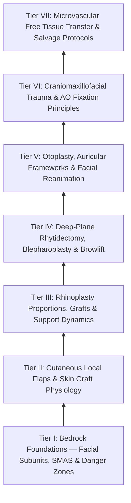
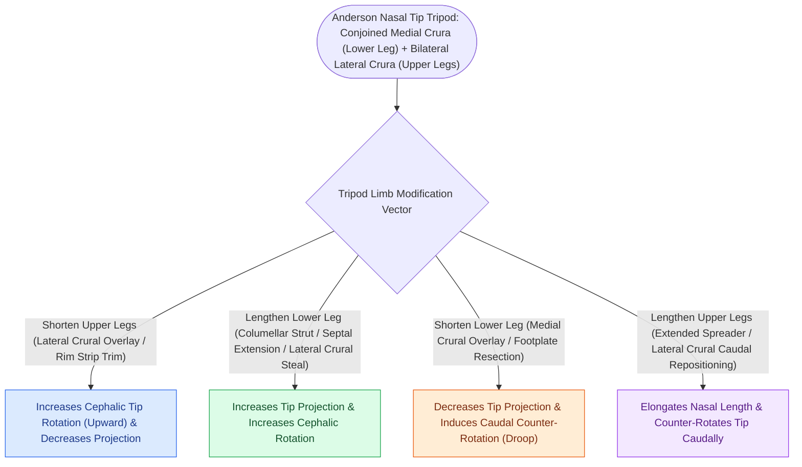

# The FPRS Knowledge Graph provides a structured mastery curriculum

Welcome to the **Comprehensive Facial Plastic & Reconstructive Surgery (FPRS) Knowledge Graph**. This interconnected Obsidian wiki is structured as a **progressively load-bearing mastery framework** encompassing 104 granular knowledge nodes spanning facial angiosomes, cutaneous local flaps, functional and aesthetic rhinoplasty, deep-plane rhytidectomy, comprehensive facial reanimation, craniomaxillofacial rigid internal fixation (AO principles), and complex microvascular free tissue transfer.

> [!NOTE] **Subspecialty Knowledge Cards Census & Curriculum Architecture**
> | Metric | Value | Details |
> | :--- | :--- | :--- |
> | **Atomic Cards (Notes)** | **146** | Granular single-concept clinical and surgical factoids |
> | **Source Coverage** | **146 / 146 (100%)** | Full attribution to authoritative surgical textbooks |
> | **Active Recall Questions** | **310 total (2.1/card)** | Integrated retrieval prompts with mechanistic rationales |
> | **Illustrated Cards** | **51 notes (102 figs)** | High-yield operative line drawings and anatomical diagrams |
> | **Personal Notes Guard** | **100% verified** | Cryptographically guarded resident notes region |
> | **Active Wiki-Links** | **1,012 links** | Bidirectional knowledge graph traversal web |
> | **Mastery Pyramid** | **7 Progressive Tiers** | From Bedrock Foundations to High-Stakes Complication Rescue |



---

## Tier I: Bedrock Foundations — Angiosomes, Biomechanics, SMAS & Facial Nerve Planes

### 📖 Tier I Clinical Foundations & Craft Nuances

### **1. Facial Topographic Subunits & Relaxed Skin Tension Lines (RSTLs)**

> * **[[Gonzalez-Ulloa facial aesthetic subunits guide complete subunit reconstruction|Gonzalez-Ulloa Aesthetic Facial Subunits]]:** Forehead, Eyes/Periorbital, Nose, Lips, Cheeks, Chin, and Neck. Reconstructive principle: If a surgical defect encompasses greater than 50% of an aesthetic subunit (particularly on the nose, lip, or forehead), replacing the *entire subunit* produces superior aesthetic outcomes by hiding scar boundaries along subunit junction lines.  
> * **Skin Biomechanics:**  
>   * *[[Relaxed skin tension lines minimize scar hypertrophy along perpendicular muscular vectors|Relaxed Skin Tension Lines (RSTLs)]]:* Correspond to the directional orientation of underlying dermal collagen and elastic bundles, perpendicular to the vector of underlying mimetic muscle contraction. Incisions placed strictly parallel to [[Relaxed skin tension lines minimize scar hypertrophy along perpendicular muscular vectors|RSTLs]] experience minimal distracting tension and heal with minimal scar hypertrophy.  
>   * *[[Relaxed skin tension lines minimize scar hypertrophy along perpendicular muscular vectors|Lines of Maximal Extensibility]] (LME):* Oriented precisely 90° perpendicular to RSTLs; represents the vector along which tissue can be advanced or stretched with the lowest closing force.  
>   * *Creep & [[Relaxed skin tension lines minimize scar hypertrophy along perpendicular muscular vectors|Stress Relaxation]]:* *Mechanical creep* is the time-dependent elongation of skin under constant loading tension; *Stress relaxation* is the progressive reduction in tension over time when skin is held at a constant stretched displacement.

### **2. Facial SMAS Architecture & Retaining Ligamentous Anatomy**

The **[[The superficial musculoaponeurotic system divides facial fat into distinct surgical planes|Superficial Musculoaponeurotic System (SMAS)]]** divides the facial subcutaneous adipose layer into superficial and deep compartments and functions as a continuous force-distributing network:

| Retaining Ligament Complex | Anatomical Origin & Insertion | Clinical Significance in Facial Aging | Surgical Release Landmark |
| :---- | :---- | :---- | :---- |
| **Zygocutaneous (McGregor’s Patch)** | Arises from inferior border of anterior zygomatic arch; inserts into overlying cheek dermis. | Tethers the anterior malar fat pad; its attenuation leads to midface descent and deep nasolabial folds. | Must be fully released in deep-plane rhytidectomy to mobilize the malar fat pad superiorly. |
| **Masseteric Cutaneous Ligaments** | Arise from the anterior border of the masseter muscle; penetrate SMAS into dermis. | Restricts anterior SMAS mobility; attenuation allows inferior jowl formation over the mandibular border. | Sub-SMAS transition boundary; release allows tension-free posterior and superior rotation of the jowl. |
| **Mandibular Retaining Ligament** | Arises from anterior body of mandible $1\text{ cm}$ superior to inferior margin, $4.5\text{ cm}$ anterior to gonial angle. | Directly defines the anterior boundary of the jowl (pre-jowl sulcus). | Surgical release required to flatten the inferior border of the mandible. Proximate to marginal mandibular nerve. |

**Key Ligament & [[High-SMAS rhytidectomy extends dissection above the zygomatic arch to rejuvenate the midface|SMAS]] Links**: [[The superficial musculoaponeurotic system divides facial fat into distinct surgical planes|SMAS Architecture]] · [[Facial retaining ligaments require surgical release to mobilize ptotic midface tissues|Facial Retaining Ligaments (McGregor's Patch)]] · [[Deep-plane rhytidectomy mobilizes the skin and SMAS as a composite flap across retaining ligaments|Deep-Plane Rhytidectomy]]

### **3. Facial Nerve (CN VII) 3D Trajectory & Danger Zones**

> * **General Neuromuscular Rule:** All mimetic muscles are innervated by the facial nerve from their *deep/undersurface*, EXCEPT the three deepest muscles, which are innervated on their *superficial surface*:  
>   1. **Levator anguli oris**  
>   2. **Buccinator**  
>   3. **Mentalis**  
> * **[[Pitanguy's line defines the danger zone for the frontal branch of the facial nerve|Frontal / Temporal Branch Danger Zone]]:**  
>   * *Trajectory ([[Pitanguy's line defines the danger zone for the frontal branch of the facial nerve|Pitanguy's Line]]):* Runs from a point $0.5\text{ cm}$ inferior to the tragus to a point $1.5\text{ cm}$ superior to the lateral brow.  
>   * *Layer Dynamics:* Crosses the zygomatic arch in the **innominate fascia (sub-temporoparietal fascia)**, running strictly superficial to the deep temporal fascia (DTF) and its superficial layer. Safe dissection planes: (a) subperiosteal or (b) directly on the glistening surface of the deep temporal fascia proper beneath the loose areolar tissue.  
> * **[[The marginal mandibular nerve courses deep to platysma over the facial vessels|Marginal Mandibular Branch Danger Zone]]:**  
>   * Crosses the inferior border of the mandible over the facial artery and anterior facial vein in 20% of patients up to $1\text{–}2\text{ cm}$ below the mandible (especially when the head is extended/rotated).  
>   * Runs deep to the platysma and investing cervical fascia; safely preserved during submandibular dissection by staying strictly in the subplatysmal plane or ligating and elevating the anterior facial vein superiorly (Martin’s maneuver).  
> * **[[The great auricular nerve emerges at Erb's point and is vulnerable during rhytidectomy|Great Auricular Nerve (GAN)]]:** Emerges at Erb’s point ($6.5\text{ cm}$ inferior to the external auditory canal on the mid-belly of the SCM). Deep to [[MACS lift and SMAS plication provide vertical vector elevation via suspension purse-string sutures|SMAS]]/platysma; superficial to deep investing fascia. Sensation to lower 2/3 of auricle. Most commonly injured nerve in facelift surgery.

### 🎯 Tier I Self-Assessment Checkpoint

> [!NOTE] **Self-Assessment Checkpoint: Tier I Foundations**
> 1. **Why does elevating a temple flap directly on the deep temporal fascia protect the [[Pitanguy's line defines the danger zone for the frontal branch of the facial nerve|frontal branch of the facial nerve]]?**  
>    - *Answer / Clinical Rationale*: The frontal branch travels within the sub-temporoparietal fascia (sub-TPF) / innominate fascia. The deep temporal fascia (DTF) lies deep to the loose areolar "innominate" tissue plane. Dissecting directly against the glistening white DTF ensures the nerve remains safely elevated within the superiorly reflected superficial flap (see [[Pitanguy's line defines the danger zone for the frontal branch of the facial nerve|Pitanguy's Line & Temporal Planes]]).  
> 2. **Why must the zygocutaneous and masseteric retaining ligaments be released in [[Deep-plane rhytidectomy mobilizes the skin and SMAS as a composite flap across retaining ligaments|deep-plane rhytidectomy]]?**  
>    - *Answer / Clinical Rationale*: These true osteocutaneous and fasciocutaneous ligaments anchor the SMAS and overlying malar fat pad rigidly to the zygoma and masseteric fascia. Without complete surgical transection, upward and posterior traction on the SMAS fails to reposition the ptotic midface tissues or soften the nasolabial fold (see [[Facial retaining ligaments require surgical release to mobilize ptotic midface tissues|Facial Retaining Ligaments]]).

---

## Tier II: Cutaneous Reconstruction, Local & Interpolated Facial Flaps, Skin Grafts

### 📖 Tier II Clinical Foundations & Craft Nuances

### **1. Primary Defect Closure & Dog-Ear Management**

> * **[[Fusiform ellipse geometry requires a three-to-one ratio to prevent standing cutaneous cones|Fusiform Ellipse Geometry]]:** Ideal length-to-width ratio is **$3:1\text{ to }4:1$** with apical angles **$\le 30^\circ$** to prevent standing cutaneous cones ("dog-ears").  
> * **Standing Cone Management:** Excision using Burow's triangles along RSTL orientations; Halving technique (Rule of Halves) for suturing unequal margins; [[Fusiform ellipse geometry requires a three-to-one ratio to prevent standing cutaneous cones|M-plasty]] to shorten total incision length by splitting the redundant terminal cone into two smaller internal triangles.

### **2. Random-Pattern Local Facial Flaps**

| Flap Class & Geometry | Biomechanical Movement Vector | Primary Anatomical Applications | Design Rules & Pitfalls |
| :---- | :---- | :---- | :---- |
| **Advancement Flaps (Monopedicle, V-Y, Y-V)** | Linear translation directly along a straight axis into the defect without rotation or transposition. | Forehead defects (parallel to horizontal creases), upper lip, helical rim (Antia-Buch chondrocutaneous advancement). | Requires bilateral Burow's triangles at the base to release lateral tethering and prevent puckering. |
| **Rotation Flap** | Curvilinear pivoting around a fixed point along the arc of a circle. | Cheek defects, lateral nasal dorsum, scalp reconstruction. Mustarde cheek flap. | Circumference of the arc must be at least 4 to 5 times the width of the triangular defect. Back-cut releases pivot tension. |
| **Rhombic / Limberg Flap** | Transposition over an intervening bridge of normal tissue into an equilateral $60^\circ / 120^\circ$ rhombus. | Temple, lateral cheek, chin, neck. Webster 30° modification narrows flap angle to reduce donor closing tension. | The line of maximal closing tension lies across the secondary donor defect, which MUST align parallel to the local RSTL. |
| **Bilobed Flap (Zitelli Modification)** | Double transposition flap transferring tissue excess from loose laxity sites to tightly bound defects. | Lower 1/3 of nose (nasal tip, supratip, alar base) for defects $\le 1.5\text{ cm}$. | Total arc of rotation strictly $\le 90^\circ$ ($45^\circ$ between primary and secondary lobes). Prevents pincushioning and alar rim retraction. |

**Key Local Flap Links**: [[Advancement flaps recruit adjacent tissue laxity along a linear vector without rotation|Advancement Flaps & V-Y]] · [[Rotation flaps redistribute closing tension along a curvilinear arc of rotation|Rotation Flaps & Mustarde]] · [[Rhombic and Limberg flaps transpose tissue into sixty-degree and one-hundred-twenty-degree defects|Rhombic & Limberg Transposition]] · [[The Zitelli bilobed flap restricts rotation to ninety degrees to prevent pincushioning|Zitelli Bilobed Flap]]

### **3. Interpolated Axial-Pattern Flaps**

> * **[[The paramedian forehead flap is an axial interpolated flap pedicled on the supratrochlear artery|Paramedian Forehead Flap (PFF)]]:**  
>   * *Axial Vascular Pedicle:* Supratrochlear artery (exits orbit $1.7\text{–}2.2\text{ cm}$ lateral to midline, piercing orbital septum and ascending deep to orbicularis oculi, becoming subcutaneous $1\text{ cm}$ above superior orbital rim). Narrow base ($1.2\text{–}1.5\text{ cm}$) centered on the palpable Doppler signal.  
>   * *2-Stage vs 3-Stage Approach:* 2-Stage (Stage 1: harvest and inset; Stage 2 at 3 weeks: pedicle division and final inset). 3-Stage (Stage 1: harvest and inset; Stage 2 at 3 weeks: full debulking/thinning and cartilage structural sculpting; Stage 3 at 6 weeks: pedicle division). Highly indicated for complex full-thickness alar/tip reconstruction.  
> * **[[Abbe and Estlander cross-lip flaps are pedicled on the labial artery to repair lip defects|Abbe & Estlander Lip Flaps]]:**  
>   * *Abbe Flap:* Full-thickness interpolated [[Abbe and Estlander cross-lip flaps are pedicled on the labial artery to repair lip defects|cross-lip flap]] based on the labial artery ($1\text{–}2\text{ mm}$ deep to mucosa, running along the vermilion-cutaneous border between orbicularis oris muscle and submucosa). Divides after 2–3 weeks. Indicated for central defects of upper or lower lip $>1/3$ to $2/3$ width.  
>   * *[[Abbe and Estlander cross-lip flaps are pedicled on the labial artery to repair lip defects|Estlander Flap]]:* [[Rhombic and Limberg flaps transpose tissue into sixty-degree and one-hundred-twenty-degree defects|Transposition flap]] for lateral lip defects involving the oral commissure; requires secondary commissuroplasty to correct rounded [[Karapandzic orbicularis oris myocutaneous rotation flaps preserve oral sphincter innervation|microstomia]].

### **4. Skin Grafting Physiology: FTSG vs STSG**

> * **[[Full-thickness and split-thickness skin grafts differ in primary contraction and vascular take|Skin Graft Healing Phases]]:**  
>   1. *Serum Imbibition (Hours 0–48):* Passive absorption of nutrients and plasma transudate via capillary action; graft gains up to 40% weight.  
>   2. *[[Skin graft bolsters and negative pressure wound therapy optimize graft bed inosculation|Inosculation]] (Hours 48–72):* Direct microscopic alignment and anastomosis of host and donor capillary vascular buds.  
>   3. *Revascularization / Angiogenesis (Days 4–7):* True ingrowth of recipient neo-vessels into graft stroma.  
> * **Comparison:**  
>   * *[[Full-thickness and split-thickness skin grafts differ in primary contraction and vascular take|Full-Thickness Skin Graft]] (FTSG):* Contains epidermis and entire dermis with adnexal structures. High primary contraction (due to elastin recoil), minimal secondary contraction; excellent color and texture match (preauricular, postauricular, supraclavicular). Higher metabolic requirement; lower graft "take" on marginal beds.  
>   * *[[Full-thickness and split-thickness skin grafts differ in primary contraction and vascular take|Split-Thickness Skin Graft]] (STSG):* Contains epidermis and variable portion of dermis ($0.012\text{–}0.018\text{ inches}$). Low primary contraction, high secondary contracture; poor texture/pigmentation match. High take rate on compromised beds.

### 🎯 Tier II Self-Assessment Checkpoint

> [!NOTE] **Self-Assessment Checkpoint: Tier II Cutaneous Reconstruction**
> 1. **Why did Zitelli modify the classic Esser bilobed flap from a 180° total arc of rotation to an arc ≤90°?**  
>    - *Answer / Clinical Rationale*: The original 180° arc generated severe standing cutaneous cones, extreme closing tension vectors, and a high rate of flap "pincushioning" (trap-door deformity) and alar rim distortion. Restricting the total arc to $\le 90^\circ$ ($45^\circ$ between primary and secondary lobes) distributes tension smoothly into the lax upper dorsum without elevating the alar margin (see [[The Zitelli bilobed flap restricts rotation to ninety degrees to prevent pincushioning|Zitelli Bilobed Flap]]).  
> 2. **Where does the labial artery run in relation to the vermilion border, and why is this critical when carving an [[Abbe and Estlander cross-lip flaps are pedicled on the labial artery to repair lip defects|Abbe flap]]?**  
>    - *Answer / Clinical Rationale*: The superior and inferior labial arteries run approximately $1\text{–}2\text{ mm}$ posterior to the vermilion-cutaneous junction, nestled submucosally on the posterior/inner surface of the orbicularis oris muscle. Preserving this mucosal-muscular cuff at the pedicle pivot point ensures flap survival (see [[Abbe and Estlander cross-lip flaps are pedicled on the labial artery to repair lip defects|Abbe & Estlander Lip Flaps]]).

---

## Tier III: Functional & Aesthetic Rhinoplasty: Cartilage Kinetics & Structural Grafting

### 📖 Tier III Clinical Foundations & Craft Nuances

### **1. Aesthetic Proportions & Nasal Analysis**

> * **[[Goode's ratio and nasolabial angles define standard aesthetic nasal tip proportions|Goode's Ratio (Tip Projection)]]:** Ratio of [[Goode's ratio and nasolabial angles define standard aesthetic nasal tip proportions|tip projection]] (distance from alar groove to tip defining point along a perpendicular line) to nasal dorsal length (radix to tip) should be **0.55 to 0.60**.  
> * **[[Goode's ratio and nasolabial angles define standard aesthetic nasal tip proportions|Nasolabial Angle]]:** Angle between a line drawn through the anterior and posterior edges of the nostril and a vertical line perpendicular to the Frankfort horizontal. Ideal: **$90^\circ\text{–}95^\circ$ in men**; **$95^\circ\text{–}105^\circ$ in women**.  
> * **Nasofrontal Angle:** Measured between glabella-to-nasion line and nasion-to-rhinion dorsal line. Ideal: **$115^\circ\text{–}130^\circ$**.

### **2. Internal & External Nasal Valve Dynamics**

| Valve Complex | Anatomical Boundaries | Pathophysiology of Collapse | Structural Reconstructive Maneuvers |
| :---- | :---- | :---- | :---- |
| **Internal Nasal Valve (INV)** | Bound by Upper Lateral Cartilage (ULC) caudal margin, dorsal septum, and head of inferior turbinate. Normal angle: $10^\circ\text{–}15^\circ$. | Narrowest cross-sectional resistance zone in human airway (Poiseuille’s Law: Flow $\propto r^4$). Over-resection of dorsal hump disrupts ULC attachments, causing inverted-V deformity and collapse. | • **Spreader Grafts:** Autologous cartilaginous struts placed between dorsal septum and ULCs. • **Spreader Flaps (Turn-in):** Inverting upper lateral cartilage edges medially. • **Butterfly Grafts.** |
| **External Nasal Valve (ENV)** | Bound by Lower Lateral Cartilage (LLC) lateral crus, alar lobule/fibrofatty tissue, columella, and nasal sill. | Inherent cartilaginous flaccidity, over-resection of lateral crura (cephalic trim leaving $<5\text{–}6\text{ mm}$), or alar rim retraction. Dynamic inspiratory collapse. | • **Alar Batten Grafts:** Non-anatomical convex cartilage placed deep to pyriform aperture. • **Lateral Crural Strut Grafts:** Under-surface reinforcement. • **Alar Rim Contouring Grafts.** |

**Key Nasal Valve Links**: [[Spreader grafts restore internal nasal valve patency and prevent inverted-V deformity|Spreader Grafts & Internal Valve]] · [[Alar batten and lateral crural strut grafts prevent external nasal valve inspiratory collapse|Alar Batten & Lateral Crural Strut Grafts]]

### **3. Nasal Tip Dynamics & Anderson Tripod Theory**

The **[[The Anderson tripod theory governs nasal tip projection, rotation, and support dynamics|Anderson Tripod Theory]]** models tip kinetics: two legs formed by the bilateral lateral crura, and the third medial leg formed by the conjoined medial crura and columella.



**Key Tip Maneuver Links**: [[Lateral crural steal and overlay maneuvers dynamically modify tip rotation and projection|Lateral Crural Steal & Overlay]] · [[Tongue-in-groove and septal extension grafts provide rigid columellar and tip stabilization|Tongue-in-Groove & Septal Extension Grafts]]

### **4. Bony Vault Osteotomies & Deformity Management**

> * **[[Medial, intermediate, and lateral osteotomies close open roof deformities after hump resection|Osteotomy Sequences]]:** [[Medial, intermediate, and lateral osteotomies close open roof deformities after hump resection|Medial osteotomies]]  $\r\r\rightarrow$ [[Medial, intermediate, and lateral osteotomies close open roof deformities after hump resection|Intermediate osteotomies]] (for severe convex/deviated bones)  $\r\r\rightarrow$ [[Medial, intermediate, and lateral osteotomies close open roof deformities after hump resection|Lateral osteotomies]] (continuous low-to-high or low-to-low approach originating at the pyriform aperture above the inferior turbinate insertion).  
> * **Open Roof Deformity:** Occurs after dorsal bony hump removal without [[Medial, intermediate, and lateral osteotomies close open roof deformities after hump resection|lateral osteotomies]] to medialize and close the flattened superior bony arch.  
> * **[[Pollybeak deformities arise from cartilaginous over-projection or supratip soft tissue fibrosis|Pollybeak Deformity]]:**  
>   * *[[Pollybeak deformities arise from cartilaginous over-projection or supratip soft tissue fibrosis|Cartilaginous Pollybeak]]:* Inadequate resection of the anterior septal angle or excessive reduction of the bony dorsum relative to cartilaginous vault. Solution: Revision excision of dorsal septum.  
>   * *[[Pollybeak deformities arise from cartilaginous over-projection or supratip soft tissue fibrosis|Soft Tissue Pollybeak]]:* Thick sebaceous skin failure to redrape over supratip dead space, forming fibrotic scar. Solution: Triamcinolone acetonide ($10\text{–}40\text{ mg/mL}$) injection, taped pressure dressing, surgical defatting.

### 🎯 Tier III Self-Assessment Checkpoint

> [!NOTE] **Self-Assessment Checkpoint: Tier III Rhinoplasty**
> 1. **How does a spreader graft prevent an [[Spreader grafts restore internal nasal valve patency and prevent inverted-V deformity|inverted-V deformity]] post-rhinoplasty?**  
>    - *Answer / Clinical Rationale*: Resection of a cartilaginous dorsal hump severs the T-shaped horizontal fusion between the upper lateral cartilages and the dorsal septum. [[Spreader grafts restore internal nasal valve patency and prevent inverted-V deformity|Spreader grafts]] restore the natural stenting separation between the septum and ULCs, preventing inferomedial collapse of the ULCs and the resulting visible skeletonization of the caudal nasal bone edges (see [[Spreader grafts restore internal nasal valve patency and prevent inverted-V deformity|Spreader Grafts]]).  
> 2. **Differentiate a Lateral Crural Steal from a [[Lateral crural steal and overlay maneuvers dynamically modify tip rotation and projection|Lateral Crural Overlay]].**  
>    - *Answer / Clinical Rationale*: A *lateral crural steal* advances lateral crural cartilage medially into the dome without cutting it, increasing [[Goode's ratio and nasolabial angles define standard aesthetic nasal tip proportions|tip projection]] and cephalic rotation. A *[[Lateral crural steal and overlay maneuvers dynamically modify tip rotation and projection|lateral crural overlay]]* involves dividing the lateral crus, overlapping the cut ends, and suturing them, which increases cephalic rotation while *decreasing* or maintaining tip projection (see [[Lateral crural steal and overlay maneuvers dynamically modify tip rotation and projection|Lateral Crural Steal & Overlay]]).

---

## Tier IV: Aesthetic Facial Surgery: Deep-Plane Rhytidectomy, Blepharoplasty & Browlift

### 📖 Tier IV Clinical Foundations & Craft Nuances

### **1. Rhytidectomy Planes & Deep-Plane Dissection**

> * **Surgical Approaches:**  
>   * *Subcutaneous Facelift with [[MACS lift and SMAS plication provide vertical vector elevation via suspension purse-string sutures|SMAS Plication]] / Imbrication:* Elevation of skin flap followed by folding (plication) or excision and edge suturing (imbrication) of the lateral SMAS.  
>   * *[[Deep-plane rhytidectomy mobilizes the skin and SMAS as a composite flap across retaining ligaments|Deep-Plane Rhytidectomy (Hamra / Mendelson / Jacono)]]:* Entry into the sub-SMAS plane anterior to the parotid gland. The skin and SMAS are kept in continuity as a composite flap. Dissection continues medially, sharply releasing the zygocutaneous and masseteric retaining ligaments, entering the pre-masseteric and pre-zygomatic spaces to reposition the descent of the midface and malar fat pad directly.  
> * **[[Corset platysmaplasty and lateral suspension restore the youthfulness of the cervicomental angle|Cervicoplasty & Platysmaplasty]]:** Submental incision; midline submental defatting; sharp transection and mobilization of medial platysmal borders; interlocking running horizontal mattress sutures ([[Corset platysmaplasty and lateral suspension restore the youthfulness of the cervicomental angle|corset platysmaplasty]]) down to thyroid cartilage. Lateral platysmal suspension to mastoid fascia.

### **2. Blepharoplasty (Upper & Lower)**

| Procedure | Key Anatomical Planes & Fat Compartments | Step-by-Step Execution | Complication Avoidance |
| :---- | :---- | :---- | :---- |
| **Upper Blepharoplasty** | Skin, Orbicularis oculi, Retro-orbicularis oculi fat (ROOF), Orbital septum, Nasal (medial) and Central fat pads. | Skin crease marking ($8\text{–}10\text{ mm}$ above lash line in women, $7\text{–}8\text{ mm}$ in men); maintain at least $10\text{–}12\text{ mm}$ of skin between upper incision and lower brow rim. Pinch test to confirm complete eyelid closure. Conservative fat resection from medial compartment. | Avoid over-resection of skin causing lagophthalmos. Protect trochlea/superior oblique tendon between medial and central fat pads. |
| **Lower Blepharoplasty (Transconjunctival vs Subciliary)** | Capsulopalpebral fascia, Inferior oblique muscle (divides Medial and Central fat pads), Lateral fat pad, Arcus marginalis. | • **Transconjunctival:** Pre-septal or post-septal entry. Direct fat reduction or fat transposition across the inferior orbital rim over the tear trough. • **Subciliary:** Skin-muscle flap elevated; lateral canthopexy or canthoplasty (lateral tarsal strip) anchored to inner periosteum of Whitnall’s tubercle. | Avoid middle lamellar cicatrization causing ectropion and scleral show. Protect inferior oblique muscle. |

**Key Eyelid Links**: [[Upper blepharoplasty requires precise skin crease marking to avoid lagophthalmos|Upper Blepharoplasty]] · [[Lower blepharoplasty addresses fat herniation while preserving the inferior oblique muscle|Lower Blepharoplasty & Inferior Oblique]] · [[Lateral canthopexy and lateral tarsal strip suspension prevent post-blepharoplasty ectropion|Canthopexy & Lateral Tarsal Strip]]

### **3. Forehead & Brow Rejuvenation**

> * **[[Endoscopic browlift releases the conjoint tendon and arcus marginalis along the supraorbital rim|Endoscopic Browlift Technique]]:** Five small radial incisions ($1\text{–}2\text{ cm}$) behind hairline. Dissection: Subperiosteal across the central forehead down to the supraorbital rim; subgaleal/sub-TPF in the temporal zones directly over the deep temporal fascia proper.  
> * **Landmarks & Releases:** Release the conjoint tendon and arcus marginalis along the supraorbital rim. Identify and preserve the supraorbital and supratrochlear neurovascular bundles. Cauterize the **[[The sentinel vein marks the trajectory of the frontal branch of the facial nerve|sentinel vein]]** (branch of internal maxillary/ophthalmic system). Resect or avulse the [[Endoscopic browlift releases the conjoint tendon and arcus marginalis along the supraorbital rim|corrugator supercilii]] and procerus muscles to soften vertical/horizontal glabellar furrows. Fixation via Endotine, cortical bone tunnels, or mini-screws.

### 🎯 Tier IV Self-Assessment Checkpoint

> [!NOTE] **Self-Assessment Checkpoint: Tier IV Facial Rejuvenation**
> 1. **What muscle separates the medial and central fat compartments of the lower eyelid?**  
>    - *Answer / Clinical Rationale*: The **[[Lower blepharoplasty addresses fat herniation while preserving the inferior oblique muscle|inferior oblique muscle]]**. During transconjunctival or transcutaneous [[Lower blepharoplasty addresses fat herniation while preserving the inferior oblique muscle|fat transposition]]/reduction, this muscle must be visualized and carefully preserved to prevent diplopia secondary to muscle injury or scarring.  
> 2. **What is the significance of the sentinel vein during an [[Endoscopic browlift releases the conjoint tendon and arcus marginalis along the supraorbital rim|endoscopic browlift]]?**  
>    - *Answer / Clinical Rationale*: The [[The sentinel vein marks the trajectory of the frontal branch of the facial nerve|sentinel vein]] is a constant emissary vein running from the temporal region into the deep system, located approximately $1\text{ cm}$ lateral to the zygomaticofrontal suture line. It serves as an immediate anatomical landmark: the [[Pitanguy's line defines the danger zone for the frontal branch of the facial nerve|frontal branch of the facial nerve]] runs in the overlying sub-TPF tissue plane just superior and medial to this vessel.

---

## Tier V: Otoplasty, Auricular Frameworks & Comprehensive Facial Reanimation

### 📖 Tier V Clinical Foundations & Craft Nuances

### **1. Otoplasty & Auricular Deformities**

> * **Aesthetic Parameters:** Auriculocephalic angle: **$20^\circ\text{–}30^\circ$**; Helical-mastoid distance: **$15\text{–}20\text{ mm}$** (superior, middle, inferior lobule thirds).  
> * **Pathophysiology & Reconstructive Techniques:**  
>   * *Poorly Developed [[Mustarde and Furnas sutures correct antihelical effacement and conchal hypertrophy|Antihelical Fold]]:* **[[Mustarde and Furnas sutures correct antihelical effacement and conchal hypertrophy|Mustarde Sutures]]** (horizontal mattress 4-0 clear Mersilene/Prolene placed through posterior cartilage and anterior perichondrium to tube the antihelix); **[[Stenstrom and Chongchet cartilage scoring utilizes Gibson's principle to fold the antihelix|Chongchet / Stenstrom technique]]** (anterior [[Stenstrom and Chongchet cartilage scoring utilizes Gibson's principle to fold the antihelix|cartilage scoring]] to induce directional bending away from the scored side based on Gibson's principle).  
>   * *Conchal Bowl Hypertrophy:* **[[Mustarde and Furnas sutures correct antihelical effacement and conchal hypertrophy|Furnas Sutures]]** (concha-to-mastoid fascia mattress setback sutures); Conchal bowl crescentic cartilage resection if setback creates external auditory canal stenosis.  
>   * *Prominent Lobule:* Posterior skin excision with lobulopexy.  
> * **[[Microtia autologous costal cartilage framework stages balance four-stage Brent and two-stage Nagata reconstruction protocols|Microtia Reconstruction (Brent vs Nagata)]]:**  
>   * *Brent Technique (4 Stages):* Stage 1: Autologous 6th, 7th, 8th [[Microtia autologous costal cartilage framework stages balance four-stage Brent and two-stage Nagata reconstruction protocols|costal cartilage framework]] fabrication and subcutaneous pocket placement. Stage 2: Lobule transposition. Stage 3: Framework elevation with retroauricular [[Full-thickness and split-thickness skin grafts differ in primary contraction and vascular take|FTSG]] and TPFF. Stage 4: Tragus construction.  
>   * *[[Microtia autologous costal cartilage framework stages balance four-stage Brent and two-stage Nagata reconstruction protocols|Nagata Technique]] (2 Stages):* Stage 1: Cartilage framework fabrication with integrated tragus and lobule transposition in one step. Stage 2: Framework elevation with [[Pitanguy's line defines the danger zone for the frontal branch of the facial nerve|temporoparietal fascia]] flap (TPFF) and skin graft.

### **2. Facial Reanimation: Dynamic & Static Paradigms**

| Strategy | Specific Procedure | Mechanism & Vector of Action | Optimal Timing & Clinical Application |
| :---- | :---- | :---- | :---- |
| **Direct Nerve Repair / Grafting** | Epineural neurorrhaphy / Sural or Great Auricular cable graft | Direct end-to-end axonal regeneration along native neuromuscular pathways. | Immediate repair (<1 year post-injury) when motor endplates and proximal stumps are viable. |
| **Nerve Transfers (Neurotization)** | Masseteric nerve (CN V3) to Facial Nerve branch; Hypoglossal (CN XII) to CN VII | Masseteric nerve yields powerful biting-induced smile excursion; 12-7 transfer (end-to-side with jump graft) restores resting tone without tongue hemiatrophy. | Viable within <12–18 months while distal mimetic muscle motor endplates remain receptive. |
| **Dynamic Muscle Transfer** | Free Gracilis Muscle Transfer (with Masseteric nerve or CFNG) / Temporalis Muscle Transfer | Microvascular transplantation of gracilis muscle to modiolus and zygomatic arch; temporalis muscle tendon transposition to oral commissure. | Gold standard for chronic, long-standing paralysis (>2 years) where native facial musculature has fibrosed. |
| **Static Suspension & Eye Protection** | Upper lid Platinum/Gold weight ($1.0\text{–}1.6\text{ g}$), Lateral Tarsal Strip, Fascia Lata Modiolus Sling | Gravity-assisted eyelid closure; lateral canthal tightening; static elevation of oral commissure and nasal valve suspension. | Immediate corneal protection in flaccid paralysis; adjunctive static support in elderly or non-reinnervation candidates. |

**Key Reanimation Links**: [[Epineural neurorrhaphy and cable nerve grafting restore facial continuity within twelve months|Direct Nerve Repair & Cable Grafts]] · [[The masseteric nerve provides a dense motor donor for single-stage facial reanimation|Masseteric Nerve Transfer]] · [[Free gracilis muscle transfer provides dynamic smile restoration in chronic facial paralysis|Free Gracilis Muscle Transfer]] · [[Upper eyelid platinum weights and lateral tarsal strips protect the cornea in flaccid facial paralysis|Platinum Weights & Static Eye Protection]]

### 🎯 Tier V Self-Assessment Checkpoint

> [!NOTE] **Self-Assessment Checkpoint: Tier V [[Mustarde and Furnas sutures correct antihelical effacement and conchal hypertrophy|Otoplasty]] & Reanimation**
> 1. **Why is the masseteric nerve (CN V3 branch) preferred over the classic [[Cross-facial nerve grafting provides coordinated spontaneous smile excursion in children|cross-facial nerve graft]] ([[Cross-facial nerve grafting provides coordinated spontaneous smile excursion in children|CFNG]]) as a single-stage motor donor for gracilis free transfer in adults?**  
>    - *Answer / Clinical Rationale*: The masseteric nerve provides a dense source of pure motor axons in close proximity to the recipient site, generating powerful, predictable commissural excursion (often $>1\text{ cm}$) and rapid reinnervation (within 3–6 months), whereas single-stage [[Cross-facial nerve grafting provides coordinated spontaneous smile excursion in children|CFNG]] exhibits prolonged axonal transit time across the face and lower ultimate axonal volume in adult patients (see [[The masseteric nerve provides a dense motor donor for single-stage facial reanimation|Masseteric Nerve Transfer]]).  
> 2. **What is Gibson’s principle of cartilage warping, and how does it dictate Stenstrom’s [[Mustarde and Furnas sutures correct antihelical effacement and conchal hypertrophy|otoplasty]] technique?**  
>    - *Answer / Clinical Rationale*: Gibson's principle states that when cartilage is scored or disrupted on one surface, the intact tensile elastic forces on the opposite, uninjured perichondrial surface cause the cartilage to curl and warp *away* from the injured side. Stenstrom uses anterior antihelical scoring to cause the cartilage to naturally fold posteriorly into a rounded antihelix (see [[Stenstrom and Chongchet cartilage scoring utilizes Gibson's principle to fold the antihelix|Gibson's Principle Scoring]]).

---

## Tier VI: Craniomaxillofacial Trauma & Rigid Internal Fixation (AO Principles)

### 📖 Tier VI Clinical Foundations & Craft Nuances

### **1. Mandibular Biomechanics & Champy’s Ideal Lines of Osteosynthesis**

> * **Biomechanics:** During mastication, bite forces create a **tension zone along the superior alveolar border** and a **compression zone along the inferior basilar border** of the mandibular body and angle.  
> * **[[Champy lines of ideal osteosynthesis dictate monocortical miniplate fixation along mandibular tension zones|Champy Principle]]:** Placement of a single non-compression miniplate ($2.0\text{ mm}$) along the superior border (tension band) on the external oblique ridge for mandibular angle fractures. For symphyseal/parasymphyseal fractures, torsional forces require two plates: a superior subapical tension band plate ($2.0\text{ mm}$) and an inferior basilar plate ($2.0\text{ mm}$).

### **2. Midface Fracture Classification & Buttress Reconstruction**

| Fracture Pattern | Anatomical Disruption Planes | Clinical Examination Hallmarks | Rigid Fixation Strategy (AO Buttresses) |
| :---- | :---- | :---- | :---- |
| **Le Fort I (Horizontal Maxillary)** | Separation of hard palate from midface; crosses nasomaxillary buttress, zygomaticomaxillary (ZMC) buttress, and lower pterygoid plates. | Mobile maxilla ("floating palate"); anterior open bite; maxillary dental malocclusion. | Establish maxillomandibular fixation (MMF) to restore occlusion; plate bilateral nasomaxillary and zygomaticomaxillary buttresses with $1.5\text{–}2.0\text{ mm}$ L-shaped plates. |
| **Le Fort II (Pyramidal)** | Crosses nasofrontal junction, nasal bones, lacrimal bones, inferior orbital rim, orbital floor, and ZMC buttress. | Mobile midface pyramid; step-offs at bilateral inferior orbital rims; bilateral periorbital ecchymosis. | MMF; fix nasofrontal junction, inferior orbital rims, and bilateral ZMC buttresses. |
| **Le Fort III (Craniofacial Disjunction)** | Complete separation of facial skeleton from skull base: zygomaticofrontal (ZF) suture, orbital walls, nasofrontal suture, and pterygoid plates. | Entire facial skeleton mobile relative to neurocranium ("dish-face deformity"); massive facial edema; CSF rhinorrhea. | Reconstruct from stable skull base inward: ZF sutures → Nasofrontal junction → Zygomatic arches → ZMC buttress → MMF. |
| **Zygomaticomaxillary Complex (ZMC)** | Tetrapod fracture: (1) ZF suture, (2) Inferior orbital rim, (3) ZMC buttress, (4) Zygomatic arch. | Flattened malar eminence, paresthesia in V2 (infraorbital nerve) distribution, trismus (impingement of coronoid process). | 2-point or 3-point fixation (ZF suture, ZMC buttress $\pm$ inferior orbital rim) following reduction with Carroll-Girard screw or Gillies approach. |

**Key Trauma Links**: [[Le Fort I fractures separate the hard palate and require bilateral buttress plate fixation|Le Fort I Horizontal Maxilla]] · [[Le Fort II pyramidal and Le Fort III craniofacial disjunction fractures disrupt facial buttresses|Le Fort II & III Panfacial Disjunction]] · [[Zygomaticomaxillary complex fractures disrupt four buttress articulations requiring multi-point reduction|ZMC Tetrapod Fractures]] · [[Maxillomandibular fixation MMF using arch bars, hybrid systems, and IMF screws re-establishes occlusion|MMF Fixation Principles]]

### **3. Orbital Floor Fractures & Ophthalmic Emergencies**

> * **[[Orbital floor blowout fractures with muscle entrapment or significant enophthalmos mandate reconstruction|Operative Indications]]:** [[Orbital floor blowout fractures with muscle entrapment or significant enophthalmos mandate reconstruction|Enophthalmos]] $>2\text{ mm}$, defect area $>50\%$ of orbital floor on coronal CT, persistent diplopia with positive forced duction test, or **[[Pediatric white-eyed blowout fractures cause muscle entrapment requiring emergent surgical release|pediatric "white-eyed" trapdoor fracture]]** with entrapment and active [[Pediatric white-eyed blowout fractures cause muscle entrapment requiring emergent surgical release|oculocardiac reflex]] (bradycardia, nausea — *emergent OR indication within hours*).  
> * **[[Acute retrobulbar hematoma in facial trauma requires immediate bedside lateral canthotomy|Retrobulbar Hematoma Emergency]]:** Sudden proptosis, severe pain, decreased visual acuity, afferent pupillary defect (Marcus Gunn pupil), and elevated intraocular pressure ($IOP > 40\text{ mmHg}$).  
>   * **Immediate Bedside Intervention:** *Emergent [[Post-blepharoplasty retrobulbar hematoma requires immediate bedside decompression to prevent blindness|Lateral Canthotomy]] and [[Post-blepharoplasty retrobulbar hematoma requires immediate bedside decompression to prevent blindness|Inferior Cantholysis]]*. Do NOT delay for CT scan. Administer IV Mannitol, high-dose Dexamethasone, and topical Timolol/Acetazolamide drops.

### 🎯 Tier VI Self-Assessment Checkpoint

> [!NOTE] **Self-Assessment Checkpoint: Tier VI Maxillofacial Trauma**
> 1. **Why is a pediatric "white-eyed" blowout fracture considered a true surgical emergency compared to a comminuted adult blowout fracture?**  
>    - *Answer / Clinical Rationale*: In children, elastic greenstick bone fractures can immediately spring back (trapdoor mechanism), incarcerating the inferior rectus muscle and surrounding fibrofatty tissue. This induces acute muscle ischemia, rapid necrosis, and permanent fibrotic restriction within 24–48 hours, alongside potentially severe vagal bradycardia via the [[Pediatric white-eyed blowout fractures cause muscle entrapment requiring emergent surgical release|oculocardiac reflex]] (see [[Pediatric white-eyed blowout fractures cause muscle entrapment requiring emergent surgical release|Pediatric Trapdoor Fracture]]).  
> 2. **What is the sequence of steps for performing an emergent [[Acute retrobulbar hematoma in facial trauma requires immediate bedside lateral canthotomy|lateral canthotomy]] and [[Post-blepharoplasty retrobulbar hematoma requires immediate bedside decompression to prevent blindness|inferior cantholysis]]?**  
>    - *Answer / Clinical Rationale*: (1) Infiltrate lateral canthus with local anesthetic with epinephrine. (2) Crush the lateral canthal angle horizontally with straight hemostat for 30 seconds for hemostasis. (3) Incise the crushed skin horizontally $1\text{–}1.5\text{ cm}$ down to the orbital rim ([[Acute retrobulbar hematoma in facial trauma requires immediate bedside lateral canthotomy|lateral canthotomy]]). (4) Strum and identify the inferior crus of the lateral canthal tendon vertically with scissors and transect it completely ([[Post-blepharoplasty retrobulbar hematoma requires immediate bedside decompression to prevent blindness|inferior cantholysis]]), releasing the lower lid completely from the lateral orbital rim to decompress the orbit (see [[Acute retrobulbar hematoma in facial trauma requires immediate bedside lateral canthotomy|Bedside Canthotomy & Cantholysis]]).

---

## Tier VII: Complex Microvascular Free Tissue Transfer & Maxillofacial Reconstruction

### 📖 Tier VII Clinical Foundations & Craft Nuances

### **1. Free Flap Selection Matrix in Head & Neck FPRS**

| Free Flap Donor | Vascular Pedicle & Caliber | Tissue Composition & Characteristics | Primary FPRS Reconstructive Indications |
| :---- | :---- | :---- | :---- |
| **Radial Forearm (RFFF)** | Radial artery + Venae comitantes / Cephalic vein ($2.0\text{–}3.0\text{ mm}$). | Thin, highly pliable, hairless fasciocutaneous paddle; potential for sensate harvest via lateral/medial antebrachial cutaneous nerve. | Oral cavity mucosal defects, total nasal lining, external soft tissue resurfacing. Requires preoperative Allen test. |
| **Anterolateral Thigh (ALT)** | Descending branch of Lateral Circumflex Femoral Artery (LCFA) ($2.0\text{–}2.5\text{ mm}$). | Versatile volume; can be harvested as pure skin paddle, thinned perforator flap, or myocutaneous with vastus lateralis. | Total glossectomy defects, large cheek through-and-through composite defects, lateral skull base obliteration. |
| **Fibula Free Flap (FFF)** | Peroneal artery + Venae comitantes ($2.0\text{–}3.0\text{ mm}$). | Up to $25\text{ cm}$ of dense cortical bone; can undergo multiple closing wedge osteotomies; septocutaneous skin paddle. | Mandibular and maxillary composite bony reconstructions; accommodates endosseous dental implants. Must preserve distal $5\text{ cm}$ for ankle stability. |
| **Scapula / Parascapular** | Circumflex Scapular Artery (branch of subscapular system) ($2.5\text{–}3.5\text{ mm}$). | Bone from lateral scapular border with independent skin paddles (scapular/parascapular) and latissimus dorsi muscle. | Complex composite orbital-maxillary defects requiring separate 3D volume, skin coverage, and bone. |

**Key Free Flap Links**: [[The radial forearm free flap provides thin, pliable fasciocutaneous tissue for oral and pharyngeal defects|Radial Forearm Free Flap (RFFF)]] · [[The anterolateral thigh free flap provides versatile soft tissue volume based on the LCFA|Anterolateral Thigh (ALT) Flap]] · [[The fibula free flap provides vascularized cortical bone for composite mandibular reconstruction|Fibula Free Flap (FFF)]] · [[Preserving the distal five centimeters of the fibula prevents ankle instability and talar tilt|Distal Fibula Preservation]] · [[The subscapular system provides composite scapular bone and latissimus dorsi muscle flaps|Subscapular Chimeric System]]

### **2. Microvascular Technical Standards & Thrombosis Salvage Protocol**

The **[[Microvascular free flap salvage requires urgent re-exploration within two hours of vascular compromise|Free Flap Vascular Crisis & Salvage Protocol]]** governs the emergency management of compromised free tissue transfers:

```
========================================================================================  
                     FREE FLAP VASCULAR CRISIS & SALVAGE PROTOCOL  
========================================================================================  
1. MONITORING: Hourly pinprick bleeding, surface temperature, color, and implantable Doppler.  
2. DIFFERENTIATE COMPROMISE:  
   - ARTERIAL OCCLUSION: Flap is pale, cool, loss of Doppler signal, NO bleeding on 25G needle prick.  
   - VENOUS CONGESTION: Flap is purple/violaceous, brisk dark burgundy bleeding, tense swelling.  
3. BEDSIDE RESCUE:  
   - Release tight neck/perforator skin closure sutures immediately.  
   - Administer 5,000 unit IV Heparin bolus.  
4. OPERATING ROOM EXPLORATION (Time to OR < 1-2 hours):  
   - Open neck incision; inspect microvascular pedicle for kinking, compression, or hematoma.  
   - Perform revision of venous/arterial anastomosis.  
   - Fogarty catheter thrombectomy; flush pedicle with Heparinized saline or tPA ($2\text{–}5\text{ mg}$).  
   - If venous outflow cannot be salvaged: Apply medicinal leeches (*Hirudo medicinalis*) with   
     prophylactic Ciprofloxacin to cover *Aeromonas hydrophila*.  
========================================================================================
```

### 🎯 Tier VII Self-Assessment Checkpoint

> [!NOTE] **Self-Assessment Checkpoint: Tier VII Microvascular Surgery**
> 1. **Why is preserving the distal 5 cm of the fibular bone mandatory during [[Osteoradionecrosis of the mandible requires radical bony debridement and vascularized fibula free flap repair|fibula free flap]] harvest?**  
>    - *Answer / Clinical Rationale*: The distal $5\text{ cm}$ of the fibula stabilizes the lateral malleolus and provides insertion for the anterior and posterior talofibular and calcaneofibular ligaments. Harvesting bone within this distal zone disrupts the mortise joint, leading to severe [[Preserving the distal five centimeters of the fibula prevents ankle instability and talar tilt|ankle instability]] and permanent valgus talar tilt (see [[Preserving the distal five centimeters of the fibula prevents ankle instability and talar tilt|Distal Fibula Preservation]]).  
> 2. **Why is antibiotic prophylaxis with Ciprofloxacin mandatory when applying medicinal leeches to a congested flap?**  
>    - *Answer / Clinical Rationale*: The gut microbiome of *Hirudo medicinalis* contains the symbiotic gram-negative rod *Aeromonas hydrophila*, which produces aerolysin and enterotoxins capable of causing devastating myonecrosis and flap failure without specific fluoroquinolone coverage (see [[Microvascular free flap salvage requires urgent re-exploration within two hours of vascular compromise|Leech Therapy & Aeromonas Prophylaxis]]).

---

## Tier S: Auricular & Adjunct Aesthetic Surgery Completion

### 📖 Tier S Clinical Foundations & Craft Nuances

- **Microtia Reconstruction**: [[Microtia reconstruction spans staged autologous costal cartilage frameworks and porous polyethylene implants|Microtia Reconstruction (Brent/Nagata/Medpor)]]
- **Keloids & Hypertrophic Scars**: [[Hypertrophic scars and keloids result from abnormal TGF-beta signaling and collagen deposition|Keloid Multimodal Management]]
- **Scar Revision Craft**: [[Scar revision employs Z-plasty W-plasty and geometric broken line closure along relaxed skin tension lines|Scar Revision (Z/W-plasty & GBLC)]]
- **Cosmetic Botulinum Toxin**: [[Cosmetic botulinum toxin treats dynamic rhytids through presynaptic acetylcholine blockade|Cosmetic Botulinum Toxin]]

---

## Operative Verification & High-Stakes FPRS Complication Matrix

For complete landmarking, failure modes, and systematic rescue drills across all seven tiers, refer to the master procedural safety note: **[[High-stakes FPRS complications require proactive landmarking and emergency rescue protocols|High-Stakes FPRS Complications & Rescue Protocols Matrix]]**.

| Tier | Procedural Milestone | Key Anatomical / Technical Landmark | Failure Mode to Anticipate | Rescue / Prevention Maneuver |
| :---- | :---- | :---- | :---- | :---- |
| **I** | SMAS Dissection & Nerve Sparing | Pitanguy's line; Deep temporal fascia; Subplatysmal plane | Frontal branch transection during temporal flap elevation | Stay strictly on the glistening white deep temporal fascia; never enter the sub-TPF innominate fat layer. |
| **II** | Paramedian Forehead Flap (PFF) | Supratrochlear artery pedicle ($1.7\text{–}2.2\text{ cm}$ from midline) | Flap necrosis from over-narrowing the base or transecting the pedicle near orbital rim | Preserve at least a $1.2\text{–}1.5\text{ cm}$ pedicle width; dissect subperiosteally in the lowest $1\text{ cm}$ above orbital rim. |
| **III** | Structural Septorhinoplasty | Internal nasal valve; dorsal septum; lateral crural integrity | Inverted-V deformity and internal valve collapse following dorsal hump reduction | Place bilateral autologous cartilaginous spreader grafts or turn-in spreader flaps. |
| **IV** | Lower Blepharoplasty | Middle lamella; Arcus marginalis; Inferior oblique muscle | Cicatricial ectropion and lower eyelid retraction / scleral show | Perform lateral canthopexy or lateral tarsal strip suspension; avoid excessive anterior skin-muscle resection. |
| **V** | Dynamic Facial Reanimation | Masseteric nerve (CN V3); Modiolus anchoring vectors | Incorrect vector of smile pulling commissure horizontally rather than superolaterally | Anchor gracilis tendon along vector matching the contralateral zygomaticus major muscle toward the zygomatic arch. |
| **VI** | Maxillofacial Trauma Fixation | Champy's tension band; Le Fort vertical and horizontal buttresses | Post-reduction malocclusion or retrobulbar hemorrhage during orbital floor exploration | Verify reproducible dental occlusion in MMF prior to plating; immediate lateral canthotomy/cantholysis for retrobulbar hematoma. |
| **VII** | Microvascular Mandibular Reconstruction | Peroneal pedicle; distal $5\text{ cm}$ fibula; Microvascular anastomoses | Venous thrombosis resulting in total free flap congestion and loss | Perform immediate re-exploration in OR within 2 hours; thrombectomy, vein graft revision, and systemic heparinization. |

**Key Rescue & Safety Links**: [[High-stakes FPRS complications require proactive landmarking and emergency rescue protocols|Comprehensive FPRS Complication Matrix]] · [[Acute retrobulbar hematoma in facial trauma requires immediate bedside lateral canthotomy|Retrobulbar Hematoma Rescue]] · [[Lateral canthopexy and lateral tarsal strip suspension prevent post-blepharoplasty ectropion|Ectropion Rescue]] · [[Microvascular free flap salvage requires urgent re-exploration within two hours of vascular compromise|Free Flap Salvage]]

---

---

## Connected Concepts & Graph Traversal

> [!TIP] **Navigate the Atomized FPRS Knowledge Graph**
> Every section of this linear source document has been atomized into individual, hyperlinked Obsidian wiki notes. Use the links below to jump directly into specific knowledge nodes.

- **Master Map of Content**: [[The FPRS Knowledge Graph provides a structured mastery curriculum|FPRS MOC]]
- **Tier I — Bedrock Foundations**:
  - [[Gonzalez-Ulloa facial aesthetic subunits guide complete subunit reconstruction|Gonzalez-Ulloa aesthetic subunits]]
  - [[Relaxed skin tension lines minimize scar hypertrophy along perpendicular muscular vectors|Relaxed skin tension lines (RSTLs)]]
  - [[The superficial musculoaponeurotic system divides facial fat into distinct surgical planes|SMAS & facial fat planes]]
  - [[Facial retaining ligaments require surgical release to mobilize ptotic midface tissues|Facial retaining ligaments]]
  - [[Pitanguy's line defines the danger zone for the frontal branch of the facial nerve|Pitanguy's line & frontal branch]]
  - [[The marginal mandibular nerve courses deep to platysma over the facial vessels|Marginal mandibular nerve]]
  - [[The great auricular nerve emerges at Erb's point and is vulnerable during rhytidectomy|Great auricular nerve at Erb's point]]
- **Tier II — Cutaneous Reconstruction, Local Flaps & Skin Grafts**:
  - [[Fusiform ellipse geometry requires a three-to-one ratio to prevent standing cutaneous cones|Fusiform ellipse & dog-ear management]]
  - [[Advancement flaps recruit adjacent tissue laxity along a linear vector without rotation|Advancement flaps & V-Y]]
  - [[Rotation flaps redistribute closing tension along a curvilinear arc of rotation|Rotation flaps & Mustarde cheek flap]]
  - [[Rhombic and Limberg flaps transpose tissue into sixty-degree and one-hundred-twenty-degree defects|Rhombic & Limberg flaps]]
  - [[The Zitelli bilobed flap restricts rotation to ninety degrees to prevent pincushioning|Zitelli bilobed flap]]
  - [[The paramedian forehead flap is an axial interpolated flap pedicled on the supratrochlear artery|Paramedian forehead flap (PFF)]]
  - [[Abbe and Estlander cross-lip flaps are pedicled on the labial artery to repair lip defects|Abbe & Estlander cross-lip flaps]]
  - [[Full-thickness and split-thickness skin grafts differ in primary contraction and vascular take|FTSG vs STSG physiology]]
- **Tier III — Functional & Aesthetic Rhinoplasty**:
  - [[Goode's ratio and nasolabial angles define standard aesthetic nasal tip proportions|Goode's ratio & nasal angles]]
  - [[Spreader grafts restore internal nasal valve patency and prevent inverted-V deformity|Spreader grafts & internal valve]]
  - [[Alar batten and lateral crural strut grafts prevent external nasal valve inspiratory collapse|Alar batten & lateral crural struts]]
  - [[The Anderson tripod theory governs nasal tip projection, rotation, and support dynamics|Anderson tripod theory]]
  - [[Lateral crural steal and overlay maneuvers dynamically modify tip rotation and projection|Lateral crural steal & overlay]]
  - [[Tongue-in-groove and septal extension grafts provide rigid columellar and tip stabilization|Tongue-in-groove & septal extension grafts]]
  - [[Medial, intermediate, and lateral osteotomies close open roof deformities after hump resection|Nasal osteotomies & open roof]]
  - [[Pollybeak deformities arise from cartilaginous over-projection or supratip soft tissue fibrosis|Pollybeak deformities]]
- **Tier IV — Aesthetic Facial Surgery**:
  - [[Deep-plane rhytidectomy mobilizes the skin and SMAS as a composite flap across retaining ligaments|Deep-plane rhytidectomy]]
  - [[Corset platysmaplasty and lateral suspension restore the youthfulness of the cervicomental angle|Corset platysmaplasty]]
  - [[Upper blepharoplasty requires precise skin crease marking to avoid lagophthalmos|Upper blepharoplasty]]
  - [[Lower blepharoplasty addresses fat herniation while preserving the inferior oblique muscle|Lower blepharoplasty & inferior oblique]]
  - [[Lateral canthopexy and lateral tarsal strip suspension prevent post-blepharoplasty ectropion|Lateral canthopexy & tarsal strip]]
  - [[Endoscopic browlift releases the conjoint tendon and arcus marginalis along the supraorbital rim|Endoscopic browlift]]
  - [[The sentinel vein marks the trajectory of the frontal branch of the facial nerve|Sentinel vein landmark]]
- **Tier V — Otoplasty & Facial Reanimation**: 
  - [[Mustarde and Furnas sutures correct antihelical effacement and conchal hypertrophy|Mustarde & Furnas sutures]]
  - [[Stenstrom and Chongchet cartilage scoring utilizes Gibson's principle to fold the antihelix|Gibson's principle scoring]]
  - [[Microtia autologous costal cartilage framework stages balance four-stage Brent and two-stage Nagata reconstruction protocols|Brent & Nagata microtia techniques]]
  - [[Epineural neurorrhaphy and cable nerve grafting restore facial continuity within twelve months|Direct nerve repair & cable grafts]]
  - [[The masseteric nerve provides a dense motor donor for single-stage facial reanimation|Masseteric nerve transfer]]
  - [[Free gracilis muscle transfer provides dynamic smile restoration in chronic facial paralysis|Free gracilis muscle transfer]]
  - [[Upper eyelid platinum weights and lateral tarsal strips protect the cornea in flaccid facial paralysis|Platinum weights & corneal protection]]
- **Tier VI — Craniomaxillofacial Trauma (AO Principles)**:
  - [[Champy lines of ideal osteosynthesis dictate monocortical miniplate fixation along mandibular tension zones|Champy's principle & mandible fractures]]
  - [[Le Fort I fractures separate the hard palate and require bilateral buttress plate fixation|Le Fort I maxillary fractures]]
  - [[Le Fort II pyramidal and Le Fort III craniofacial disjunction fractures disrupt facial buttresses|Le Fort II & III panfacial fractures]]
  - [[Zygomaticomaxillary complex fractures disrupt four buttress articulations requiring multi-point reduction|ZMC complex fractures]]
  - [[Pediatric white-eyed blowout fractures cause muscle entrapment requiring emergent surgical release|Pediatric white-eyed blowout fractures]]
  - [[Orbital floor blowout fractures with muscle entrapment or significant enophthalmos mandate reconstruction|Orbital floor reconstruction]]
  - [[Acute retrobulbar hematoma in facial trauma requires immediate bedside lateral canthotomy|Retrobulbar hematoma & lateral canthotomy]]
- **Tier VII — Complex Microvascular Free Flaps**:
  - [[The radial forearm free flap provides thin, pliable fasciocutaneous tissue for oral and pharyngeal defects|Radial forearm free flap (RFFF)]]
  - [[The anterolateral thigh free flap provides versatile soft tissue volume based on the LCFA|Anterolateral thigh (ALT) flap]]
  - [[The fibula free flap provides vascularized cortical bone for composite mandibular reconstruction|Fibula free flap (FFF)]]
  - [[Preserving the distal five centimeters of the fibula prevents ankle instability and talar tilt|Distal fibula preservation]]
  - [[The subscapular system provides composite scapular bone and latissimus dorsi muscle flaps|Subscapular chimeric system]]
  - [[Microvascular free flap salvage requires urgent re-exploration within two hours of vascular compromise|Microvascular flap salvage protocol]]
  - [[High-stakes FPRS complications require proactive landmarking and emergency rescue protocols|High-stakes FPRS complications matrix]]

---

## **Tier S: Auricular & Adjunct Aesthetic Surgery Completion**
- **Microtia Reconstruction**: [[Microtia reconstruction spans staged autologous costal cartilage frameworks and porous polyethylene implants|Microtia Reconstruction (Brent/Nagata/Medpor)]]
- **Keloids & Hypertrophic Scars**: [[Hypertrophic scars and keloids result from abnormal TGF-beta signaling and collagen deposition|Keloid Multimodal Management]]
- **Scar Revision Craft**: [[Scar revision employs Z-plasty W-plasty and geometric broken line closure along relaxed skin tension lines|Scar Revision (Z/W-plasty & GBLC)]]
- **Cosmetic Botulinum Toxin**: [[Cosmetic botulinum toxin treats dynamic rhytids through presynaptic acetylcholine blockade|Cosmetic Botulinum Toxin]]
