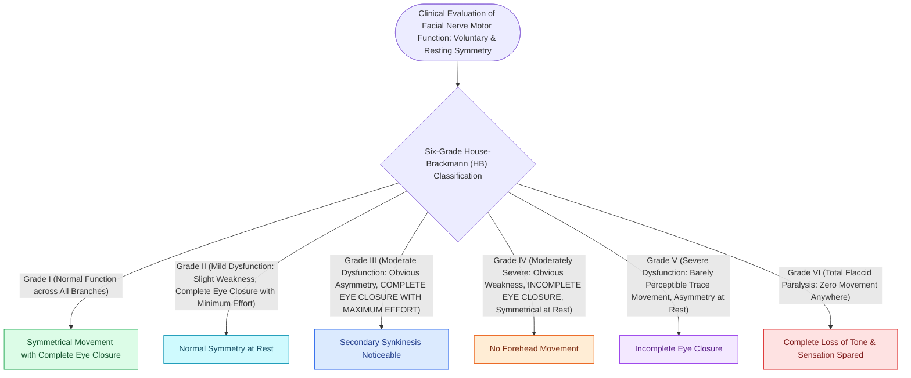

# The House-Brackmann facial nerve grading system standardizes facial paralysis severity

## Active Recall

> [!question]- What is the critical clinical distinction between House-Brackmann Grade III and Grade IV dysfunction?
> *Answer / Clinical Rationale*: **Grade III achieves complete eye closure with maximal effort**, whereas **Grade IV exhibits incomplete eye closure (lagophthalmos)**.

> [!question]- What House-Brackmann grade is assigned to a patient with resting facial asymmetry and only trace perceptible movement on effort?
> *Answer / Clinical Rationale*: **Grade V (Severe Dysfunction)**, which is defined by overt **resting facial asymmetry** (drooping oral commissure and effaced nasolabial fold), **incomplete eye closure (lagophthalmos)**, and only **barely perceptible trace voluntary motion** on maximal effort without synkinesis—distinguishing it from Grade IV (normal resting symmetry and tone) and Grade VI (complete flaccid paralysis with zero motion).

## Core Clinical & Mechanistic Principles
Adopted by the AAO-HNS in 1985, the **House-Brackmann (HB) Facial Nerve Grading System** is the universal international scale for quantifying facial nerve function and recovery from **Grade I (Normal)** to **Grade VI (Total Flaccid Paralysis)**.

### The Critical "Grade III vs IV" Eye Closure Watershed
- **Grade III**: The eye closes **COMPLETELY** with maximal effort.
- **Grade IV**: Eye closure is **INCOMPLETE** ([[Upper blepharoplasty requires precise skin crease marking to avoid lagophthalmos|lagophthalmos]] present; high corneal ulceration risk).

## Connected Concepts & Graph Traversal
- **Dynamic Smile Reanimation**: [[The masseteric nerve provides a dense motor donor for single-stage facial reanimation|Masseteric Nerve Transfer]]
- **Marginal Mandibular Nerve**: [[The marginal mandibular nerve courses deep to platysma over the facial vessels|Marginal Mandibular Nerve]]
- **Frontal Branch Landmark**: [[The sentinel vein marks the trajectory of the frontal branch of the facial nerve|Sentinel Vein & Frontal Branch]]
- **Erb's Point Sensory Nerve**: [[The great auricular nerve emerges at Erb's point and is vulnerable during rhytidectomy|Great Auricular Nerve]]
- **Cosmetic Neuromodulation**: [[Cosmetic botulinum toxin treats dynamic rhytids through presynaptic acetylcholine blockade|Botulinum Toxin]]
