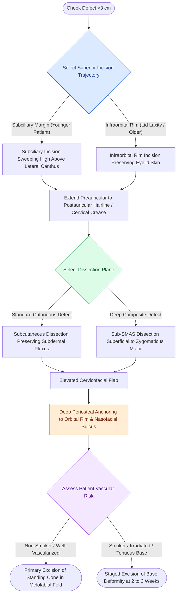

# The Mustarde cervicofacial rotation-advancement flap recruits cervical and preauricular tissue laxity to reconstruct large cheek and lower eyelid defects

## Active Recall

> [!question]- Why must the lateral incision of a cervicofacial flap be carried superior to the lateral canthus into the temporal crow's-feet rather than drifting inferiorly?
> *Answer / Clinical Rationale*: Carrying the incision **higher than the lateral palpebral fissure** prevents downward traction on the lateral canthus and lower eyelid. Inferior drift of the lateral incision establishes a downward-directed vector of wound contracture that causes **lateral lower eyelid retraction and ectropion**.

> [!question]- When is the standing cutaneous deformity at the base of a large cervicofacial flap intentionally left in place rather than excised primarily?
> *Answer / Clinical Rationale*: In patients with **ischemic risk factors (heavy tobacco smoking, prior radiation therapy, diabetes)**, maintaining the standing cutaneous deformity preserves the **subdermal vascular plexus and venous outflow** at the flap base during initial healing. It is then safely excised 2 to 3 weeks later under local anesthesia.

> [!question]- How does altering the pivot point position affect the kinematic movement of a cervicofacial flap?
> *Answer / Clinical Rationale*: Shifting the pivot point laterally on a line perpendicular to the vertical defect axis widens the flap base and converts pure rotational (pivotal) movement into **predominantly linear advancement**, transferring large amounts of cervical skin with less arcuate distortion.

## Core Clinical & Mechanistic Principles

The cervicofacial rotation-advancement flap (Mustarde / Esser flap) represents the workhorse regional reconstructive option for large ($>3\text{ cm}$) cutaneous and soft tissue defects of the medial, central, and lateral cheek, as well as composite lower eyelid-cheek defects. The flap mobilizes the substantial, redundant skin reservoir of the lateral preauricular cheek and superior neck, advancing and rotating it medially and superiorly into the defect.

### Incision Design & Geometric Kinematics
1. **Superior Incision Trajectory**:
   - For defects involving or adjacent to the lower eyelid, incisions are placed either in the **subciliary crease** (in younger patients with vigorous eyelid tone) or along the **inferior bony orbital rim** (in older patients or those with lid laxity to avoid sacrificing healthy eyelid skin).
   - The incision sweeps laterally and must be carried **higher than the lateral palpebral fissure** into the periorbital crow's-feet rhytids. A downward drift of this incision creates a gravitational vector that pulls down the lateral canthus, precipitating lateral ectropion.
2. **Preauricular and Cervical Extension**:
   - The incision turns sharply inferiorly into the preauricular crease, wraps around the earlobe, and follows one of two paths:
     - *Anterior Cervical Crease*: Extending into an anterior cervical skin fold provides maximum forward advancement and mobilization for medial defects.
     - *Postauricular Hairline*: Extending behind the ear into the mastoid sulcus and along the postauricular hairline maximizes scar camouflage, often configured as a modified bilobed flap.
3. **Rotational Kinematics**:
   - Standard rotation flaps require an arc radius $R = 2.5\text{ to }3 \times$ the defect diameter $D$.
   - As defect size increases, shifting the pivot point laterally widens the flap base and tip, transforming the motion from pure rotation into combined rotation-advancement with dominant medial translation.
   - Similar to [[MACS lift and SMAS plication provide vertical vector elevation via suspension purse-string sutures|vertical vector elevation]] in facial rejuvenation, high-anchored suspension neutralizes caudal wound pull.

### Tension Relief & Staged Ischemia Protocols
- **Back-Cuts & Burow Triangles**: To relieve arc tension along the peripheral circumference of the flap, a small back-cut, Z-plasty, or equalizing Burow triangle can be excised at the cervical base.
- **Management of Standing Cutaneous Deformity**:
  - Medial and upward transfer inevitably generates a standing cutaneous cone inferior and medial to the defect along the melolabial fold.
  - In healthy patients, this cone is excised primarily parallel to the melolabial crease.
  - In patients with vascular compromise (active tobacco smokers, irradiated beds, severe diabetes), the standing cone is **intentionally left intact** during the primary stage to maximize venous drainage and arterial inflow to the distal tip. Excision and final scar revision are performed 2 to 3 weeks later under local anesthesia once neovascularization has established.

## Connected Concepts & Graph Traversal
- **Curvilinear Rotational Mechanics**: [[Rotation flaps redistribute closing tension along a curvilinear arc of rotation|Rotation Flap Dynamics]]
- **Linear Vector Advancements**: [[Advancement flaps recruit adjacent tissue laxity along a linear vector without rotation|Advancement Flaps]]
- **Cervical Sensory Protection**: [[The great auricular nerve emerges at Erb's point and is vulnerable during rhytidectomy|Great Auricular Nerve Anatomy]]
- **Facial Perforator Territories**: [[Facial angiosomes and perforator choke zones determine cutaneous flap survival boundaries|Facial Angiosomes & Perforator Zones]]
- **Cervical Laxity Dynamics**: [[The Dedo classification categorizes cervical aging deformities based on skin laxity, submental fat, platysma banding, and skeletal morphology|Dedo Classification of Cervical Laxity]]
- **Marginal Nerve Danger**: [[The marginal mandibular nerve courses deep to platysma over the facial vessels|Marginal Mandibular Nerve Course]]
