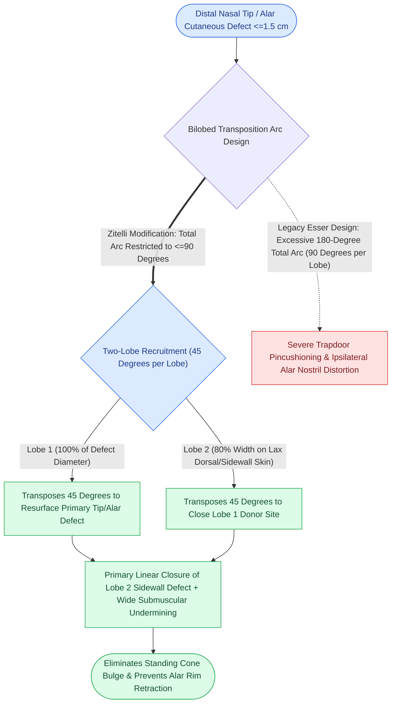

# The Zitelli bilobed flap restricts rotation to ninety degrees to prevent pincushioning

## Active Recall

> [!question]- What are the precise angular and dimensional parameters of a Zitelli bilobed flap?
> *Answer / Clinical Rationale*: **$45^\circ$ between primary defect and lobe 1**, and **$45^\circ$ between lobe 1 and lobe 2** (total arc $\le 90^\circ$). Lobe 1 is **$100\%$ of defect width**; Lobe 2 is **$80\text{–}85\%$ of defect width**.

> [!question]- What deformity occurs if a bilobed flap is designed with an excessive arc of rotation ($>100^\circ$)?
> *Answer / Clinical Rationale*: Severe **pincushioning (trapdoor deformity)**, standing cutaneous cones, and **[[Alar rim retraction requires non-anatomical contour grafts, batten grafts, or composite chondrocutaneous grafting based on the Gorney classification|alar rim retraction]] / nostril asymmetry**.

## Core Clinical & Mechanistic Principles
First introduced by Esser (1918) with a $180^\circ$ arc and refined by John Zitelli (1989), the **Zitelli Bilobed Flap** is the premier double-transposition flap for [[Interpolated melolabial flaps reconstruct nasal alar defects by bridging the alar crease to prevent blunting and trapdoor deformity|reconstructing]] defects of the **lower third of the nose (nasal tip, supratip, and alar lobule) measuring $\le 1.5\text{ cm}$**.

### Why Zitelli Restricted the Arc to $\le 90^\circ$
- **The $180^\circ$ Esser Failure**: The original $180^\circ$ rotation generated massive standing cones, high closing tension, and severe **"pincushioning" (trapdoor deformity)** that pulled and distorted the mobile alar margin.
- **The $90^\circ$ Zitelli Solution**: Restricting rotation to **$45^\circ + 45^\circ = 90^\circ$** recruits lax skin from the upper nasal dorsum and sidewall where tissue laxity is high, transferring tension horizontally without elevating the alar rim.
- **Burrow's Triangle Excision at Pivot Point**: The standing cutaneous cone (Burrow's triangle) excised at the pivot point between the primary defect and lobe 1 must be tailored with an **apex angle of approximately $30^\circ$** directed toward the alar groove to ensure flat transposition and prevent standing cone dog-ear deformities.

## Connected Concepts & Graph Traversal
- **Axial Forehead Alternative**: [[The paramedian forehead flap is an axial interpolated flap pedicled on the supratrochlear artery|Paramedian Forehead Flap]]
- **Relaxed Skin Lines**: [[Scar revision employs Z-plasty W-plasty and geometric broken line closure along relaxed skin tension lines|Relaxed Skin Tension Lines]]
- **Tripod Tip Mechanics**: [[The Anderson tripod theory governs nasal tip projection, rotation, and support dynamics|Anderson Tripod Theory]]
- **Facial Vascular Pedicle**: [[The facial artery and facial vein provide the primary vascular supply to the anterior face|Facial Artery Anatomy]]
- **Aesthetic Proportion Rules**: [[Goode's ratio and nasolabial angles define standard aesthetic nasal tip proportions|Nasal Aesthetic Proportions]]
- **Alar Flap Alternative**: [[Interpolated melolabial flaps reconstruct nasal alar defects by bridging the alar crease to prevent blunting and trapdoor deformity|Interpolated Melolabial Flap]]
