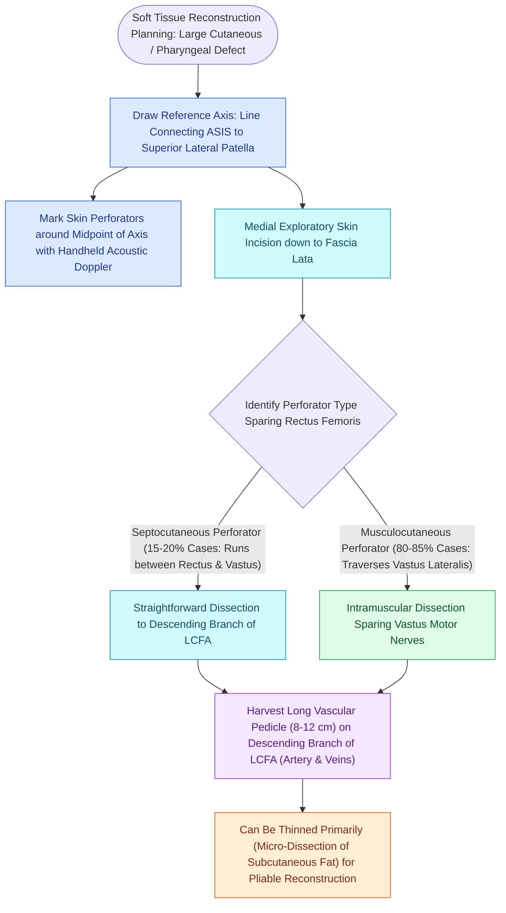

# The anterolateral thigh free flap provides versatile soft tissue volume based on the LCFA

## Active Recall

> [!question]- What is the axial arterial pedicle supplying the anterolateral thigh (ALT) flap?
> *Answer / Clinical Rationale*: The **descending branch of the lateral circumflex femoral artery (LCFA)**.

> [!question]- Between which two muscles of the thigh are the ALT cutaneous perforators typically located?
> *Answer / Clinical Rationale*: Between the **rectus femoris** and the **vastus lateralis** muscles.

## Core Clinical & Mechanistic Principles
First described by Song in 1984, the **Anterolateral Thigh (ALT) Free Flap** is the [[The facial artery and facial vein provide the primary vascular supply to the anterior face|primary]] workhorse soft-tissue flap in modern reconstructive surgery.

It is based on **septocutaneous or musculocutaneous perforators** arising from the **descending branch of the lateral circumflex femoral artery (LCFA)**.

### Harvest Anatomy & Landmarks
- A line is drawn from the **Anterior Superior Iliac Spine (ASIS)** to the **superolateral border of the patella**.
- The majority of cutaneous perforators cluster within a **$3\text{-cm}$ circle centered at the midpoint of this line**, exiting between the **rectus femoris** and **vastus lateralis** muscles.

## Connected Concepts & Graph Traversal
- **Bony Mandibular Reconstruction**: [[The fibula free flap provides vascularized cortical bone for composite mandibular reconstruction|Fibula Free Flap]]
- **Subscapular Composite Flap**: [[The subscapular system provides composite scapular bone and latissimus dorsi muscle flaps|Subscapular System]]
- **Recipient Facial Vessels**: [[The facial artery and facial vein provide the primary vascular supply to the anterior face|Facial Vessels]]
- **Scalp Defect Reconstruction**: [[Scalp laceration repair requires layered subgaleal and galeal closure with galeatomy to achieve tension-free closure|Scalp Reconstruction]]
- **Mandibular AO Principles**: [[Mandible fractures require anatomical reduction and load-sharing miniplate fixation along Champy lines of ideal osteosynthesis|Mandible Fracture Fixation]]
