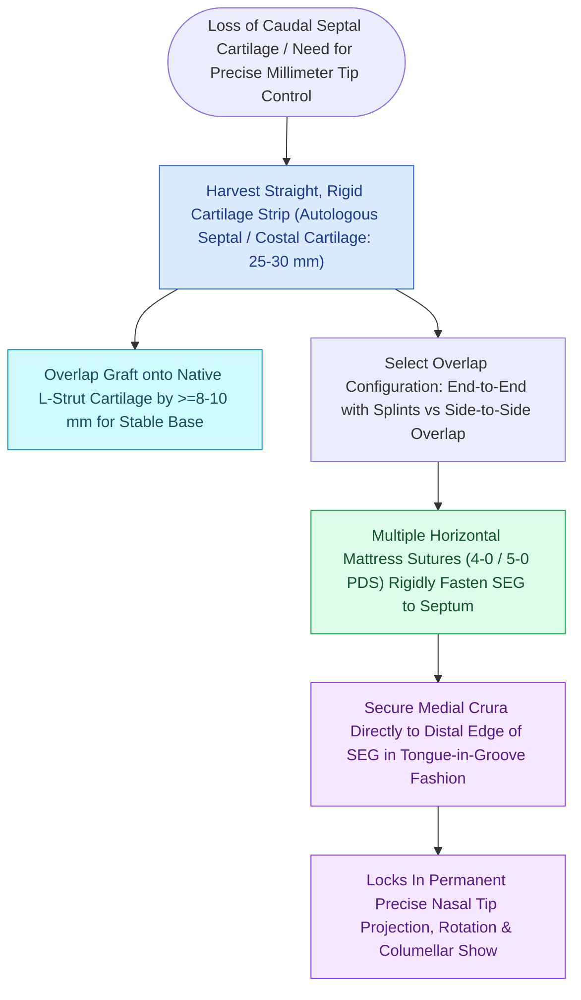

# The caudal septal extension graft controls tip projection and rotation via rigid septal overlap

## Active Recall

> [!question]- What is the principal mechanical difference between a caudal septal extension graft and a columellar strut?
> *Answer / Clinical Rationale*: A **septal extension graft is rigidly fixated to the native cartilaginous caudal septum**, providing an immovable platform that locks tip projection and rotation, whereas a **columellar strut floats** between the medial crura without septal anchor.

> [!question]- What suture material is preferred for securing a septal extension graft to the caudal septum?
> *Answer / Clinical Rationale*: **4-0 or 5-0 [[Monofilament versus braided absorbable and non-absorbable sutures have distinct tissue reactivity|Polydioxanone]] (PDS)** horizontal mattress sutures, providing long-term tensile support during fibrous union.

## Core Clinical & Mechanistic Principles
A **Caudal Septal Extension Graft (SEG)** is a rigid cartilage graft (harvested from quadrangular cartilage, costal cartilage, or irradiated homologous rib) that is **rigidly fixed to the caudal nasal septum with overlapping mattress sutures**, extending into the interdomal space to precisely dictate **nasal [[Goode's ratio and nasolabial angles define standard aesthetic nasal tip proportions|tip projection]], rotation, and shape**.

### Fixation Techniques: End-to-End vs Side-to-Side
- **Side-to-Side Overlap**: Most stable fixation; requires slight septal beveling to prevent asymmetric columellar deflection.
- **End-to-End Extended Spreader Sandwich**: SEG placed between bilateral extended [[Spreader grafts restore internal nasal valve patency and prevent inverted-V deformity|spreader grafts]] for perfect midline stability.

## Connected Concepts & Graph Traversal
- **Dynamic Tripod Theory**: [[The Anderson tripod theory governs nasal tip projection, rotation, and support dynamics|Anderson Tripod Theory]]
- **Columellar Strut Comparison**: [[Columellar strut grafts support the medial crural footplates to maintain tip projection|Columellar Strut Grafts]]
- **Lateral Crural Steal**: [[Lateral crural steal and overlay maneuvers dynamically modify tip rotation and projection|Lateral Crural Steal & Overlay]]
- **Aesthetic Nasal Proportions**: [[Goode's ratio and nasolabial angles define standard aesthetic nasal tip proportions|Goode's Ratio]]
- **Microtia Costal Donor**: [[Microtia reconstruction spans staged autologous costal cartilage frameworks and porous polyethylene implants|Costal Cartilage Source]]
