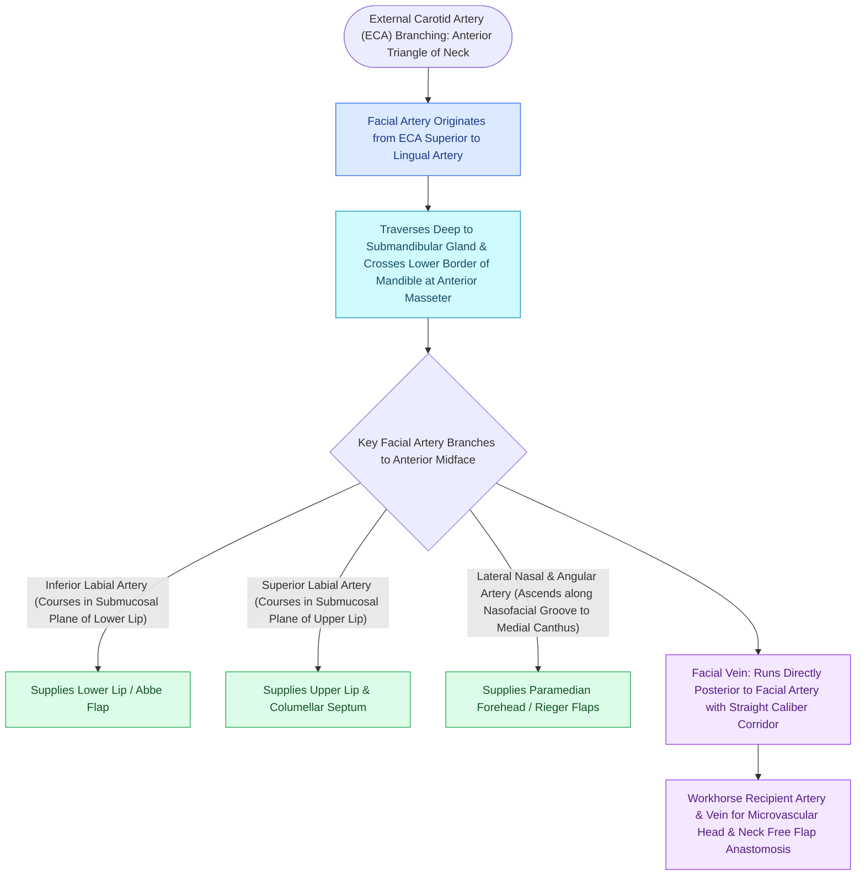

# The facial artery and facial vein provide the primary vascular supply to the anterior face

## Active Recall

> [!question]- What is the spatial relationship between the facial artery, anterior facial vein, and the marginal mandibular nerve at the mandible?
> *Answer / Clinical Rationale*: The facial artery lies **anterior and tortuous**; the facial vein lies **posterior and straight**; the **marginal mandibular nerve crosses superficial** to both vessels.

> [!question]- Where does the critical collateral anastomosis between the external and internal carotid systems occur on the midface?
> *Answer / Clinical Rationale*: At the **medial canthus**, where the **angular artery (ECA)** anastomoses with the **dorsal nasal and supratrochlear arteries (ICA / ophthalmic)**.

## Core Clinical & Mechanistic Principles
The **Facial Artery** (branch of the External Carotid Artery) and **Anterior Facial Vein** form the primary axial vascular axis supplying the soft tissues of the perioral, midfacial, and nasal regions.

### Key Anatomical Relationships
1. **Mandibular Crossing**: Crosses the inferior border of the mandible immediately anterior to the masseter muscle. The facial artery is **tortuous and deep to the platysma**, while the anterior facial vein runs **straight and posterior** to the artery.
2. **Nerve Relationship**: The **marginal mandibular branch of CN VII** crosses superficial to the facial vein and artery (see [[The marginal mandibular nerve courses deep to platysma over the facial vessels|Marginal Mandibular Nerve]]).
3. **Angular Artery Anastomosis**: The terminal angular artery anastomoses with the dorsal nasal artery (from the ophthalmic artery / Internal Carotid system) at the medial canthus, forming a critical ECA-ICA collateral bridge.

## Connected Concepts & Graph Traversal
- **Forehead Supratrochlear Supply**: [[The paramedian forehead flap is an axial interpolated flap pedicled on the supratrochlear artery|Supratrochlear Artery]]
- **Marginal Nerve Intersection**: [[The marginal mandibular nerve courses deep to platysma over the facial vessels|Marginal Mandibular Nerve]]
- **Free Flap Microvascular Anastomosis**: [[The anterolateral thigh free flap provides versatile soft tissue volume based on the LCFA|ALT Recipient Vessels]]
- **Fibula Flap Recipient**: [[The fibula free flap provides vascularized cortical bone for composite mandibular reconstruction|Fibula Recipient Anastomosis]]
- **Filler Vascular Occlusion**: [[Hyaluronic acid filler vascular occlusion requires immediate high-dose pulsed hyaluronidase to prevent skin necrosis and blindness|Filler Vascular Occlusion]]
