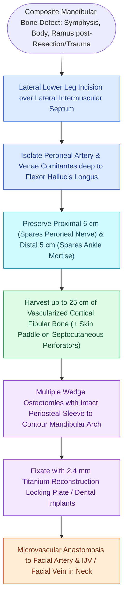

# The fibula free flap provides vascularized cortical bone for composite mandibular reconstruction

## Active Recall

> [!question]- What is the axial vascular supply of the osteocutaneous fibula free flap?
> *Answer / Clinical Rationale*: The **peroneal artery** and paired venae comitantes.

> [!question]- Why is the fibula free flap uniquely suited for functional dental rehabilitation?
> *Answer / Clinical Rationale*: Its **dense, thick bicortical bone** provides rigid structural stability capable of anchoring **endosseous dental implants** and withstanding masticatory bite forces.

## Core Clinical & Mechanistic Principles
The **[[Osteoradionecrosis of the mandible requires radical bony debridement and vascularized fibula free flap repair|Fibula Free Flap]] (FFF)** is the gold-standard vascularized bone flap for composite mandibular and maxillary reconstruction.

It is an osteoseptocutaneous flap supplied by the **peroneal artery** and its paired venae comitantes, providing up to **$25\text{ cm}$ of dense, bicortical bone**.

### Virtual Surgical Planning (VSP) & Fixation
- **CAD/CAM Cutting Guides**: 3D virtual surgical planning provides patient-specific cutting guides for precise osteotomies and pre-bent reconstruction plates.
- **Minimum Segment Length**: Segments must be **$\ge 1.5\text{–}2.0\text{ cm}$** to maintain adequate periosteal perfusion and avoid segment necrosis.

## Connected Concepts & Graph Traversal
- **Soft Tissue ALT Alternative**: [[The anterolateral thigh free flap provides versatile soft tissue volume based on the LCFA|Anterolateral Thigh Flap]]
- **Composite Scapula Flap**: [[The subscapular system provides composite scapular bone and latissimus dorsi muscle flaps|Subscapular Bone Flaps]]
- **Recipient Facial Vessels**: [[The facial artery and facial vein provide the primary vascular supply to the anterior face|Facial Recipient Vessels]]
- **Distal Fibula Preservation**: [[Preserving the distal five centimeters of the fibula prevents ankle instability and talar tilt|Distal Fibula Bone Anchor]]
- **Champy Monocortical Lines**: [[Champy lines of ideal osteosynthesis dictate monocortical miniplate fixation along mandibular tension zones|Champy Mandibular Fixation]]
