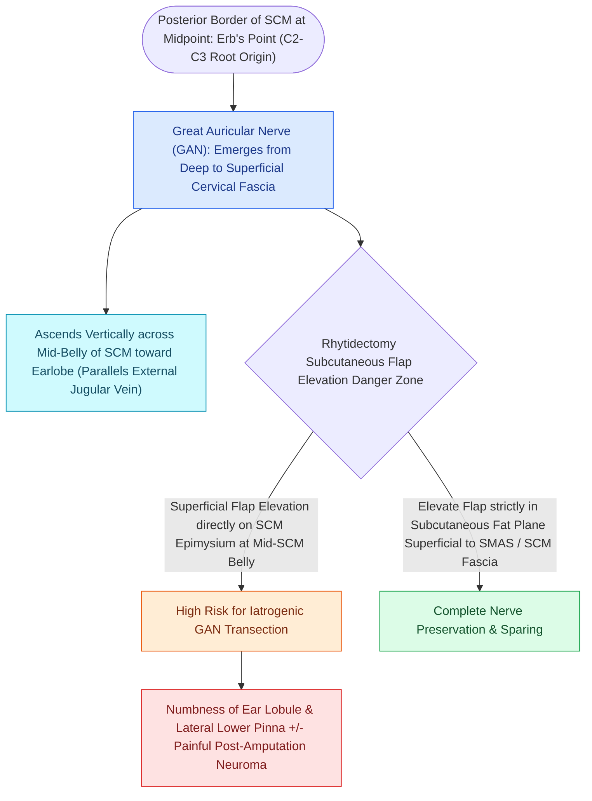

# The great auricular nerve emerges at Erb's point and is vulnerable during rhytidectomy

## Active Recall

> [!question]- What is the surface anatomical landmark for identifying the great auricular nerve at Erb's point?
> *Answer / Clinical Rationale*: Approximately **$6.5\text{ cm}$ inferior to the external auditory canal**, crossing the mid-belly/posterior border of the **sternocleidomastoid (SCM) muscle**.

> [!question]- What is the sensory distribution loss resulting from transection of the great auricular nerve?
> *Answer / Clinical Rationale*: Anesthesia of the **lower two-thirds of the auricle**, earlobe, and preauricular/parotid skin.

## Core Clinical & Mechanistic Principles
The **Great Auricular Nerve (GAN)** arises from the [[The Mustarde cervicofacial rotation-advancement flap recruits cervical and preauricular tissue laxity to reconstruct large cheek and lower eyelid defects|cervical]] plexus (**C2–C3**) and is the **most commonly injured nerve in rhytidectomy (facelift surgery)**, accounting for $>60\%$ of all nerve injuries:

- **McKinney's Point & Trajectory**:
  - The main trunk of the GAN crosses the middle third of the sternocleidomastoid muscle at **McKinney's point**: located exactly **$6.5\text{ cm}$ inferior to the bony external auditory canal (EAC)** along the mid-belly of the SCM.
  - It provides sensory innervation to the **lower two-thirds of the auricle**, the ear lobule, and the skin overlying the parotid gland and angle of the mandible.
  - The nerve branches into anterior and posterior divisions: the posterior division supplies the posterior auricle and lobule; the anterior division supplies parotid fascia and preauricular skin.

### Injury Mechanisms & Clinical Sequelae
1. **Transection or Entrapment**:
   - Occurs during elevation of the post-auricular skin flap over the SCM or during aggressive lateral platysmal suspension sutures.
2. **Clinical Manifestations**:
   - Complete numbness of the earlobe and lower auricle (causing difficulty wearing earrings or holding telephones).
   - **Painful Neuroma**: Transection can lead to a hypersensitive amputation neuroma triggered by neck turning or collar pressure.

## Connected Concepts & Graph Traversal
- **Marginal Mandibular Danger**: [[The marginal mandibular nerve courses deep to platysma over the facial vessels|Marginal Mandibular Nerve]]
- **Frontal Branch Sentinel Vein**: [[The sentinel vein marks the trajectory of the frontal branch of the facial nerve|Sentinel Vein & Frontal Branch]]
- **Facial Paralysis Staging**: [[The House-Brackmann facial nerve grading system standardizes facial paralysis severity|House-Brackmann Grading]]
- **Auricular Otoplasty Sensation**: [[Mustarde and Furnas sutures correct antihelical effacement and conchal hypertrophy|Prominent Ear Otoplasty]]
- **Microtia Reconstruction**: [[Microtia reconstruction spans staged autologous costal cartilage frameworks and porous polyethylene implants|Microtia Auricular Craft]]
- **Critical Safety / Danger Zone**: [[The Mustarde cervicofacial rotation-advancement flap recruits cervical and preauricular tissue laxity to reconstruct large cheek and lower eyelid defects|Mustarde Cervicofacial Flap]]
