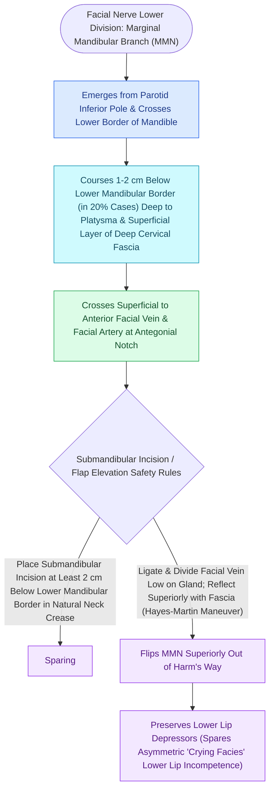

# The marginal mandibular nerve courses deep to platysma over the facial vessels

## Active Recall

> [!question]- How far below the inferior border of the mandible can the marginal mandibular nerve dip in a patient with an extended neck?
> *Answer / Clinical Rationale*: In up to **$20\%$ of patients**, the nerve dips **$1\text{–}2\text{ cm}$ below the inferior border of the mandible** posterior to where it crosses the facial artery.

> [!question]- What is Martin's maneuver for protecting the marginal mandibular nerve during submandibular dissection?
> *Answer / Clinical Rationale*: Ligating the **anterior facial vein** low on the submandibular gland and reflecting the superior venous stump upward with the overlying fascia, which sweeps the nerve superiorly out of the dissection field.

## Core Clinical & Mechanistic Principles
The **marginal mandibular branch of the facial nerve (CN VII)** innervates the depressors of the lower lip (**depressor anguli oris, depressor labii inferioris, and mentalis**). Its injury causes devastating lower lip asymmetry, characterized by inability to evert or depress the lower lip on the affected side during smiling ("crooked smile").

### Surgical Sparing Techniques
1. **Subplatysmal Dissection Plane**:
   - In [[Deep-plane rhytidectomy mobilizes the skin and SMAS as a composite flap across retaining ligaments|rhytidectomy]] and submandibular gland excision, dissecting strictly in the **subcutaneous plane** or remaining directly against the deep investing fascia avoids the nerve.
2. **Martin’s Maneuver (Facial Vein Elevation)**:
   - The marginal mandibular nerve crosses **superficial to the anterior facial vein** and facial artery.
   - Identifying the anterior facial vein at the inferior border of the submandibular gland, ligating it, and reflecting the superior stump upward with the fascia **automatically protects the nerve** within the elevated tissue cuff.

## Connected Concepts & Graph Traversal
- **Facial Vessels Landmark**: [[The facial artery and facial vein provide the primary vascular supply to the anterior face|Facial Artery and Vein]]
- **Great Auricular Nerve / Erb's Point**: [[The great auricular nerve emerges at Erb's point and is vulnerable during rhytidectomy|Great Auricular Nerve]]
- **Frontal Branch Sentinel Vein**: [[The sentinel vein marks the trajectory of the frontal branch of the facial nerve|Sentinel Vein & Frontal Branch]]
- **Dynamic Facial Reanimation**: [[The masseteric nerve provides a dense motor donor for single-stage facial reanimation|Masseteric Reanimation]]
- **Facial Paralysis Severity**: [[The House-Brackmann facial nerve grading system standardizes facial paralysis severity|House-Brackmann Staging]]
- **Critical Safety / Danger Zone**: [[The Mustarde cervicofacial rotation-advancement flap recruits cervical and preauricular tissue laxity to reconstruct large cheek and lower eyelid defects|Mustarde Cervicofacial Flap]]
