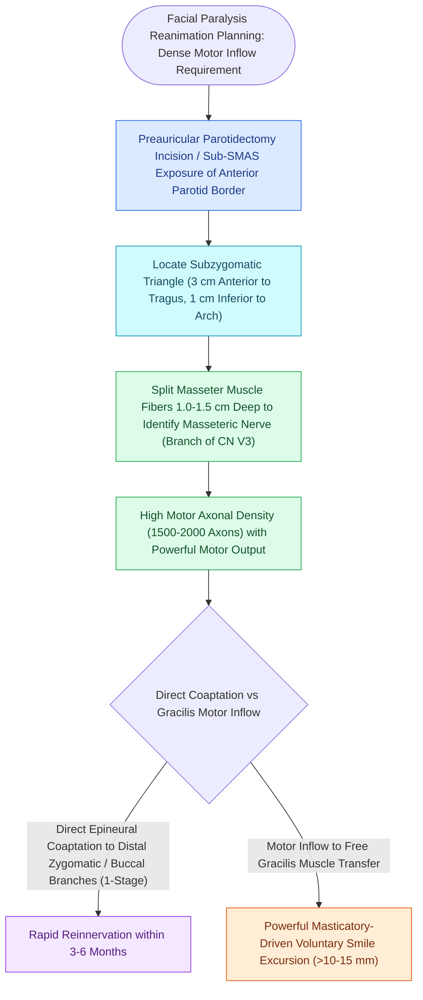

# The masseteric nerve provides a dense motor donor for single-stage facial reanimation

## Active Recall

> [!question]- Where is the nerve to the masseter anatomically identified during surgical dissection?
> *Answer / Clinical Rationale*: In the deep sub-masseteric plane, approximately **$1.0\text{ cm}$ inferior to the zygomatic arch and $1.5\text{ cm}$ anterior to the tragus**, emerging from the sigmoid notch of the mandible.

> [!question]- Why is the masseteric nerve superior to a [[Cross-facial nerve grafting provides coordinated spontaneous smile excursion in children|cross-facial nerve graft]] (CFNG) for single-stage smile restoration in adults?
> *Answer / Clinical Rationale*: It provides a **dense pure-motor axonal load** ($>1,500$ axons) with a very short distance to the target, achieving rapid, powerful excursion within 3 to 6 months, whereas CFNG in adults often yields weak, delayed excursion.

## Core Clinical & Mechanistic Principles
The **nerve to the masseter muscle (branch of CN V3)** is the premier donor nerve for dynamic facial reanimation, utilized either for **direct nerve transfer** to midfacial branches of CN VII or as the motor source for **free gracilis muscle transfer**.

### Neurotization Applications
1. **Direct Masseteric-to-Facial Transfer**:
   - Indicated in flaccid paralysis $<12\text{–}18\text{ months}$ with viable mimetic muscles.
   - Coapted directly to the zygomatic or buccal branches of the facial nerve.
2. **Motor Driver for Gracilis Free Flap**:
   - Provides powerful axonal drive to power a transplanted [[Free gracilis muscle transfer provides dynamic smile restoration in chronic facial paralysis|gracilis]] muscle in long-standing chronic paralysis ($>2\text{ years}$).

## Connected Concepts & Graph Traversal
- **House-Brackmann Classification**: [[The House-Brackmann facial nerve grading system standardizes facial paralysis severity|House-Brackmann Grading]]
- **Marginal Mandibular Danger**: [[The marginal mandibular nerve courses deep to platysma over the facial vessels|Marginal Mandibular Nerve]]
- **Frontal Branch Landmark**: [[The sentinel vein marks the trajectory of the frontal branch of the facial nerve|Sentinel Vein & Frontal Nerve]]
- **Trigeminal Motor Root**: [[Trigeminal neuralgia causes paroxysmal lancinating facial pain treated with carbamazepine and microvascular decompression|Trigeminal Nerve Pathophysiology]]
- **Botulinum Toxin Synkinesis**: [[Cosmetic botulinum toxin treats dynamic rhytids through presynaptic acetylcholine blockade|Botulinum Toxin for Synkinesis]]
