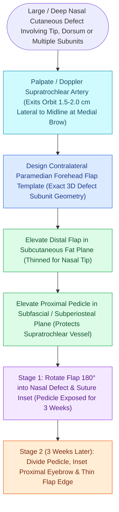

# The paramedian forehead flap is an axial interpolated flap pedicled on the supratrochlear artery

## Active Recall

> [!question]- What is the anatomical exit point and width of the vascular pedicle for a paramedian forehead flap?
> *Answer / Clinical Rationale*: The **supratrochlear artery** exits the superior medial orbit **$1.7\text{–}2.2\text{ cm}$ lateral to midline**. The pedicle base is designed **$1.2\text{–}1.5\text{ cm}$ wide** centered on the Doppler signal.

> [!question]- Why is a 3-stage paramedian forehead flap favored over a 2-stage flap for full-thickness nasal tip and alar defects?
> *Answer / Clinical Rationale*: The intermediate 2nd stage allows radical debulking of fat and precise structural cartilage grafting over a well-vascularized bed while the axial pedicle is still intact, producing a thin, rigid, aesthetically superior nasal contour.

## Core Clinical & Mechanistic Principles
The **Paramedian Forehead Flap (PFF)** is the gold-standard reconstructive modality for large ($>1.5\text{ cm}$), complex, or full-thickness defects of the nose. It is an **axial-pattern interpolated flap** supplied by the **supratrochlear artery**.

### 2-Stage vs 3-Stage Reconstructive Sequence
1. **2-Stage PFF**:
   - *Stage 1*: Harvest, inset into nasal defect, [[Three-stage paramedian forehead flap permits radical intermediate thinning and cartilage framework sculpting before pedicle division|pedicle]] bridges over normal skin.
   - *Stage 2 (3 weeks)*: Pedicle division, debulking of proximal flap, and final inset.
2. **3-Stage PFF (Menick Paradigm for Complex Defects)**:
   - *Stage 1*: Full-thickness harvest and inset.
   - *Stage 2 (3 weeks)*: Complete flap re-elevation, radical debulking of subcutaneous fat and scar, and **structural cartilage graft sculpting**.
   - *Stage 3 (6 weeks)*: Pedicle division and final inset.

## Connected Concepts & Graph Traversal
- **Local Bilobed Flap Alternative**: [[The Zitelli bilobed flap restricts rotation to ninety degrees to prevent pincushioning|Zitelli Bilobed Flap]]
- **Facial Vascular Tree**: [[The facial artery and facial vein provide the primary vascular supply to the anterior face|Facial Artery Vascular Tree]]
- **Tip Support Dynamics**: [[The Anderson tripod theory governs nasal tip projection, rotation, and support dynamics|Anderson Tripod Theory]]
- **Scalp Galeal Mechanics**: [[Scalp laceration repair requires layered subgaleal and galeal closure with galeatomy to achieve tension-free closure|Scalp Galeal Layers]]
- **Total Nasal Reconstruction**: [[Total nasal reconstruction requires three-layer structural restoration of lining, cartilage, and cover|Total Nasal Reconstruction]]
- **Aesthetic Subunit Application**: [[Forehead aesthetic subunit reconstruction divides the forehead into midline, paramedian, and lateral zones to optimize scar camouflage and brow symmetry|Forehead Aesthetic Subunits]]
- **Staged Execution Protocol**: [[Three-stage paramedian forehead flap permits radical intermediate thinning and cartilage framework sculpting before pedicle division|Three-Stage PMFF Execution]]
