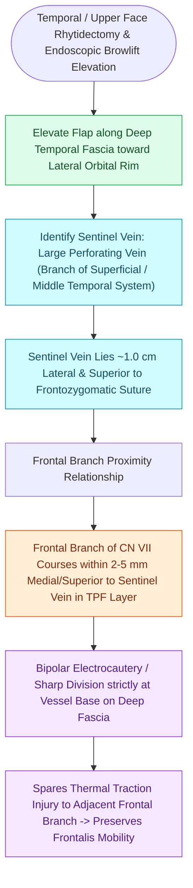

# The sentinel vein marks the trajectory of the frontal branch of the facial nerve

## Active Recall

> [!question]- Where is the sentinel vein located, and what is its surgical significance in endoscopic brow lifting?
> *Answer / Clinical Rationale*: Located **$\sim 1.0\text{ cm}$ lateral to the zygomaticofrontal suture line**. It serves as an immediate warning landmark that the **frontal branch of the facial nerve** is running in the overlying tissue just superior and medial to the vein.

> [!question]- Why should monopolar electrocautery be avoided when coagulating the sentinel vein?
> *Answer / Clinical Rationale*: Monopolar current can conduct thermally and electrically to the adjacent frontal branch in the sub-TPF layer, causing thermal neuropraxia or permanent paralysis of the frontalis muscle.

## Core Clinical & Mechanistic Principles
During endoscopic brow and temple dissection, the **Sentinel Vein (medial zygomaticotemporal vein)** is a constant, prominent emissary vein that connects the deep pterygoid venous plexus with the superficial temporal [[The House-Brackmann facial nerve grading system standardizes facial paralysis severity|system]].

It serves as the **single most reliable intraoperative vascular landmark for the frontal (temporal) branch of the facial nerve (CN VII)**.

### Navigational Rules in the Temple
- When dissecting in the temporal pocket over the deep temporal fascia proper, encountering the sentinel vein signals that the **frontal branch of the facial nerve is less than $5\text{–}6\text{ mm}$ away in the overlying superficial flap**.
- The vein should be isolated, cauterized with fine **bipolar forceps**, and sharply divided, keeping all dissection strictly on the deep fascia.

## Connected Concepts & Graph Traversal
- **Marginal Mandibular Nerve**: [[The marginal mandibular nerve courses deep to platysma over the facial vessels|Marginal Mandibular Nerve]]
- **Great Auricular Nerve / Erb's Point**: [[The great auricular nerve emerges at Erb's point and is vulnerable during rhytidectomy|Great Auricular Nerve]]
- **Facial Paralysis Staging**: [[The House-Brackmann facial nerve grading system standardizes facial paralysis severity|House-Brackmann Staging]]
- **Scalp Galeal Dissection**: [[Scalp laceration repair requires layered subgaleal and galeal closure with galeatomy to achieve tension-free closure|Scalp Subgaleal Dissection]]
- **Forehead Flap Pedicle**: [[The paramedian forehead flap is an axial interpolated flap pedicled on the supratrochlear artery|Supratrochlear Pedicle]]
- **Anatomical Foundation**: [[Forehead reconstruction requires subcutaneous or subfrontalis dissection planes to prevent motor paralysis of the frontalis muscle|Subfrontalis Dissection Plane]]
