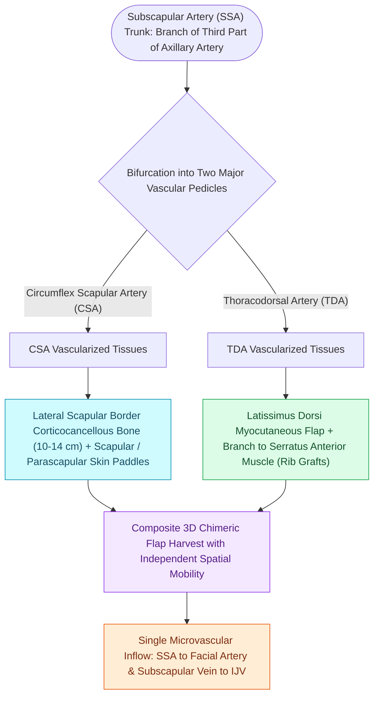

# The subscapular system provides composite scapular bone and latissimus dorsi muscle flaps

## Active Recall

> [!question]- What are the two primary terminal branches of the subscapular artery?
> *Answer / Clinical Rationale*: The **circumflex scapular artery** and the **thoracodorsal artery**.

> [!question]- What vascular branch supplies the vascularized bone of the scapular tip?
> *Answer / Clinical Rationale*: The **angular branch of the thoracodorsal artery** (or direct branch from circumflex scapular artery).

## Core Clinical & Mechanistic Principles
The **subscapular arterial system** provides the greatest versatility in composite 3D head and neck [[The fibula free flap provides vascularized cortical bone for composite mandibular reconstruction|reconstruction]], allowing simultaneous harvest of **bone (lateral scapular border / tip), multiple skin paddles (scapular/parascapular), and muscle (latissimus dorsi, serratus anterior)** on a single vascular tree.

### Primary Indications in Complex Maxillofacial Surgery
- **Complex Orbital-Maxillary Defects**: Reconstructing extensive orbital exenteration defects where the **lateral scapular bone** forms the palate/alveolus, the **latissimus dorsi muscle** obliterates the large skull base dead space, and a **scapular skin paddle** covers external facial skin.
- **Independent 3D Inset**: Because each tissue component is on a separate branch of the subscapular tree, they can be oriented independently in 3D space.

## Connected Concepts & Graph Traversal
- **Fibula Free Flap Comparison**: [[The fibula free flap provides vascularized cortical bone for composite mandibular reconstruction|Fibula Free Flap]]
- **ALT Soft Tissue Flap**: [[The anterolateral thigh free flap provides versatile soft tissue volume based on the LCFA|Anterolateral Thigh Flap]]
- **Recipient Facial Vessels**: [[The facial artery and facial vein provide the primary vascular supply to the anterior face|Facial Artery and Vein]]
- **Mandibular AO Principles**: [[Mandible fractures require anatomical reduction and load-sharing miniplate fixation along Champy lines of ideal osteosynthesis|Mandible Fracture Fixation]]
- **Anatomical Foundation**: [[Chimeric free flaps combine independent bone, muscle, and skin paddles on a common vascular branch|Chimeric Free Tissue Transfer]]
