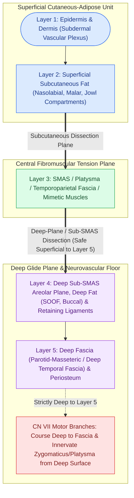

# The superficial musculoaponeurotic system divides facial fat into distinct surgical planes

## Active Recall

> [!question]- What fascial layer represents the cranial continuation of the facial SMAS in the temporal region?
> *Answer / Clinical Rationale*: The **temporoparietal fascia (TPF)** (also known as the superficial temporal fascia).

> [!question]- In what anatomical plane relative to the SMAS and deep fascia do the branches of the facial nerve travel in the cheek?
> *Answer / Clinical Rationale*: Facial nerve branches travel **deep to the SMAS and deep to the parotid-masseteric fascia**, innervating the mimetic muscles from their deep undersurface (with the exception of levator anguli oris, buccinator, and mentalis).

## Core Clinical & Mechanistic Principles
First described by Mitz and Peyronie in 1976, the **Superficial Musculoaponeurotic System (SMAS)** is a continuous, viscoelastic, fibromuscular network that invests the mimetic facial muscles and connects them to the overlying dermis. Surgical mobilization of this layer in [[High-SMAS rhytidectomy extends dissection above the zygomatic arch to rejuvenate the midface|high-SMAS rhytidectomy]] or [[MACS lift and SMAS plication provide vertical vector elevation via suspension purse-string sutures|SMAS plication]] repositions ptotic facial soft tissues along durable fascial vectors. Anatomically, the SMAS divides the subcutaneous adipose layer into **superficial fat compartments** and **deep fat compartments**.

### Fascial Continuity & Layer Dynamics
- **Superior Continuity**: The SMAS is continuous superiorly with the **temporoparietal fascia (TPF / superficial temporal fascia)** in the temporal region and the **galea aponeurotica** in the scalp.
- **Inferior Continuity**: The SMAS transitions seamlessly inferiorly over the mandibular border into the **platysma muscle** in the neck.
- **Deep Division**: The SMAS separates superficial subcutaneous fat from the **deep facial spaces** (pre-masseteric space, pre-zygomatic space) and the deep investing parotid-masseteric fascia.

### Facial Nerve Protection Rule
- All major branches of the **facial nerve (CN VII)** travel **deep to the deep investing fascia (parotid-masseteric fascia and deep cervical fascia)** until they emerge from their undersurface to innervate the mimetic muscles.
- Operating in the **sub-SMAS plane** is oncologically and aesthetically safe as long as dissection remains superficial to the deep investing fascia.

## Connected Concepts & Graph Traversal
- **Retaining Ligaments**: [[Facial retaining ligaments require surgical release to mobilize ptotic midface tissues|Facial Retaining Ligaments]]
- **Deep-Plane Surgery**: [[Deep-plane rhytidectomy mobilizes the skin and SMAS as a composite flap across retaining ligaments|Deep-Plane Rhytidectomy]]
- **Temporal Nerve Danger**: [[Pitanguy's line defines the danger zone for the frontal branch of the facial nerve|Frontal Branch of Facial Nerve]]
- **Neck Continuation**: [[Corset platysmaplasty and lateral suspension restore the youthfulness of the cervicomental angle|Cervicoplasty & Platysma]]
- **Surgical Plane Foundation**: [[Cheek reconstruction employs deep SMAS plane elevation superficial to the zygomaticus major to restore volume contour defects while preserving the facial nerve|Deep SMAS Plane Cheek Reconstruction]]
