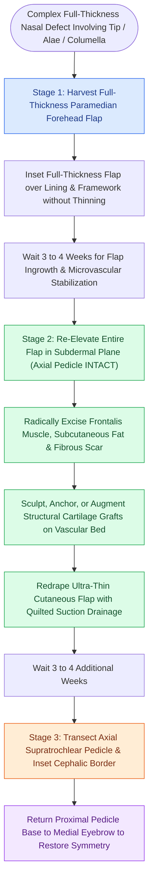

# Three-stage paramedian forehead flap permits radical intermediate thinning and cartilage framework sculpting before pedicle division

## Active Recall

> [!question]- Why is aggressive primary thinning of a paramedian forehead flap hazardous during Stage 1 of complex full-thickness nasal repairs?
> *Answer / Clinical Rationale*: In full-thickness repairs, the distal flap is inset over newly created mucosal lining flaps and avascular structural cartilage grafts. Aggressive primary debulking of frontalis muscle and deep fat strips away the robust microvascular plexus, creating high risks of **distal ischemic necrosis, cartilage graft infection, and construct breakdown**, particularly in smokers or irradiated beds.

> [!question]- What distinct surgical maneuvers occur during Stage 2 (the intermediate stage) of a three-stage paramedian forehead flap?
> *Answer / Clinical Rationale*: At **3 to 4 weeks post-transfer**, the entire cutaneous flap is **completely re-elevated off the nasal bed in the subdermal plane while preserving the intact proximal supratrochlear vascular pedicle**. Frontalis muscle, subcutaneous fat, and dense intervening fibrous scar are radically excised. Structural cartilage grafts (alar battens, columellar struts, tip grafts) are carved, repositioned, or added directly onto the fully revascularized recipient bed before redraping the ultra-thin cutaneous flap.

> [!question]- When is a three-stage paramedian forehead flap specifically indicated over a traditional two-stage transfer?
> *Answer / Clinical Rationale*: It is indicated for **full-thickness multi-subunit nasal defects**, defects requiring **extensive 3D cartilage framework reconstruction (tip, alae, columella)**, patients with **thick, sebaceous nasal skin**, active smokers, and compromised recipient beds where primary thinning carries an unacceptable risk of ischemic loss.

## Core Clinical & Mechanistic Principles
The paramedian forehead flap is the premier reconstructive modality for major nasal defects. While the classic two-stage procedure remains highly effective for superficial or medium-depth defects, complex full-thickness reconstructions involving multiple aesthetic subunits and delicate 3D contours (such as the nasal tip, alar rims, and columella) are vulnerable to bulkiness, contour blunting, and ischemic complications. The three-stage forehead flap, championed by Menick and Baker, fundamentally decouples tissue transfer from structural contouring, prioritizing [[Skin graft bolsters and negative pressure wound therapy optimize graft bed inosculation|graft bed vascularization]] and tissue survival.

### The Inherent Dilemma of the Two-Stage Transfer
In a standard two-stage paramedian forehead flap:
1. **Compromise in Stage 1**: If the surgeon thins the distal flap aggressively to recreate delicate nasal skin, the subdermal plexus may become ischemic when draped across avascular cartilage grafts or newly transposed mucosal lining flaps. If the flap is left thick, it heals with dense, disorganized fibroadipose scar tissue.
2. **Compromise in Stage 2 (Pedicle Division)**: At 3 weeks, when the pedicle is severed, the axial supratrochlear blood supply is completely disconnected. Attempting radical debulking of deep scar and muscle at this exact moment leaves the newly inset flap reliant solely on peripheral wound margins, creating significant risks of edge necrosis, delayed healing, or persistent bulky trapdoor deformities.

### Operative Technique Across the Three Stages
- **Stage 1 (Transfer & Preliminary Reconstruction)**:
  - Axial supratrochlear pedicle ($1.2\text{–}1.5\text{ cm}$ wide base) is centered over the Doppler signal at the medial orbital rim.
  - The flap is elevated full-thickness, incorporating skin, subcutaneous fat, and frontalis muscle.
  - Internal lining (septal hinge flaps or vestibular flaps) and baseline skeletal framework (cantilever dorsal graft or columellar strut) are assembled.
  - Flap is inset without thinning, securing robust arterial inflow and venous outflow.
- **Stage 2 (Intermediate Thinning & Sculpting at 3–4 Weeks)**:
  - The entire nasal portion of the flap is incised along its peripheral borders and elevated off the recipient bed in the delicate subdermal plane.
  - **The supratrochlear pedicle is left completely connected and undisturbed**, maintaining vigorous axial arterial perfusion.
  - The thick sheet of frontalis muscle and fibroadipose scar is radically excised down to the dermis.
  - Because the recipient bed is now fully revascularized, additional structural cartilage grafts (alar battens, lateral crural struts, Peck or Sheen tip cap grafts) can be sculpted and anchored with 5-0 PDS.
  - The thinned skin paddle is redraped over the crisp cartilage scaffold and secured with fine perimeter and quilting sutures.
- **Stage 3 (Pedicle Division & Inset at 6–8 Weeks)**:
  - The bridging pedicle is transected.
  - The superior inset at the rhinion and medial canthus is sculpted and inset with precise subdermal sutures.
  - The proximal pedicle base is converted into an inverted triangle, the glabellar donor scar is excised and widely undermined, and the proximal pedicle is returned to restore the anatomical position and height of the medial eyebrow.

## Connected Concepts & Graph Traversal
- **Axial Workhorse Overview**: [[The paramedian forehead flap is an axial interpolated flap pedicled on the supratrochlear artery|Paramedian Forehead Flap]]
- **Trilaminar Nasal Loss**: [[Total nasal reconstruction requires three-layer structural restoration of lining, cartilage, and cover|Total Nasal Reconstruction]]
- **Tip Projection Dynamics**: [[The Anderson tripod theory governs nasal tip projection, rotation, and support dynamics|Anderson Tripod Theory]]
- **Cartilage Warping Dynamics**: [[Costal cartilage harvest and concentric carving prevent structural graft warping in revision rhinoplasty|Costal Cartilage Carving]]
- **Vascular Perfusion Physics**: [[Facial angiosomes and perforator choke zones determine cutaneous flap survival boundaries|Facial Angiosomes & Choke Zones]]
- **Aesthetic Subunit Mandate**: [[Gonzalez-Ulloa facial aesthetic subunits guide complete subunit reconstruction|Facial Aesthetic Subunits]]
