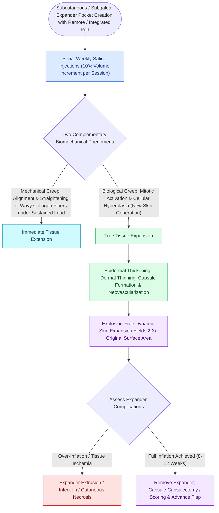

# Tissue expansion biomechanics generate vascularized skin for large pediatric and scalp defects

## Active Recall

> [!question]- What histological change occurs in the epidermis versus the dermis during prolonged tissue expansion?
> *Answer / Clinical Rationale*: The **epidermis thickens** (increased mitotic rate and hyperkeratosis), whereas the **dermis thins significantly** with fragmented elastic fibers.

> [!question]- What is the difference between mechanical creep and biological creep?
> *Answer / Clinical Rationale*: **Mechanical creep** is immediate physical deformation from fluid extrusion and fiber realignment, while **biological creep** is true new tissue generation through stretch-induced cellular mitosis.

## Core Clinical & Mechanistic Principles
**Tissue Expansion** exploits the skin’s biological response to sustained mechanical stretch, generating new **histologically matched, sensation-preserved, hair-bearing skin** to [[Scalp local flap design exploits loose temporoparietal tissue laxity and galeal scoring to reconstruct rigid vertex defects|reconstruct]] large scalp defects, congenital melanocytic nevi, and burn scar contractures.

### Expander Selection & Inflation Protocol
- **Expander Sizing**: Expander base area should be **$2.5\text{ to }3\text{ times}$ the surface area of the defect**.
- **Inflation Schedule**: Weekly sterile saline injections ($10\text{–}15\%$ of expander volume) until capillary refill blanches, stopping if pain occurs; full expansion requires $8\text{–}12\text{ weeks}$.

## Connected Concepts & Graph Traversal
- **Scalp Anatomy**: [[Scalp reconstruction requires galeal score incisions and large rotational pinwheel flaps|Scalp Reconstruction]]
- **Tissue Biomechanics**: [[Relaxed skin tension lines minimize scar hypertrophy along perpendicular muscular vectors|Biomechanics & Creep]]
- **Microtia Expansion**: [[Microtia autologous costal cartilage framework stages balance four-stage Brent and two-stage Nagata reconstruction protocols|Microtia Skin Pocket]]
- **Adjunct Coverage Technique**: [[Calvarial bone denuded of periosteum requires outer table burring to diploic bone or vascularized flap coverage to prevent osteonecrosis|Calvarial Outer Table Burring]]
- **Anatomical Foundation**: [[Scalp local flap design exploits loose temporoparietal tissue laxity and galeal scoring to reconstruct rigid vertex defects|Scalp Local Flap Design]]
