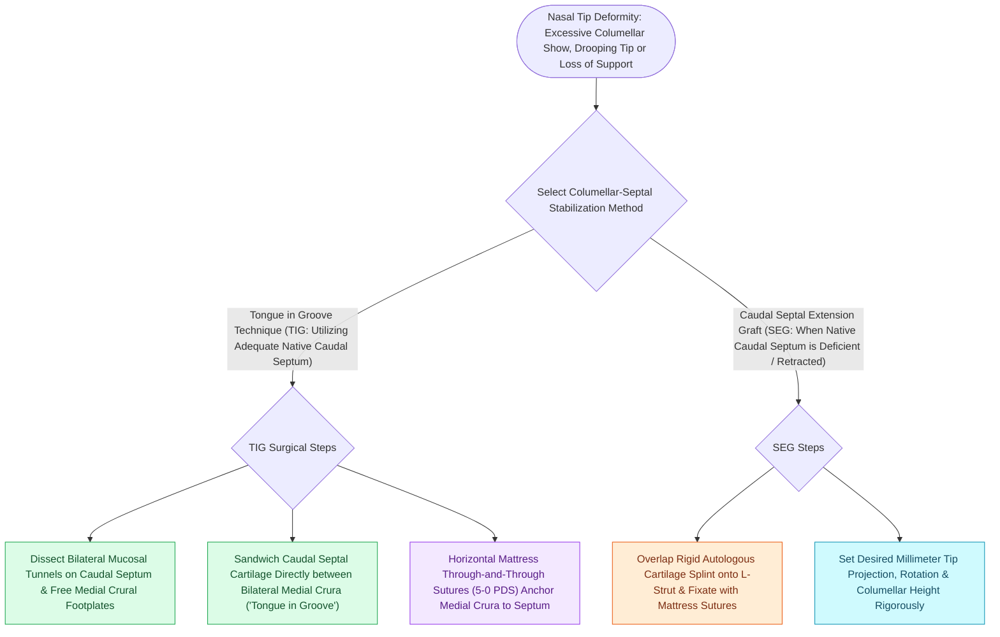

# Tongue-in-groove and septal extension grafts provide rigid columellar and tip stabilization

## Active Recall

> [!question]- How does a tongue-in-groove maneuver correct a hanging columella?
> *Answer / Clinical Rationale*: It secures the medial crura higher and deeper onto the caudal septum, tucking the redundant columellar skin and cartilage superiorly.

> [!question]- Why is a septal extension graft favored over a floating [[Columellar strut grafts support the medial crural footplates to maintain tip projection|columellar strut]] in thick-skinned revision rhinoplasty?
> *Answer / Clinical Rationale*: A floating columellar strut can displace or buckle under the heavy contracture forces of a thick skin envelope, whereas an **SEG is rigidly fixed to the septal bedrock**, providing unyielding projection and rotation.

## Core Clinical & Mechanistic Principles
Loss of nasal tip support postoperatively leads to progressive tip ptosis, loss of projection, and airway compromise. **Tongue-in-groove (TIG)** and **Septal Extension Grafts (SEG)** provide rigid structural fixation of the nasal tip directly to the caudal septum.

### Clinical Indications & Nuances
1. **Tongue-in-Groove (TIG)**:
   - Indicated when native caudal septal length is adequate.
   - Eliminates columellar show, corrects hanging columella, and prevents late tip drop.
2. **Septal Extension Graft (SEG)**:
   - Indicated in short caudal septums, revision rhinoplasty, or thick Asian/Mestizo skin envelopes requiring powerful projection.
   - End-to-end (with batten) or side-to-side overlap to the caudal septum using 4-0 [[Monofilament versus braided absorbable and non-absorbable sutures have distinct tissue reactivity|PDS]].

## Connected Concepts & Graph Traversal
- **Tripod Theory**: [[The Anderson tripod theory governs nasal tip projection, rotation, and support dynamics|Anderson Tripod Theory]]
- **Dynamic Maneuvers**: [[Lateral crural steal and overlay maneuvers dynamically modify tip rotation and projection|Lateral Crural Steal & Overlay]]
- **Deformity Prevention**: [[Pollybeak deformities arise from cartilaginous over-projection or supratip soft tissue fibrosis|Pollybeak Deformity]]
- **Anatomical Foundation**: [[Cephalic trim of lower lateral cartilages must preserve at least six millimeters of lateral crus|Cephalic Trim 6-mm Rule]]
- **Surgical Craft**: [[Spreader grafts restore internal nasal valve patency and prevent inverted-V deformity|Spreader Grafts]]
