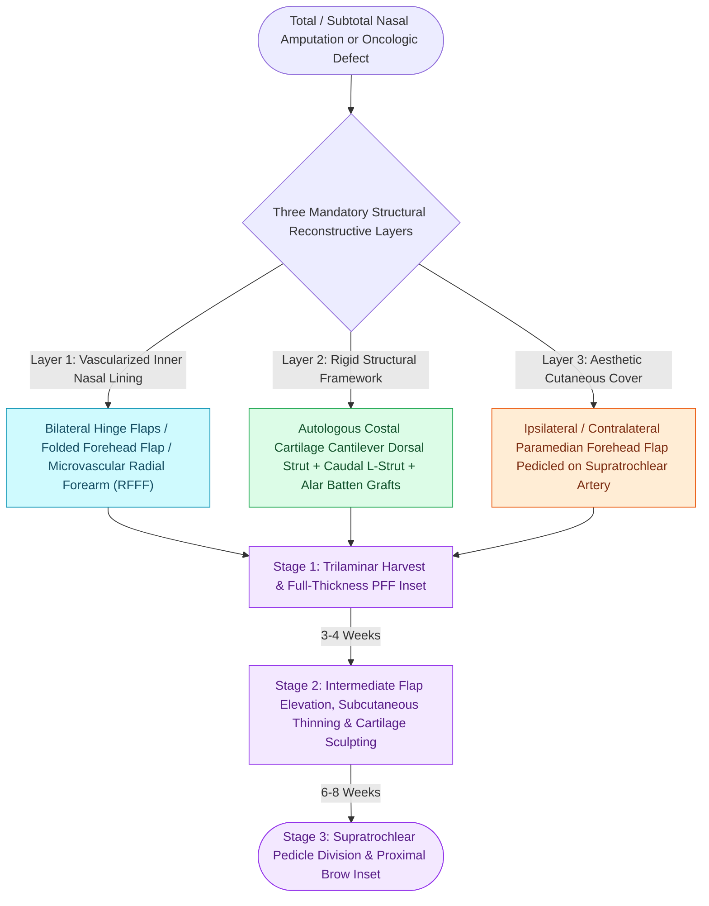

# Total nasal reconstruction requires three-layer structural restoration of lining, cartilage, and cover

## Active Recall

> [!question]- What three distinct anatomical layers must be independently reconstructed in a full-thickness nasal defect?
> *Answer / Clinical Rationale*: (1) **Internal Mucosal Lining**, (2) **Middle Cartilaginous/Bony Framework**, and (3) **External Cutaneous Cover**.

> [!question]- What microvascular free flap is most commonly utilized to provide vascularized inner mucosal lining in total rhinectomy defects?
> *Answer / Clinical Rationale*: The **Radial Forearm Free Flap (RFFF)**, chosen for its ultra-thin, pliable skin paddle that can be folded into bilateral nasal vaults.

## Core Clinical & Mechanistic Principles
Reconstructing full-thickness total or subtotal nasal [[The radial forearm free flap provides thin, pliable fasciocutaneous tissue for oral and pharyngeal defects|defects]] (following trauma or oncologic rhinectomy) requires independent anatomical restoration of **all three structural layers: Internal Mucosal Lining, Middle Cartilage/Bone Framework, and External Cutaneous Cover**.

### The Three-Stage Paramedian Forehead Flap Protocol (Menick)
1. **Stage 1 (Harvest & Inset)**: Elevate full-thickness PFF; inset over lining and framework.
2. **Stage 2 (Intermediate Debulking at 3–4 Weeks)**: Elevate entire flap off framework; sculpt subcutaneous fat; place additional structural cartilage.
3. **Stage 3 (Pedicle Division at 6–8 Weeks)**: Divide supratrochlear pedicle; inset proximal eyebrow base.

## Connected Concepts & Graph Traversal
- **Cover Flap**: [[The paramedian forehead flap is an axial interpolated flap pedicled on the supratrochlear artery|Paramedian Forehead Flap]]
- **Rib Framework**: [[Costal cartilage harvest and concentric carving prevent structural graft warping in revision rhinoplasty|Costal Cartilage Harvest]]
- **🔗 Lining Free Flap (Head and Neck)**: [[The radial forearm free flap provides thin, pliable fasciocutaneous tissue for oral and pharyngeal defects|Radial Forearm Free Flap]]
- **Diagnostic Evaluation**: [[Rieger dorsal nasal rotation advancement flaps reconstruct defects of the nasal dorsum and tip|Rieger Dorsal Nasal Flap]]
- **Trilaminar Reconstruction Framework**: [[Nasal lining reconstruction employs bipedicled vestibular, ipsilateral or contralateral septal mucoperichondrial hinge flaps, and turbinate flaps to prevent cicatricial airway stenosis|Nasal Lining Reconstruction]]
