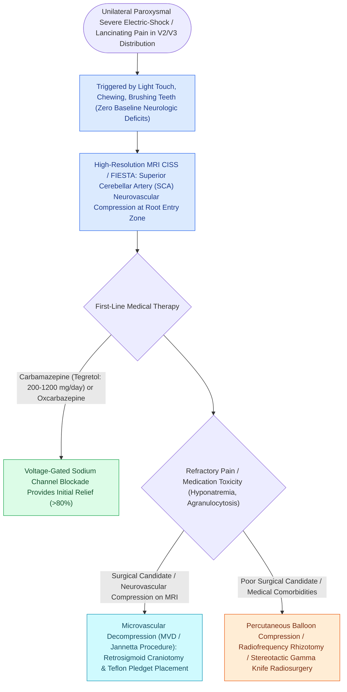

# Trigeminal neuralgia causes paroxysmal lancinating facial pain treated with carbamazepine and microvascular decompression

## Active Recall

> [!question]- What is the first-line medication for the treatment of classic trigeminal neuralgia?
> *Answer / Clinical Rationale*: **Carbamazepine** (or Oxcarbazepine), a voltage-gated sodium channel blocker.

> [!question]- What is the most common offending blood vessel compressing the trigeminal nerve root entry zone in classic trigeminal neuralgia?
> *Answer / Clinical Rationale*: The **Superior Cerebellar Artery (SCA)**.

## Core Clinical & Mechanistic Principles
**Trigeminal Neuralgia (Tic Douloureux)** is a severe neuropathic [[The masseteric nerve provides a dense motor donor for single-stage facial reanimation|facial]] pain disorder characterized by paroxysmal, electric shock-like, stabbing pain in the distribution of one or more divisions of the **trigeminal nerve (CN V2 and V3 most common, V1 in $<5\%$ )**:
- **Neurovascular Compression Etiology (Classic TN)**:
  - Pulsatile arterial loop compression—most commonly the **Superior Cerebellar Artery (SCA)** or Anterior Inferior Cerebellar Artery (AICA)—impinging on the trigeminal root entry zone (REZ) at the pons.
  - Causes focal demyelination of sensory axons, generating **ephaptic cross-talk (short-circuiting)** between non-painful tactile $A\beta$ fibers and nociceptive $C$ fibers.
- **Clinical Hallmarks**:
  - Unilateral, severe, sharp, lancinating pain lasting from fractions of a second to 2 minutes.
  - Triggered by light, non-noxious tactile stimuli: chewing, talking, brushing teeth, shaving, smiling, or a light breeze touching the face (**trigger zones**).
  - Normal neurological examination (absence of baseline sensory deficit).
- **Medical & Surgical Therapeutic Ladder**:
  1. **First-Line Pharmacotherapy**: **Carbamazepine ($100\text{–}1200\text{ mg/day}$)** or **Oxcarbazepine** (voltage-gated sodium channel blockers); initial response is $>80\%$ (also serves as a diagnostic confirmation).
  2. **Second-Line / Add-on Agents**: Baclofen, gabapentin, lamotrigine.
  3. **Microvascular Decompression (MVD / Jannetta Procedure - Gold Standard Surgery)**:
     - Suboccipital retrosigmoid craniotomy; mobilize the offending SCA/AICA loop off the trigeminal nerve root entry zone and interpose a **shredded Teflon felt sponge**.
     - Achieves immediate pain relief in $>90\%$ of patients with long-term cure rates of $>75\text{–}80\%$ and preservation of facial sensation.

### Surgical Technique & Critical Safety Checks
- **Percutaneous Rhizotomy Techniques**: Glycerol rhizotomy, radiofrequency thermocoagulation, or balloon compression of the Gasserian ganglion through the foramen ovale (reserved for elderly patients unfit for craniotomy).

## Connected Concepts & Graph Traversal
- **Masseteric Motor Donor**: [[The masseteric nerve provides a dense motor donor for single-stage facial reanimation|Masseteric Motor Branch (V3)]]
- **Facial Sensory Anatomy**: [[The facial artery and facial vein provide the primary vascular supply to the anterior face|Facial Neurovascular Supply]]
- **Facial Paralysis Differential**: [[The House-Brackmann facial nerve grading system standardizes facial paralysis severity|House-Brackmann Scale]]
- **Botulinum Toxin Relief**: [[Cosmetic botulinum toxin treats dynamic rhytids through presynaptic acetylcholine blockade|Botulinum Toxin Injections]]
- **Dynamic Reanimation Alternative**: [[Temporalis muscle tendon transfer provides regional dynamic smile reanimation|Temporalis Tendon Transfer]]
