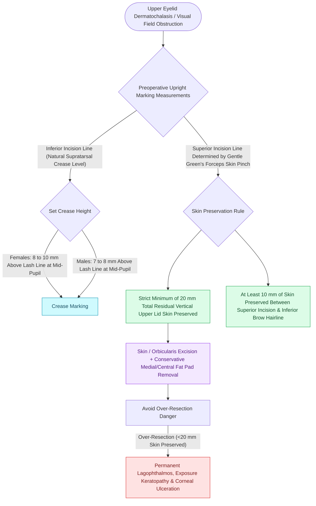

# Upper blepharoplasty requires precise skin crease marking to avoid lagophthalmos

## Active Recall

> [!question]- What structure runs between the medial and central fat pads of the upper eyelid that is vulnerable to thermal injury during fat reduction?
> *Answer / Clinical Rationale*: The **trochlea and tendon of the superior oblique muscle**, injury to which causes vertical/torsional diplopia (Brown syndrome).

> [!question]- What is the minimum vertical height of intact skin that must remain between the superior blepharoplasty incision and the lower brow border?
> *Answer / Clinical Rationale*: At least **$10\text{ to }12\text{ mm}$** to ensure adequate eyelid mobility and prevent postoperative lagophthalmos.

## Core Clinical & Mechanistic Principles
Upper [[Lower blepharoplasty addresses fat herniation while preserving the inferior oblique muscle|blepharoplasty]] addresses dermatochalasis (excessive skin) and steatoblepharon (fat herniation). Over-resection of skin is a catastrophic error that results in **lagophthalmos (inability to fully close the eyelid)**, corneal exposure, keratitis, and permanent ocular pain.

### Upper Eyelid Fat Compartments
- **Medial (Nasal) Fat Pad**: Pale/white fat (embryologically distinct); contains sensory branches.
- **Central (Preaponeurotic) Fat Pad**: Yellow, vascular fat overlying the levator aponeurosis.
- **Trochlea / Superior Oblique Tendon**: Runs directly between the medial and central fat pads. Aggressive deep blind cauterization causes **diplopia** from superior oblique paresis.
- **Lacrimal Gland**: Sits laterally. Must NOT be mistaken for a lateral fat pad (the upper eyelid has **NO lateral fat pad**); prolapsed lacrimal gland requires suspension (dacryopexy), not excision.

## Connected Concepts & Graph Traversal
- **Lower Lid**: [[Lower blepharoplasty addresses fat herniation while preserving the inferior oblique muscle|Lower Blepharoplasty]]
- **Ectropion Prevention**: [[Lateral canthopexy and lateral tarsal strip suspension prevent post-blepharoplasty ectropion|Canthopexy]]
- **Brow Dynamics**: [[Endoscopic browlift releases the conjoint tendon and arcus marginalis along the supraorbital rim|Endoscopic Browlift]]
- **High-Stakes Safety**: [[Post-blepharoplasty retrobulbar hematoma requires immediate bedside decompression to prevent blindness|Post-Blepharoplasty Retrobulbar Hematoma]]
- **Anatomical Foundation**: [[Cutler-Beard bridge flaps reconstruct full-thickness upper eyelid defects via lower eyelid tissue advancement beneath a spared margin|Cutler-Beard Bridge Flap]]
- **Disease Mechanism Differential**: [[Blepharochalasis causes episodic painless eyelid edema leading to atrophic skin laxity, orbital fat pseudoherniation, and secondary ptosis|Blepharochalasis]]
