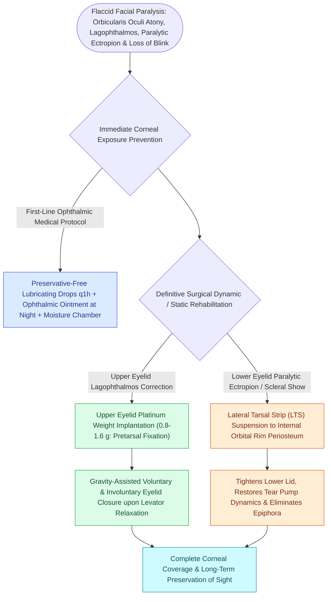

# Upper eyelid platinum weights and lateral tarsal strips protect the cornea in flaccid facial paralysis

## Active Recall

> [!question]- Why are platinum eyelid weights preferred over traditional gold weights in upper eyelid loading?
> *Answer / Clinical Rationale*: Platinum has a **higher specific gravity (density)** than gold, allowing a thinner, less visible profile for the same weight, and has a significantly **lower rate of capsule contracture and contact allergy**.

> [!question]- How does a pretarsal eyelid weight achieve eyelid closure in a patient with facial nerve paralysis?
> *Answer / Clinical Rationale*: It provides **gravity-assisted passive closure** of the upper eyelid whenever the levator palpebrae superioris muscle (CN III) relaxes.

## Core Clinical & Mechanistic Principles
In flaccid facial nerve paralysis, paralysis of the **orbicularis oculi muscle** causes severe **paralytic lagophthalmos**, paralytic [[Lateral canthopexy and lateral tarsal strip suspension prevent post-blepharoplasty ectropion|ectropion]], loss of the blink reflex, and exposure keratopathy. Without urgent corneal protection, permanent corneal ulceration and blindness ensue.

### Preoperative Weight Sizing Protocol
- Trial weights ($0.8\text{ to }1.6\text{ g}$) are taped to the upper eyelid in the clinic.
- The ideal weight provides **complete eyelid closure in the upright position without inducing $>1.0\text{ mm}$ of mechanical ptosis** in primary gaze.

## Connected Concepts & Graph Traversal
- **Dynamic Reanimation**: [[Free gracilis muscle transfer provides dynamic smile restoration in chronic facial paralysis|Gracilis Free Transfer]]
- **Lid Suspension**: [[Lateral canthopexy and lateral tarsal strip suspension prevent post-blepharoplasty ectropion|Lateral Tarsal Strip]]
- **Blepharoplasty**: [[Upper blepharoplasty requires precise skin crease marking to avoid lagophthalmos|Upper Blepharoplasty]]
- **Critical Safety / Corneal Protection**: [[Cutler-Beard bridge flaps reconstruct full-thickness upper eyelid defects via lower eyelid tissue advancement beneath a spared margin|Cutler-Beard Bridge Flap]]
- **Static Symmetry Restoration**: [[Static facial suspension utilizes multivectored fascia lata or expanded polytetrafluoroethylene slings to restore symmetry in non-innervation candidates|Static Facial Suspension (Multivectored Slings)]]
