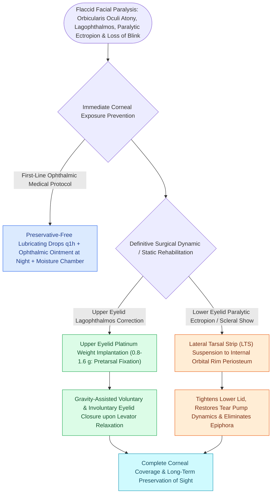

# Upper eyelid platinum weights and lateral tarsal strips protect the cornea in flaccid facial paralysis

## Active Recall

> [!question]- Why are platinum eyelid weights preferred over traditional gold weights in upper eyelid loading?
> *Answer / Clinical Rationale*: Platinum has a **higher specific gravity (density)** than gold, allowing a thinner, less visible profile for the same weight, and has a significantly **lower rate of capsule contracture and contact allergy**.

> [!question]- How does a pretarsal eyelid weight achieve eyelid closure in a patient with facial nerve paralysis?
> *Answer / Clinical Rationale*: It provides **gravity-assisted passive closure** of the upper eyelid whenever the levator palpebrae superioris muscle (CN III) relaxes.

## Core Clinical & Mechanistic Principles
In flaccid facial nerve paralysis, paralysis of the **orbicularis oculi muscle** causes severe **paralytic lagophthalmos**, paralytic [[Lateral canthopexy and lateral tarsal strip suspension prevent post-blepharoplasty ectropion|ectropion]], loss of the blink reflex, and exposure keratopathy. Without urgent corneal protection, permanent corneal ulceration and blindness ensue.

### Preoperative Weight Sizing & Pretarsal Surgical Inset
- **Sizing**: Trial weights ($0.6\text{ to }1.6\text{ g}$) are taped to the upper eyelid in the clinic; the ideal weight provides **complete eyelid closure in the upright position without inducing $>1.0\text{–}2.0\text{ mm}$ of mechanical ptosis** in primary gaze.
- **Platinum vs Gold**: Platinum ($21.45\text{ g/cm}^3$) is denser than gold ($19.3\text{ g/cm}^3$), permitting a **$10\text{–}12\%$ thinner, lower-profile implant** with reduced visibility and lower capsule allergy/extrusion rates.
- **Surgical Inset**: Make a supratarsal crease incision, dissect through orbicularis oculi to expose the anterior **tarsal plate**, fixate the weight to the upper half of the tarsus (centered medial to the pupil) with **6-0 Prolene** sutures, and perform layered muscle and skin closure.

## Connected Concepts & Graph Traversal
- **Dynamic Reanimation**: [[Free gracilis muscle transfer provides dynamic smile restoration in chronic facial paralysis|Gracilis Free Transfer]]
- **Lid Suspension**: [[Lateral canthopexy and lateral tarsal strip suspension prevent post-blepharoplasty ectropion|Lateral Tarsal Strip]]
- **Blepharoplasty**: [[Upper blepharoplasty requires precise skin crease marking to avoid lagophthalmos|Upper Blepharoplasty]]
- **House-Brackmann Staging**: [[The House-Brackmann facial nerve grading system standardizes facial paralysis severity|House-Brackmann Scale]]
- **Dynamic Smile Donor**: [[The masseteric nerve provides a dense motor donor for single-stage facial reanimation|Masseteric Nerve Transfer]]
- **Critical Safety / Corneal Protection**: [[Cutler-Beard bridge flaps reconstruct full-thickness upper eyelid defects via lower eyelid tissue advancement beneath a spared margin|Cutler-Beard Bridge Flap]]
- **Static Symmetry Restoration**: [[Static fascia lata slings suspend the modiolus and nasal valve in non-innervation candidates|Static Facial Suspension (Multivectored Slings)]]
- **🔗 Acute Bell's Palsy Eye Care (Otology)**: [[Acute Bell's palsy presents with unilateral lower motor neuron facial paralysis treated with early oral steroids|Bell's Palsy Eye Care]]
