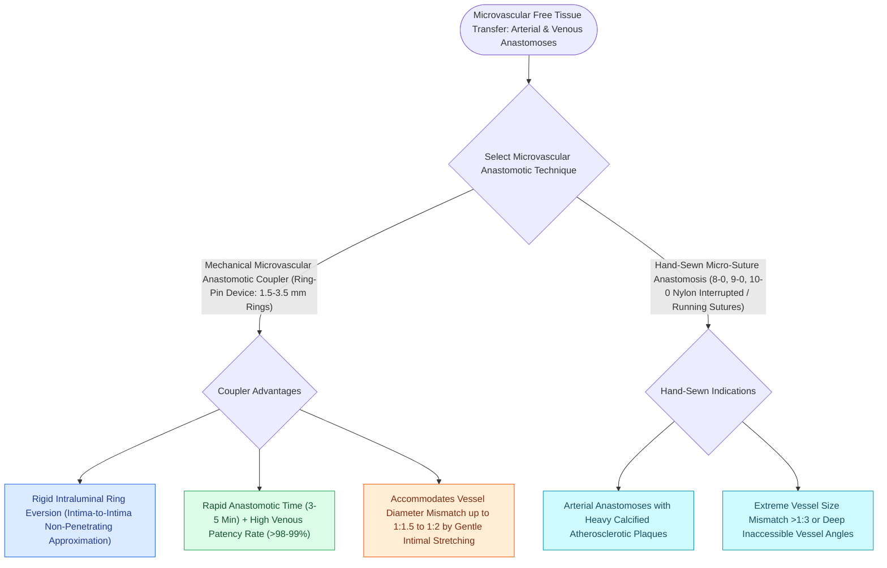

# Vascular coupler devices and hand-sewn microvascular anastomoses achieve high patency in free tissue transfer

## Active Recall

> [!question]- Why do mechanical anastomotic couplers achieve higher venous patency rates than hand-sewn sutures?
> *Answer / Clinical Rationale*: Mechanical couplers ensure **perfect, uniform intima-to-intima eversion with zero intraluminal foreign suture material**, preventing turbulence and platelet aggregation.

> [!question]- What suture material and size is standard for hand-sewn microarterial anastomoses?
> *Answer / Clinical Rationale*: **9-0 or 10-0 monofilament Nylon (Ethilon)** on a non-cutting taper point needle.

## Core Clinical & Mechanistic Principles
[[Microvascular free flap salvage requires urgent re-exploration within two hours of vascular compromise|Microvascular]] free tissue transfer achieves overall flap survival rates $>95\text{–}98\%$. The choice between **mechanical anastomotic coupler devices (GEM Coupler)** and **hand-sewn sutures (9-0 / 10-0 Nylon)** dictates operative speed and patency.

### Coupler Sizing Principle
- Measure outer vessel diameter; select the largest coupler ring that accommodates the vessel without stretching ($2.0\text{–}3.0\text{ mm}$ is standard for internal jugular tributaries).

## Connected Concepts & Graph Traversal
- **Free Flap Salvage**: [[Microvascular free flap salvage requires urgent re-exploration within two hours of vascular compromise|Free Flap Salvage Protocol]]
- **Monitoring**: [[Implantable Doppler probes provide continuous real-time monitoring of microvascular free flap pedicles|Implantable Doppler]]
- **Anticoagulation**: [[Postoperative free flap anticoagulation and antiplatelet protocols balance thrombosis against hematoma|Anticoagulation Protocols]]
- **Reconstructive Ladder**: [[Osteoradionecrosis of the mandible requires radical bony debridement and vascularized fibula free flap repair|Mandibular Osteoradionecrosis (ORN)]]
- **Anatomical Foundation**: [[Chimeric free flaps combine independent bone, muscle, and skin paddles on a common vascular branch|Chimeric Free Tissue Transfer]]
- **Surgical Craft**: [[Near-total lip reconstruction combines functional local muscle flaps with microvascular free flaps|Near-Total Lip Reconstruction]]
