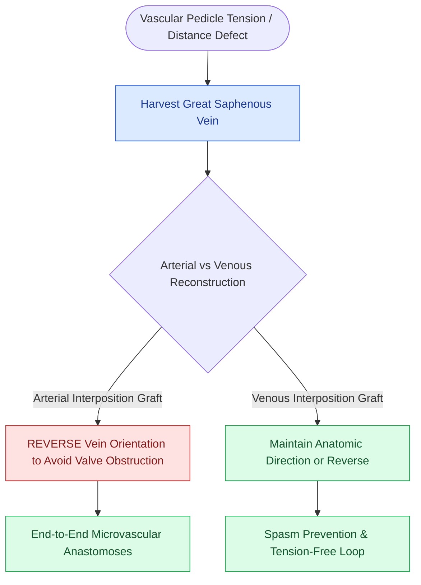

# Vein grafts harvested from the great saphenous vein bridge long pedicle gaps in revision microvascular surgery

## Active Recall

> [!question]- Why must a saphenous vein graft be reversed when used as an arterial interposition graft?
> *Answer / Clinical Rationale*: To ensure that **internal venous valves do not obstruct antegrade arterial blood flow** across the [[Vascular coupler devices and hand-sewn microvascular anastomoses achieve high patency in free tissue transfer|microvascular anastomosis]].

> [!question]- Where is the Great Saphenous Vein most reliably harvested at the ankle?
> *Answer / Clinical Rationale*: **$1.0\text{ cm}$ anterior and superior to the medial malleolus**.

## Core Clinical & Mechanistic Principles
When free flap [[Microvascular free flap salvage requires urgent re-exploration within two hours of vascular compromise|vascular]] pedicles are too short to reach recipient vessels in the vessel-depleted neck (due to prior radical neck dissection, radiation fibrosis, or pedicle thrombosis), **Interposition Vein Grafts** harvested from the **Great Saphenous Vein (GSV)** bridge the anatomical gap.

### Vessel Sizing & Hydrostatic Dilation
- Gently distend the harvested vein graft with heparinized saline ($10\text{ units/mL}$) to overcome vascular spasm and verify valve orientation before microvascular coaptation.

## Connected Concepts & Graph Traversal
- **Salvage Context**: [[Microvascular free flap salvage requires urgent re-exploration within two hours of vascular compromise|Free Flap Salvage]]
- **Anastomoses**: [[Vascular coupler devices and hand-sewn microvascular anastomoses achieve high patency in free tissue transfer|Coupler & Suture Craft]]
- **🔗 Recipient Vessels (Head and Neck)**: [[The radial forearm free flap provides thin, pliable fasciocutaneous tissue for oral and pharyngeal defects|RFFF Vessel Selection]]
- **Reconstructive Ladder**: [[Osteoradionecrosis of the mandible requires radical bony debridement and vascularized fibula free flap repair|Mandibular Osteoradionecrosis (ORN)]]
- **Anatomical Foundation**: [[Chimeric free flaps combine independent bone, muscle, and skin paddles on a common vascular branch|Chimeric Free Tissue Transfer]]
- **Surgical Craft**: [[Near-total lip reconstruction combines functional local muscle flaps with microvascular free flaps|Near-Total Lip Reconstruction]]
