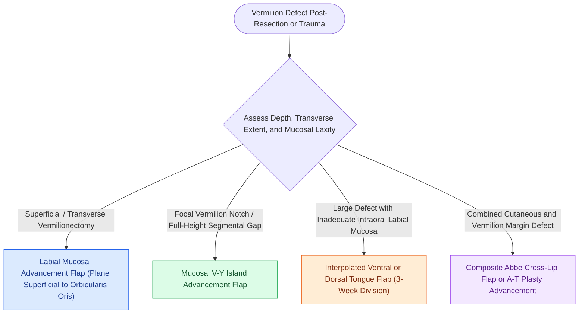

# Vermilion reconstruction requires mucosal advancement, tongue flaps, or vermilionectomy with mucosal lip crawl

## Active Recall

> [!question]- In what anatomical plane is a labial mucosal advancement flap elevated to resurface vermilion defects?
> *Answer / Clinical Rationale*: Dissection is carried out **deep to the minor salivary glands and immediately superficial to the posterior surface of the orbicularis oris muscle**, stretching submucosal neurovascular fibrils forward using gentle blunt spread dissection.

> [!question]- How do donor tongue surfaces differ when harvesting interpolated glossal flaps for upper versus lower lip vermilion reconstruction?
> *Answer / Clinical Rationale*: The **ventral surface of the tongue** is typically selected for **lower lip** repair (providing smooth mucosa), whereas the **dorsal surface of the tongue** is used for **upper lip** repair (where mucosal filiform papillae provide texture match). Flap division and inset occur at **3 weeks**.

## Core Clinical & Mechanistic Principles
Vermilion defects disrupt both the dry-wet mucosal transition and the protective seal of the oral sphincter. Because the vermilion lacks adnexal structures (hair follicles and sweat glands) and possesses a distinctive red hue from superficial dermal capillary loops, reconstruction must recruit specialized mucosa rather than regular facial skin to prevent chronic desquamation and crusting.

Surgical restoration relies on [[Advancement flaps recruit adjacent tissue laxity along a linear vector without rotation|advancement flap]] biomechanics or interpolated mucosal transfer:
- **Labial Mucosal Advancement Flap**: The primary workhorse for partial-to-total transverse vermilion defects (including post-vermilionectomy for actinic cheilitis). A horizontal mucosal incision is made along the gingivolabial border or labial sulcus; dissection proceeds deep to the minor salivary glands directly over the orbicularis oris. To protect sensation, dissection utilizes selective spreading to preserve traversing neurovascular structures. The mobilized mucosa is advanced forward across the free lip border and sutured to the anterior vermilion cutaneo-mucosal junction. Potential complications include post-contraction rounding of the lip margin and slight hyperpigmentation (a deeper red tint compared to weathered natural vermilion).
- **Mucosal V-Y Island Advancement Flap**: Indicated for focal or volume-deficient vermilion notches. Designed with a mucosal V-incision pointed toward the gingivolabial sulcus, elevated on a submucosal/muscular soft-tissue stalk, and advanced vertically or horizontally to fill the contour gap.
- **Cross-Lip Mucosal Switch Flap**: Single-pedicled or bipedicled ("bucket handle") mucosal bands harvested from the opposing lip posterior to the vermilion line. Incorporated into large defects and divided at 2 to 3 weeks.
- **Interpolated Tongue Flaps**: Utilized when severe traumatic loss or prior radiation precludes local labial tissue recruitment. Ventral tongue flaps are rotated onto the lower lip, while dorsal flaps resurface the upper lip. Flap pedicles remain attached across the oral aperture for 3 weeks prior to division and final contour inset.

### Technical Pearls for Vermilion Resurfacing
1. **Minimizing Eversion Deformity**: Avoid over-advancing mucosal edges past the cutaneo-mucosal junction; excessive pull results in downward or upward traction on the anterior skin margin, pulling perioral hair follicles into contact with the opposing lip.
2. **Preserving Neural Tone**: Blunt, longitudinal spreading parallel to sensory branches of the mental nerve (V3) or infraorbital nerve (V2) ensures rapid sensory reinnervation within 3 to 6 months.

## Connected Concepts & Graph Traversal
- **Cross-Lip Composite Switch**: [[Abbe and Estlander cross-lip flaps are pedicled on the labial artery to repair lip defects|Abbe & Estlander Flaps]]
- **Full-Thickness Functional Flap**: [[Karapandzic orbicularis oris myocutaneous rotation flaps preserve oral sphincter innervation|Karapandzic Flap]]
- **Subtotal Reconstruction**: [[Gilles fan flaps and Webster-Bernard cheek advancements reconstruct large lower lip defects|Gilles Fan & Webster-Bernard Flaps]]
- **Near-Total Lip Repair Ladder**: [[Near-total lip reconstruction combines functional local muscle flaps with microvascular free flaps|Near-Total Lip Reconstruction]]
- **Aesthetic Subunit Architecture**: [[Gonzalez-Ulloa facial aesthetic subunits guide complete subunit reconstruction|Facial Aesthetic Subunits]]
- **Electrical Burn Vermilion Loss**: [[Pediatric oral commissure electrical burns risk delayed labial artery hemorrhage and require dynamic microstomia splinting|Electrical Commissure Burn Reconstruction]]
