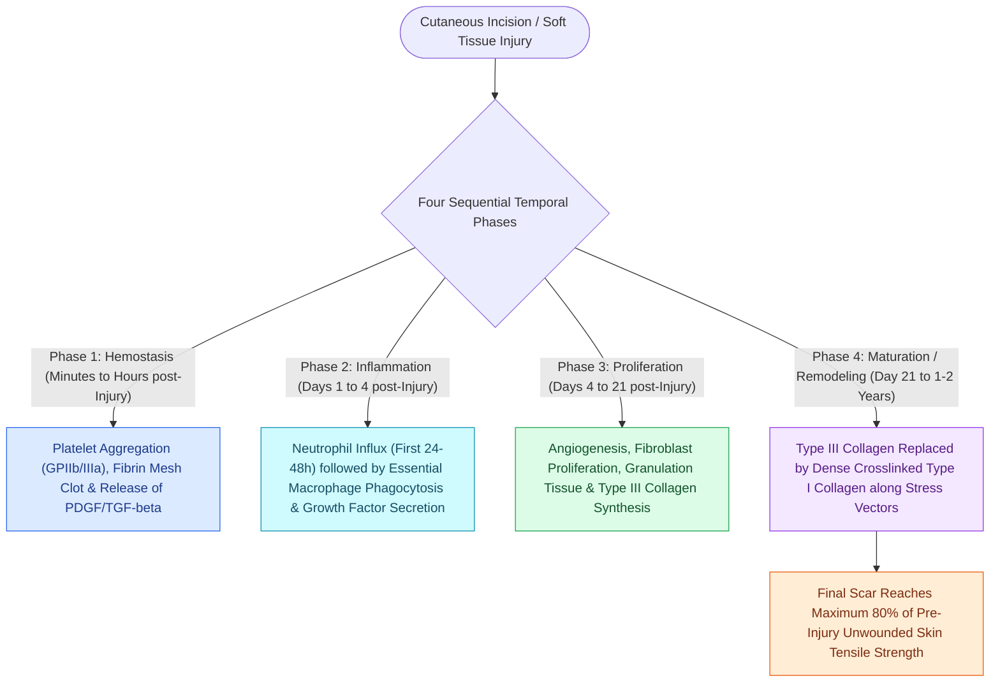

# Wound healing progresses through hemostasis, inflammation, proliferation, and maturation

## Active Recall

> [!question]- Which inflammatory cell is considered the indispensable orchestrator of tissue repair and transition to proliferation?
> *Answer / Clinical Rationale*: The **macrophage** (arriving at 48–72 hours), which debrides tissue and secretes essential cytokines (PDGF, TGF-$\beta$, VEGF) driving fibroplasia and angiogenesis.

> [!question]- What collagen type transition occurs between the proliferation and maturation phases of wound healing?
> *Answer / Clinical Rationale*: **Type III collagen (immature, fine fibrils) is progressively replaced by Type I collagen (mature, dense cross-linked bundles)**, increasing tensile strength.

## Core Clinical & Mechanistic Principles
Cutaneous wound [[O-to-Z rotation-advancement flaps and secondary intention healing reconstruct lateral forehead defects and concave anatomical transition zones|healing]] is an orchestrated biological cascade divided into four continuous, overlapping phases: **Hemostasis, Inflammation, Proliferation (Fibroplasia), and Maturation (Remodeling)**.

### Tensile Strength Timeline
- **1 Week**: $3\text{–}5\%$ of normal uninjured skin tensile strength (sutures removed).
- **3 Weeks**: $\sim 20\%$ (rapid collagen deposition).
- **6 Weeks**: $\sim 50\text{–}60\%$.
- **3 Months to 1 Year**: Plateaus at **maximum $80\%$** of normal skin strength (a scar is never 100% as strong as uninjured skin).

## Connected Concepts & Graph Traversal
- **Scar Pathophysiology**: [[Hypertrophic scars and keloids result from abnormal TGF-beta signaling and collagen deposition|Hypertrophic Scars & Keloids]]
- **Tension Alignment**: [[Relaxed skin tension lines minimize scar hypertrophy along perpendicular muscular vectors|Relaxed Skin Tension Lines]]
- **Suture Selection**: [[Monofilament versus braided absorbable and non-absorbable sutures have distinct tissue reactivity|Suture Materials]]
- **Anatomical Foundation**: [[O-to-Z rotation-advancement flaps and secondary intention healing reconstruct lateral forehead defects and concave anatomical transition zones|Forehead O-to-Z Flap]]
- **Surgical Craft**: [[Pediatric oral commissure electrical burns risk delayed labial artery hemorrhage and require dynamic microstomia splinting|Oral Commissure Electrical Burns]]
