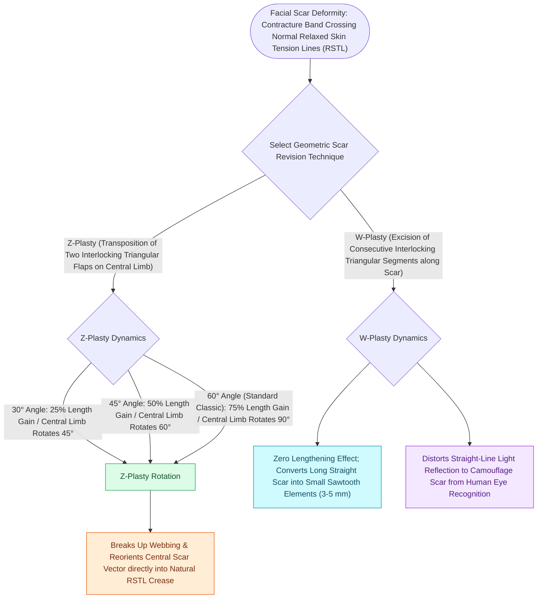

# Z-plasty and W-plasty reorient scar vectors and break up linear contracture lines

## Active Recall

> [!question]- How much theoretical scar lengthening and axis rotation is achieved by a classic 60-degree Z-plasty?
> *Answer / Clinical Rationale*: **$75\%$ increase in length** along the central limb axis, with a **$90^\circ$ rotation** of the scar vector.

> [!question]- Does a W-plasty lengthen a contracted scar?
> *Answer / Clinical Rationale*: **NO**. A W-plasty excises tissue and breaks up linear light reflection without lengthening the scar; Z-plasty is required for lengthening contractures.

## Core Clinical & Mechanistic Principles
Surgical scar revision utilizes geometric rearrangement techniques—principally **Z-plasty, W-plasty, and [[Scar revision employs Z-plasty W-plasty and geometric broken line closure along relaxed skin tension lines|Geometric Broken Line Closure]] (GBLC)**—to **reorient scars into [[Relaxed skin tension lines minimize scar hypertrophy along perpendicular muscular vectors|Relaxed Skin Tension Lines (RSTLs)]], lengthen contracted scars, and camouflage linear lines from the human eye**.

### W-Plasty & Geometric Broken Line Closure (GBLC)
- **W-Plasty**: Interlocking triangular flaps ($5\text{–}7\text{ mm}$ limbs at $60^\circ$) that do **not lengthen the scar** but break a long visible linear line into irregular segments that reflect light randomly.
- **GBLC**: Uses irregular geometric shapes (triangles, rectangles, semicircles) to achieve maximum optical camouflage across wide facial aesthetic units.

## Connected Concepts & Graph Traversal
- **RSTL Alignment**: [[Relaxed skin tension lines minimize scar hypertrophy along perpendicular muscular vectors|Relaxed Skin Tension Lines]]
- **Abnormal Scars**: [[Hypertrophic scars and keloids result from abnormal TGF-beta signaling and collagen deposition|Hypertrophic Scars]]
- **Subunit Camouflage**: [[Gonzalez-Ulloa facial aesthetic subunits guide complete subunit reconstruction|Aesthetic Subunits]]
- **Anatomical Foundation**: [[Scar revision employs Z-plasty W-plasty and geometric broken line closure along relaxed skin tension lines|Scar Revision]]
- **Surgical Craft**: [[Bilateral A-T plasty and H-plasty advancements reconstruct forehead and suprabrow defects by recruiting transverse tissue laxity along relaxed skin tension lines|Forehead A-T Plasty]]
